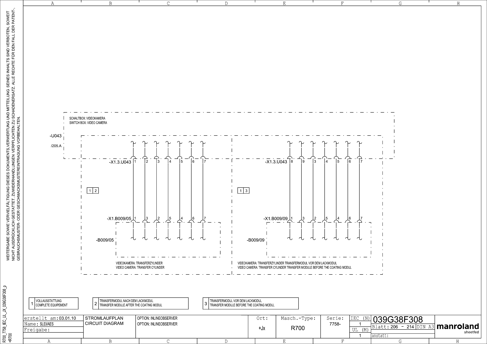

# +Jx — Sheet 206 of 214 — OPTION: INLINEOBSERVER

**OPTION: INLINEOBSERVER**

> Part of the manroland **R700** printing press IEC/UL circuit diagrams.
> Drawing class: **Stromlaufplan / Circuit diagram** (DIN A3).
> Document `+Jx` covers the **1st printing module + feed register** machine section.

## At a glance

| Field | Value |
|---|---|
| Document | `+Jx`  (039G38F308) |
| Sheet | **206** of 214 |
| Section (DE) | OPTION: INLINEOBSERVER |
| Section (EN) | OPTION: INLINEOBSERVER |
| Section type | CIRCUIT — Circuit diagram |
| Machine type | `R700` |
| Series | `7758` |
| Created | 03.01.10 |
| Replaces | — |
| Columns used | A, B, C, D, E, F |
| Path numbers | — |
| Labels on sheet | 55 |
| Cross-refs out | 1 |
| Cross-refs in | 22 |

**Previous:** [+Jx sheet 205](SHEET_0205.md) · **Next:** [+Jx sheet 207](SHEET_0207.md) · **Document TOC:** [_TOC.md](_TOC.md)  (+Jx) · **Master TOC:** [all sheets](../_MASTER_TOC.md)

## Sheet image (300 DPI, exact vector render)



_Rendered directly from the PDF vector layer at 300 DPI (1-bit), no OCR and no resampling. Use it to confirm anything ambiguous in the text below._

## Cross-references on this sheet

Each entry is a wire leaving this sheet. The printed token is `/sheet.column`; the link resolves to that sheet inside the same document.

| Ref | Target sheet | Col | Path | Destination on target | Target section | From col |
|---|---|---|---|---|---|---|
| `/205.A` | [+Jx sheet 205](SHEET_0205.md) | A | — | — | OPTION: INLINEOBSERVER | A |

### Incoming references (sheets that point here)

Every other sheet that sends a wire to this one. `Back-ref` is the token printed on *that* sheet; `Path` is its line number.

| From sheet | Cols | Back-ref | Path | Refs | What continues there |
|---|---|---|---|---|---|
| [+Jx#116](SHEET_0116.md) | E, F | `/116.E`, `/116.F` | — | 14 | — |
| [+Jx#120](SHEET_0120.md) | C | `/120.C` | — | 7 | — |
| [+Jx#205](SHEET_0205.md) | A | `/205.A` | — | 1 | — |


## Devices on this sheet

| Tag | Class | Class meaning (IEC) | Col | Sub | Terminal | Sign |
|---|---|---|---|---|---|---|
| `B009/05` | B | Umformer / transducer, sensor | B | 05 | — | — |
| `U043` | U | Umrichter / frequency converter | A | — | — | — |
| `B009/09` | B | Umformer / transducer, sensor | E | 09 | — | — |
| `X1.3.U043` | — | cross-device reference | B | — | — | — |
| `X1.3.U043` | — | cross-device reference | E | — | — | — |

## Potentials / nets

_No named potentials on this sheet._

## Wire-end annotations (grouped as printed)

A wire that continues elsewhere is annotated with a small cluster: the destination description, the path/line number `#NN`, and the `/sheet.column` cross reference. Each row below is one such cluster exactly as it is grouped on the drawing.

| Col | Y | Path | Cross-ref | Text on the wire |
|---|---|---|---|---|
| B | 286.9 | — | — | `SCHALTBOX: VIDEOKAMERA SWITCH BOX: VIDEO CAMERA` |
| A | 327.6 | — | — | `U043` |
| A | 353.1 | — | `/205.A` | — |
| C | 391.4 | — | — | `X1.3.U043 1 2 3 4 5 6 7` |
| E | 391.4 | — | — | `X1.3.U043` |
| F | 391.4 | — | — | `8 9 3 4 5 6 7` |
| C | 463.0 | — | — | `1 2 1 3` |
| C | 530.3 | — | — | `X1.B009/05 1 3 2 5 4 6 7` |
| E | 530.3 | — | — | `X1.B009/09 1 3 2 5 4 6 7` |
| B | 582.8 | — | — | `B009/05` |
| E | 582.8 | — | — | `B009/09` |
| C | 641.2 | — | — | `VIDEOKAMERA: TRANSFERZYLINDER VIDEO CAMERA: TRANSFER CYLINDER` |
| E | 641.2 | — | — | `VIDEOKAMERA: TRANSFERZYLINDER TRANSFERMODUL VOR DEM LACKMODUL VIDEO CAMERA: TRANSFER CYLINDER TRANSFER MODULE BEFORE THE COATING MODUL` |
| A | 733.4 | — | — | `1 COMPLETE EQUIPEMENT VOLLAUSSTATTUNG` |
| C | 733.4 | — | — | `2 TRANSFERMODUL NACH DEM LACKMODUL TRANSFER MODULE AFTER THE COATING MODUL 3 TRANSFERMODUL VOR DEM LACKMODUL TRANSFER MODULE BEFORE THE COATING MODUL` |


## Notes and free text on this sheet

| Text | Col | Y (pt) |
|---|---|---|
| `X1.B009/05` | B | 530.32 |
| `VIDEOKAMERA: TRANSFERZYLINDER` | C | 641.22 |
| `VIDEO CAMERA: TRANSFER CYLINDER` | C | 651.85 |
| `SCHALTBOX: VIDEOKAMERA` | B | 286.88 |
| `SWITCH BOX: VIDEO CAMERA` | B | 297.49 |
| `X1.B009/09` | E | 530.32 |
| `VIDEOKAMERA: TRANSFERZYLINDER TRANSFERMODUL VOR DEM LACKMODUL` | E | 641.23 |
| `VIDEO CAMERA: TRANSFER CYLINDER TRANSFER MODULE BEFORE THE COATING MODUL` | E | 651.86 |
| `VOLLAUSSTATTUNG` | A | 733.35 |
| `COMPLETE EQUIPEMENT` | A | 743.98 |
| `TRANSFERMODUL NACH DEM LACKMODUL` | B | 733.37 |
| `TRANSFER MODULE AFTER THE COATING MODUL` | B | 743.99 |
| `TRANSFERMODUL VOR DEM LACKMODUL` | D | 733.36 |
| `TRANSFER MODULE BEFORE THE COATING MODUL` | D | 743.99 |

## Complete label inventory (exact text from the drawing)

Every text object inside the drawing area of this sheet, in DIN reading order (column A→H, then top→bottom). This is the authoritative list: if a string is not here it is not printed on this sheet.

| Col | Y | X | Dir | Type | Text |
|---|---|---|---|---|---|
| A | 327.6 | 121.6 | → | device tag | `U043` |
| A | 353.1 | 124.7 | → | cross-reference | `/205.A` |
| A | 733.3 | 87.9 | → | text | `VOLLAUSSTATTUNG` |
| A | 738.6 | 75.4 | → | number | `1` |
| A | 744.0 | 87.6 | → | text | `COMPLETE EQUIPEMENT` |
| B | 286.9 | 169.8 | → | text | `SCHALTBOX: VIDEOKAMERA` |
| B | 297.5 | 169.8 | → | text | `SWITCH BOX: VIDEO CAMERA` |
| B | 391.4 | 328.0 | → | number | `1` |
| B | 392.1 | 267.0 | → | device ref | `X1.3.U043` |
| B | 463.0 | 217.6 | → | number | `1` |
| B | 463.0 | 231.6 | → | number | `2` |
| B | 530.3 | 261.6 | → | text | `X1.B009/05` |
| B | 530.3 | 328.0 | → | number | `1` |
| B | 582.8 | 235.0 | → | device tag | `B009/05` |
| B | 733.4 | 243.8 | → | text | `TRANSFERMODUL NACH DEM LACKMODUL` |
| B | 738.6 | 231.0 | → | number | `2` |
| B | 744.0 | 243.8 | → | text | `TRANSFER MODULE AFTER THE COATING MODUL` |
| C | 391.4 | 357.2 | → | number | `2` |
| C | 391.4 | 385.2 | → | number | `3` |
| C | 391.4 | 413.9 | → | number | `4` |
| C | 391.4 | 441.9 | → | number | `5` |
| C | 391.4 | 470.3 | → | number | `6` |
| C | 530.3 | 356.9 | → | number | `3` |
| C | 530.3 | 385.5 | → | number | `2` |
| C | 530.3 | 413.6 | → | number | `5` |
| C | 530.3 | 442.2 | → | number | `4` |
| C | 530.3 | 470.3 | → | number | `6` |
| C | 641.2 | 283.5 | → | text | `VIDEOKAMERA: TRANSFERZYLINDER` |
| C | 651.9 | 283.5 | → | text | `VIDEO CAMERA: TRANSFER CYLINDER` |
| D | 391.4 | 498.6 | → | number | `7` |
| D | 463.0 | 586.1 | → | number | `1` |
| D | 463.0 | 600.0 | → | number | `3` |
| D | 530.3 | 498.6 | → | number | `7` |
| D | 733.4 | 513.1 | → | text | `TRANSFERMODUL VOR DEM LACKMODUL` |
| D | 738.6 | 500.2 | → | number | `3` |
| D | 744.0 | 513.1 | → | text | `TRANSFER MODULE BEFORE THE COATING MODUL` |
| E | 391.4 | 648.3 | → | device ref | `X1.3.U043` |
| E | 391.4 | 711.2 | → | number | `8` |
| E | 391.4 | 739.6 | → | number | `9` |
| E | 530.3 | 644.3 | → | text | `X1.B009/09` |
| E | 530.3 | 710.6 | → | number | `1` |
| E | 530.3 | 739.6 | → | number | `3` |
| E | 582.8 | 603.5 | → | device tag | `B009/09` |
| E | 641.2 | 581.1 | → | text | `VIDEOKAMERA: TRANSFERZYLINDER TRANSFERMODUL VOR DEM LACKMODUL` |
| E | 651.9 | 581.1 | → | text | `VIDEO CAMERA: TRANSFER CYLINDER TRANSFER MODULE BEFORE THE COATING MODUL` |
| F | 391.4 | 767.9 | → | number | `3` |
| F | 391.4 | 796.5 | → | number | `4` |
| F | 391.4 | 824.6 | → | number | `5` |
| F | 391.4 | 852.9 | → | number | `6` |
| F | 391.4 | 881.3 | → | number | `7` |
| F | 530.3 | 768.2 | → | number | `2` |
| F | 530.3 | 796.3 | → | number | `5` |
| F | 530.3 | 824.9 | → | number | `4` |
| F | 530.3 | 852.9 | → | number | `6` |
| F | 530.3 | 881.3 | → | number | `7` |

## Reading-order text block

The same content as a plain block, grouped by DIN column — convenient to paste or to match against a visual description.

```text
=== Column A ===
 327.6  121.6  devtag       U043
 353.1  124.7  xref         /205.A
 733.3   87.9  text         VOLLAUSSTATTUNG
 738.6   75.4  numeric      1
 744.0   87.6  text         COMPLETE EQUIPEMENT
=== Column B ===
 286.9  169.8  text         SCHALTBOX: VIDEOKAMERA
 297.5  169.8  text         SWITCH BOX: VIDEO CAMERA
 391.4  328.0  numeric      1
 392.1  267.0  devref       X1.3.U043
 463.0  217.6  numeric      1
 463.0  231.6  numeric      2
 530.3  261.6  text         X1.B009/05
 530.3  328.0  numeric      1
 582.8  235.0  devtag       B009/05
 733.4  243.8  text         TRANSFERMODUL NACH DEM LACKMODUL
 738.6  231.0  numeric      2
 744.0  243.8  text         TRANSFER MODULE AFTER THE COATING MODUL
=== Column C ===
 391.4  357.2  numeric      2
 391.4  385.2  numeric      3
 391.4  413.9  numeric      4
 391.4  441.9  numeric      5
 391.4  470.3  numeric      6
 530.3  356.9  numeric      3
 530.3  385.5  numeric      2
 530.3  413.6  numeric      5
 530.3  442.2  numeric      4
 530.3  470.3  numeric      6
 641.2  283.5  text         VIDEOKAMERA: TRANSFERZYLINDER
 651.9  283.5  text         VIDEO CAMERA: TRANSFER CYLINDER
=== Column D ===
 391.4  498.6  numeric      7
 463.0  586.1  numeric      1
 463.0  600.0  numeric      3
 530.3  498.6  numeric      7
 733.4  513.1  text         TRANSFERMODUL VOR DEM LACKMODUL
 738.6  500.2  numeric      3
 744.0  513.1  text         TRANSFER MODULE BEFORE THE COATING MODUL
=== Column E ===
 391.4  648.3  devref       X1.3.U043
 391.4  711.2  numeric      8
 391.4  739.6  numeric      9
 530.3  644.3  text         X1.B009/09
 530.3  710.6  numeric      1
 530.3  739.6  numeric      3
 582.8  603.5  devtag       B009/09
 641.2  581.1  text         VIDEOKAMERA: TRANSFERZYLINDER TRANSFERMODUL VOR DEM LACKMODUL
 651.9  581.1  text         VIDEO CAMERA: TRANSFER CYLINDER TRANSFER MODULE BEFORE THE COATING MODUL
=== Column F ===
 391.4  767.9  numeric      3
 391.4  796.5  numeric      4
 391.4  824.6  numeric      5
 391.4  852.9  numeric      6
 391.4  881.3  numeric      7
 530.3  768.2  numeric      2
 530.3  796.3  numeric      5
 530.3  824.9  numeric      4
 530.3  852.9  numeric      6
 530.3  881.3  numeric      7
```

---
_Generated from the PDF vector text layer; no OCR. Source: `R700_7758_IEC_UL_JX_039G38F308_p`, sheet 206._
