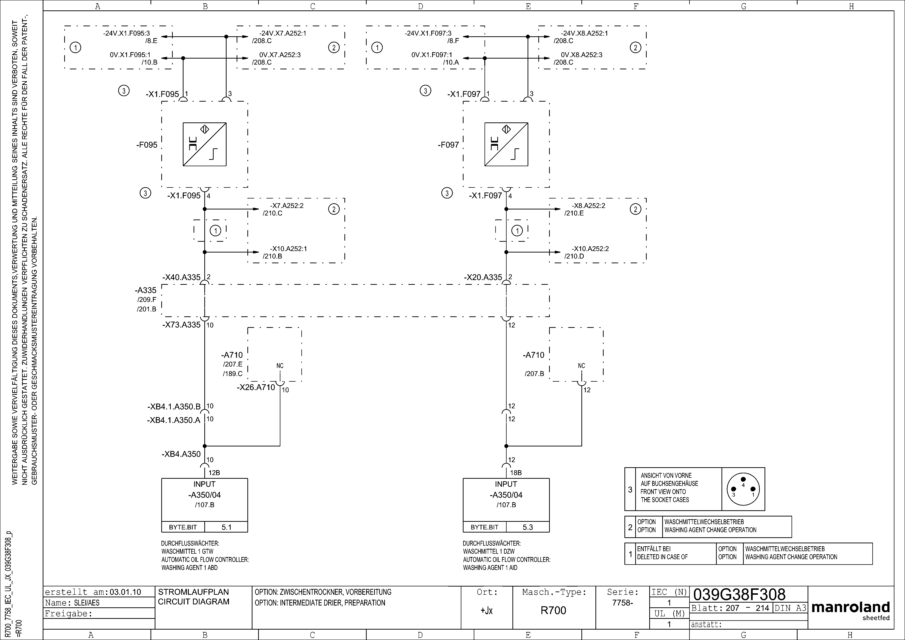

# +Jx — Sheet 207 of 214 — OPTION: ZWISCHENTROCKNER, VORBEREITUNG

**OPTION: INTERMEDIATE DRIER, PREPARATION**

> Part of the manroland **R700** printing press IEC/UL circuit diagrams.
> Drawing class: **Stromlaufplan / Circuit diagram** (DIN A3).
> Document `+Jx` covers the **1st printing module + feed register** machine section.

## At a glance

| Field | Value |
|---|---|
| Document | `+Jx`  (039G38F308) |
| Sheet | **207** of 214 |
| Section (DE) | OPTION: ZWISCHENTROCKNER, VORBEREITUNG |
| Section (EN) | OPTION: INTERMEDIATE DRIER, PREPARATION |
| Section type | CIRCUIT — Circuit diagram |
| Machine type | `R700` |
| Series | `7758` |
| Created | 03.01.10 |
| Replaces | — |
| Columns used | A, B, C, D, E, F, G |
| Path numbers | — |
| Labels on sheet | 117 |
| Cross-refs out | 19 |
| Cross-refs in | 37 |

**Previous:** [+Jx sheet 206](SHEET_0206.md) · **Next:** [+Jx sheet 208](SHEET_0208.md) · **Document TOC:** [_TOC.md](_TOC.md)  (+Jx) · **Master TOC:** [all sheets](../_MASTER_TOC.md)

## Sheet image (300 DPI, exact vector render)



_Rendered directly from the PDF vector layer at 300 DPI (1-bit), no OCR and no resampling. Use it to confirm anything ambiguous in the text below._

## Cross-references on this sheet

Each entry is a wire leaving this sheet. The printed token is `/sheet.column`; the link resolves to that sheet inside the same document.

| Ref | Target sheet | Col | Path | Destination on target | Target section | From col |
|---|---|---|---|---|---|---|
| `/8.E` | [+Jx sheet 8](SHEET_0008.md) | E | — | 24V.X1.F095:3 | SPANNUNGSVERSORGUNG, SCHALTSCHRANKBELÜFTUNG | A |
| `/8.F` | [+Jx sheet 8](SHEET_0008.md) | F | — | 24V.X1.F097:3 | SPANNUNGSVERSORGUNG, SCHALTSCHRANKBELÜFTUNG | D |
| `/208.C` | [+Jx sheet 208](SHEET_0208.md) | C | — | — | OPTION: WASCHMITTELWECHSELBETRIEB | C |
| `/208.C` | [+Jx sheet 208](SHEET_0208.md) | C | — | — | OPTION: WASCHMITTELWECHSELBETRIEB | E |
| `/10.B` | [+Jx sheet 10](SHEET_0010.md) | B | — | 0V.X1.F095:1 0V.X1.F097:1 | SPANNUNGSVERSORGUNG, SCHALTSCHRANKBELÜFTUNG | C |
| `/10.A` | [+Jx sheet 10](SHEET_0010.md) | A | — | 0V.X1.F095:1 0V.X1.F097:1 | SPANNUNGSVERSORGUNG, SCHALTSCHRANKBELÜFTUNG | C |
| `/208.C` | [+Jx sheet 208](SHEET_0208.md) | C | — | 0V.X1.F095:1 0V.X1.F097:1 | OPTION: WASCHMITTELWECHSELBETRIEB | C |
| `/208.C` | [+Jx sheet 208](SHEET_0208.md) | C | — | — | OPTION: WASCHMITTELWECHSELBETRIEB | C |
| `/210.E` | [+Jx sheet 210](SHEET_0210.md) | E | — | — | OPTION: WASCHMITTELWECHSELBETRIEB | E |
| `/210.C` | [+Jx sheet 210](SHEET_0210.md) | C | — | — | OPTION: WASCHMITTELWECHSELBETRIEB | C |
| `/210.B` | [+Jx sheet 210](SHEET_0210.md) | B | — | — | OPTION: WASCHMITTELWECHSELBETRIEB | C |
| `/210.D` | [+Jx sheet 210](SHEET_0210.md) | D | — | — | OPTION: WASCHMITTELWECHSELBETRIEB | E |
| `/209.F` | [+Jx sheet 209](SHEET_0209.md) | F | — | — | OPTION: WASCHMITTELWECHSELBETRIEB | A |
| `/201.B` | [+Jx sheet 201](SHEET_0201.md) | B | — | — | OPTION: LPPL ANDRÜCKROLLE | A |
| `/207.E` | [+Jx sheet 207](SHEET_0207.md) | E | — | — | OPTION: ZWISCHENTROCKNER, VORBEREITUNG | B |
| `/189.C` | [+Jx sheet 189](SHEET_0189.md) | C | — | — | OPTION: ZWISCHENTROCKNER, VORBEREITUNG | B |
| `/207.B` | [+Jx sheet 207](SHEET_0207.md) | B | — | — | OPTION: ZWISCHENTROCKNER, VORBEREITUNG | E |
| `/107.B` | [+Jx sheet 107](SHEET_0107.md) | B | — | — | REFERENZMODUL | B |
| `/107.B` | [+Jx sheet 107](SHEET_0107.md) | B | — | — | REFERENZMODUL | E |

### Incoming references (sheets that point here)

Every other sheet that sends a wire to this one. `Back-ref` is the token printed on *that* sheet; `Path` is its line number.

| From sheet | Cols | Back-ref | Path | Refs | What continues there |
|---|---|---|---|---|---|
| [+Jx#8](SHEET_0008.md) | E, F | `/8.E`, `/8.F` | — | 2 | 24V.X1.F097:3 |
| [+Jx#10](SHEET_0010.md) | A, B | `/10.A`, `/10.B` | — | 2 | 0V.X1.F097:1 |
| [+Jx#107](SHEET_0107.md) | B | `/107.B` | — | 2 | — |
| [+Jx#118](SHEET_0118.md) | B | `/118.B` | — | 6 | — |
| [+Jx#130](SHEET_0130.md) | A, B, D | `/130.A`, `/130.B`, `/130.D` | — | 6 | — |
| [+Jx#141](SHEET_0141.md) | E | `/141.E` | — | 1 | — |
| [+Jx#143](SHEET_0143.md) | F | `/143.F` | — | 2 | — |
| [+Jx#150](SHEET_0150.md) | B | `/150.B` | — | 1 | — |
| [+Jx#153](SHEET_0153.md) | E | `/153.E` | — | 2 | — |
| [+Jx#189](SHEET_0189.md) | C | `/189.C` | — | 1 | — |
| [+Jx#201](SHEET_0201.md) | B | `/201.B` | — | 1 | — |
| [+Jx#207](SHEET_0207.md) | B, E | `/207.B`, `/207.E` | — | 2 | — |
| [+Jx#208](SHEET_0208.md) | C | `/208.C` | — | 4 | 24V.X7.A252:1; 24V.X8.A252:1 |
| [+Jx#209](SHEET_0209.md) | F | `/209.F` | — | 1 | — |
| [+Jx#210](SHEET_0210.md) | B, C, D | `/210.B`, `/210.C`, `/210.D` | — | 4 | X10.A252:1 X10.A252:2 |


## Devices on this sheet

| Tag | Class | Class meaning (IEC) | Col | Sub | Terminal | Sign |
|---|---|---|---|---|---|---|
| `F095` | F | Schutz / protection device (fuse, circuit breaker) | A | — | — | — |
| `F097` | F | Schutz / protection device (fuse, circuit breaker) | D | — | — | — |
| `A350/04` | A | Baugruppe / assembly, module, PC board | B | 04 | — | — |
| `A350/04` | A | Baugruppe / assembly, module, PC board | E | 04 | — | — |
| `A335` | A | Baugruppe / assembly, module, PC board | A | — | — | — |
| `A710` | A | Baugruppe / assembly, module, PC board | B | — | — | — |
| `A710` | A | Baugruppe / assembly, module, PC board | E | — | — | — |
| `X1.F095` | — | cross-device reference | B | — | — | — |
| `X1.F095` | — | cross-device reference | B | — | — | — |
| `X1.F097` | — | cross-device reference | E | — | — | — |
| `X1.F097` | — | cross-device reference | D | — | — | — |
| `5.1` | — | cross-device reference | B | — | — | — |
| `XB4.A350` | — | cross-device reference | B | — | — | — |
| `5.3` | — | cross-device reference | E | — | — | — |
| `X40.A335` | — | cross-device reference | B | — | — | — |
| `X20.A335` | — | cross-device reference | E | — | — | — |
| `X73.A335` | — | cross-device reference | B | — | — | — |
| `XB4.1.A350.B` | — | cross-device reference | B | — | — | — |
| `XB4.1.A350.A` | — | cross-device reference | B | — | — | — |
| `X26.A710` | — | cross-device reference | B | — | — | — |
| `X7.A252:2` | — | cross-device reference | C | — | 2 | — |
| `X8.A252:2` | — | cross-device reference | F | — | 2 | — |
| `X10.A252:2` | — | cross-device reference | F | — | 2 | — |
| `X10.A252:1` | — | cross-device reference | C | — | 1 | — |

## Potentials / nets

| Potential | Count | Columns | Attached devices | Terminals |
|---|---|---|---|---|
| `0V` | 4 | A, C, D, F | `A252`, `F095`, `F097`, `X1`, `X7`, `X8` | `1`, `3` |
| `24V` | 4 | A, C, D, F | `A252`, `F095`, `F097`, `X1`, `X7`, `X8` | `1`, `3` |


A potential such as `L24+/4` or `M24+` is a named supply/return rail; every place it appears on this sheet is electrically common.

## Wire-end annotations (grouped as printed)

A wire that continues elsewhere is annotated with a small cluster: the destination description, the path/line number `#NN`, and the `/sheet.column` cross reference. Each row below is one such cluster exactly as it is grouped on the drawing.

| Col | Y | Path | Cross-ref | Text on the wire |
|---|---|---|---|---|
| A | 39.9 | — | `/8.E` | `24V.X1.F095:3` |
| C | 39.9 | — | — | `24V.X7.A252:1` |
| D | 39.9 | — | `/8.F` | `24V.X1.F097:3` |
| F | 39.9 | — | — | `24V.X8.A252:1` |
| C | 49.8 | — | `/208.C` | — |
| E | 49.8 | — | `/208.C` | — |
| C | 59.3 | — | — | `1 2 1 2` |
| C | 68.2 | — | `/10.B`, `/10.A`, `/208.C` | `0V.X1.F095:1 0V.X1.F097:1` |
| C | 68.2 | — | — | `0V.X7.A252:3` |
| F | 68.2 | — | — | `0V.X8.A252:3` |
| C | 78.2 | — | `/208.C` | — |
| A | 116.5 | — | — | `3` |
| D | 116.5 | — | — | `3` |
| B | 119.3 | — | — | `X1.F095 1 3` |
| E | 119.3 | — | — | `X1.F097 1 3` |
| A | 185.9 | — | — | `F095` |
| D | 185.9 | — | — | `F097` |
| A | 251.1 | — | — | `3` |
| D | 251.1 | — | — | `3` |
| B | 252.5 | — | — | `X1.F095 4` |
| E | 252.5 | — | — | `X1.F097 4` |
| C | 266.7 | — | — | `X7.A252:2` |
| F | 266.7 | — | — | `X8.A252:2` |
| C | 272.4 | — | — | `2` |
| F | 272.4 | — | — | `2` |
| C | 276.6 | — | `/210.C` | — |
| E | 276.6 | — | `/210.E` | — |
| B | 300.2 | — | — | `1` |
| E | 300.2 | — | — | `1` |
| C | 323.4 | — | — | `X10.A252:1` |
| F | 323.4 | — | — | `X10.A252:2` |
| C | 333.3 | — | `/210.B` | — |
| E | 333.3 | — | `/210.D` | — |
| C | 360.2 | — | — | `X40.A335 2 X20.A335 2` |
| A | 377.2 | — | — | `A335` |
| A | 390.3 | — | `/209.F`, `/201.B` | — |
| C | 422.6 | — | — | `X73.A335 10 12` |
| B | 462.3 | — | — | `A710` |
| E | 462.3 | — | — | `A710` |
| B | 475.4 | — | `/207.E`, `/189.C` | — |
| D | 478.2 | — | — | `NC NC` |
| E | 487.8 | — | `/207.B` | — |
| C | 504.8 | — | — | `X26.A710 10` |
| F | 509.1 | — | — | `12` |
| B | 530.3 | — | — | `XB4.1.A350.B 10` |
| E | 530.4 | — | — | `12` |
| B | 547.4 | — | — | `XB4.1.A350.A 10` |
| E | 547.4 | — | — | `12` |
| B | 592.7 | — | — | `XB4.A350 10` |
| E | 601.2 | — | — | `12` |
| B | 618.2 | — | — | `12B` |
| E | 618.2 | — | — | `18B` |
| F | 622.8 | — | — | `FRONT VIEW ONTO ANSICHT VON VORNE AUF BUCHSENGEHÄUSE` |
| B | 632.7 | — | — | `INPUT` |
| E | 632.7 | — | — | `INPUT` |
| G | 635.1 | — | — | `4` |
| G | 639.4 | — | — | `3 3 1` |
| B | 646.5 | — | — | `A350/04` |
| E | 646.5 | — | — | `A350/04` |
| F | 654.7 | — | — | `THE SOCKET CASES` |
| B | 660.3 | — | `/107.B` | — |
| E | 660.3 | — | `/107.B` | — |
| F | 683.7 | — | — | `2 OPTION OPTION` |
| G | 683.7 | — | — | `WASCHMITTELWECHSELBETRIEB WASHING AGENT CHANGE OPERATION` |
| B | 689.4 | — | — | `BYTE.BIT 5.1` |
| E | 689.4 | — | — | `BYTE.BIT 5.3` |
| B | 712.1 | — | — | `DURCHFLUSSWÄCHTER:` |
| E | 712.1 | — | — | `DURCHFLUSSWÄCHTER:` |
| G | 719.1 | — | — | `1 WASCHMITTELWECHSELBETRIEB WASHING AGENT CHANGE OPERATION` |
| F | 719.1 | — | — | `ENTFÄLLT BEI DELETED IN CASE OF` |
| G | 719.1 | — | — | `OPTION OPTION` |
| B | 722.7 | — | — | `WASCHMITTEL 1 GTW AUTOMATIC OIL FLOW CONTROLLER: WASHING AGENT 1 ABD` |
| E | 722.7 | — | — | `WASCHMITTEL 1 DZW AUTOMATIC OIL FLOW CONTROLLER: WASHING AGENT 1 AID` |


## Reconstructed tables

This sheet carries tabular content (pin map / terminal assignment / index). The grid below was rebuilt from the drawing's own rule lines, so each row is exactly one physical row of the table.

### Table 1 — 6 data rows × 5 columns (at x=212.6, y=48.2) — **/208.C**

| X1.F095 | 1 |  | 3 | /208.C |
|---|---|---|---|---|
|  | `X1.F095` | `4` |  |  |
|  |  | `1` |  | `/210.C` |
| `X40.A335 X73.A335 XB4.1.A350.B XB4.1.A350.A` |  | `2 10 10 10` | `A710 /207.E /189.C` | `/210.B NC X26.A710` |
| `XB4.A350` |  | `10 12B` |  |  |
|  | `INPUT A350/04` | `/107.B` |  |  |
| `BYTE.BIT` |  |  | `5.1` |  |


### Table 2 — 6 data rows × 6 columns (at x=609.4, y=48.2) — **/208.C 0V.X8.A252:3**

| X1.F097 | 1 |  | 3 | /208.C |  |
|---|---|---|---|---|---|
|  | `X1.F097` | `4` |  |  | `X8.A252:2` |
|  |  | `1` |  | `/210.E` | `X10.A252:2` |
| `X20.A335` |  | `2 12 12 12` | `A710 /207.B` | `/210.D NC` | `12` |
|  |  | `12 18B` |  |  |  |
|  | `INPUT` | `A350/04 /107.B` |  |  | `3` |
| `BYTE.BIT` |  | `5.3` |  |  | `2` |


## Notes and free text on this sheet

| Text | Col | Y (pt) |
|---|---|---|
| `12B` | B | 618.18 |
| `INPUT` | B | 632.7 |
| `BYTE.BIT` | B | 689.96 |
| `DURCHFLUSSWÄCHTER:` | B | 712.07 |
| `WASCHMITTEL 1 GTW` | B | 722.67 |
| `AUTOMATIC OIL FLOW CONTROLLER:` | B | 733.34 |
| `WASHING AGENT 1 ABD` | B | 743.95 |
| `18B` | E | 618.18 |
| `INPUT` | E | 632.7 |
| `BYTE.BIT` | E | 689.96 |
| `DURCHFLUSSWÄCHTER:` | E | 712.07 |
| `WASCHMITTEL 1 DZW` | E | 722.68 |
| `AUTOMATIC OIL FLOW CONTROLLER:` | E | 733.34 |
| `WASHING AGENT 1 AID` | E | 743.95 |
| `ENTFÄLLT BEI` | F | 719.13 |
| `DELETED IN CASE OF` | F | 729.78 |
| `OPTION` | G | 719.14 |
| `WASCHMITTELWECHSELBETRIEB` | G | 719.14 |
| `WASHING AGENT CHANGE OPERATION` | G | 729.78 |
| `OPTION` | F | 683.71 |
| `ANSICHT VON VORNE` | F | 622.79 |
| `AUF BUCHSENGEHÄUSE` | F | 633.43 |
| `FRONT VIEW ONTO` | F | 644.02 |
| `THE SOCKET CASES` | F | 654.67 |
| `NC` | C | 478.2 |
| `NC` | E | 478.2 |

## Complete label inventory (exact text from the drawing)

Every text object inside the drawing area of this sheet, in DIN reading order (column A→H, then top→bottom). This is the authoritative list: if a string is not here it is not printed on this sheet.

| Col | Y | X | Dir | Type | Text |
|---|---|---|---|---|---|
| A | 39.9 | 135.8 | → | potential | `24V.X1.F095:3` |
| A | 59.3 | 97.4 | → | number | `1` |
| A | 68.2 | 144.6 | → | potential | `0V.X1.F095:1` |
| A | 78.1 | 186.5 | → | cross-reference | `/10.B` |
| A | 116.5 | 161.0 | → | number | `3` |
| A | 185.9 | 179.4 | → | device tag | `F095` |
| A | 251.1 | 189.3 | → | number | `3` |
| A | 377.2 | 177.4 | → | device tag | `A335` |
| A | 390.3 | 180.9 | → | cross-reference | `/209.F` |
| A | 402.7 | 180.3 | → | cross-reference | `/201.B` |
| B | 49.8 | 191.3 | → | cross-reference | `/8.E` |
| B | 119.3 | 191.9 | → | device ref | `X1.F095` |
| B | 119.3 | 242.9 | → | number | `1` |
| B | 119.3 | 300.2 | → | number | `3` |
| B | 252.5 | 220.3 | → | device ref | `X1.F095` |
| B | 254.0 | 272.1 | → | number | `4` |
| B | 300.3 | 281.6 | → | number | `1` |
| B | 360.2 | 213.7 | → | device ref | `X40.A335` |
| B | 360.3 | 272.1 | → | number | `2` |
| B | 422.6 | 213.7 | → | device ref | `X73.A335` |
| B | 424.0 | 271.3 | → | number | `10` |
| B | 462.3 | 291.1 | → | device tag | `A710` |
| B | 475.4 | 293.7 | → | cross-reference | `/207.E` |
| B | 487.8 | 293.4 | → | cross-reference | `/189.C` |
| B | 504.8 | 311.8 | → | device ref | `X26.A710` |
| B | 530.3 | 194.2 | → | device ref | `XB4.1.A350.B` |
| B | 530.3 | 271.3 | → | number | `10` |
| B | 547.4 | 271.3 | → | number | `10` |
| B | 548.0 | 193.6 | → | device ref | `XB4.1.A350.A` |
| B | 592.7 | 212.9 | → | device ref | `XB4.A350` |
| B | 601.2 | 271.3 | → | number | `10` |
| B | 618.2 | 274.1 | → | text | `12B` |
| B | 632.7 | 254.4 | → | text | `INPUT` |
| B | 646.5 | 247.7 | → | device tag | `A350/04` |
| B | 660.3 | 256.7 | → | cross-reference | `/107.B` |
| B | 689.4 | 291.5 | → | device ref | `5.1` |
| B | 690.0 | 222.5 | → | text | `BYTE.BIT` |
| B | 712.1 | 212.0 | → | text | `DURCHFLUSSWÄCHTER:` |
| B | 722.7 | 212.6 | → | text | `WASCHMITTEL 1 GTW` |
| B | 733.3 | 212.6 | → | text | `AUTOMATIC OIL FLOW CONTROLLER:` |
| B | 743.9 | 212.6 | → | text | `WASHING AGENT 1 ABD` |
| C | 39.9 | 341.3 | → | potential | `24V.X7.A252:1` |
| C | 49.8 | 331.7 | → | cross-reference | `/208.C` |
| C | 59.8 | 437.4 | → | number | `2` |
| C | 68.2 | 341.3 | → | potential | `0V.X7.A252:3` |
| C | 78.2 | 331.7 | → | cross-reference | `/208.C` |
| C | 266.7 | 355.5 | → | device ref | `X7.A252:2` |
| C | 272.4 | 437.4 | → | number | `2` |
| C | 276.6 | 345.8 | → | cross-reference | `/210.C` |
| C | 323.4 | 355.5 | → | device ref | `X10.A252:1` |
| C | 333.3 | 345.8 | → | cross-reference | `/210.B` |
| C | 478.2 | 363.8 | → | text | `NC` |
| C | 509.1 | 370.5 | → | number | `10` |
| D | 39.9 | 532.6 | → | potential | `24V.X1.F097:3` |
| D | 49.8 | 588.8 | → | cross-reference | `/8.F` |
| D | 59.3 | 494.2 | → | number | `1` |
| D | 68.2 | 541.4 | → | potential | `0V.X1.F097:1` |
| D | 78.1 | 583.1 | → | cross-reference | `/10.A` |
| D | 116.5 | 557.8 | → | number | `3` |
| D | 119.3 | 588.8 | → | device ref | `X1.F097` |
| D | 185.9 | 576.3 | → | device tag | `F097` |
| D | 251.1 | 586.2 | → | number | `3` |
| E | 49.8 | 728.5 | → | cross-reference | `/208.C` |
| E | 78.2 | 728.5 | → | cross-reference | `/208.C` |
| E | 119.3 | 639.8 | → | number | `1` |
| E | 119.3 | 697.0 | → | number | `3` |
| E | 252.5 | 617.1 | → | device ref | `X1.F097` |
| E | 254.0 | 669.0 | → | number | `4` |
| E | 276.6 | 742.7 | → | cross-reference | `/210.E` |
| E | 300.3 | 678.5 | → | number | `1` |
| E | 333.3 | 742.7 | → | cross-reference | `/210.D` |
| E | 360.2 | 610.6 | → | device ref | `X20.A335` |
| E | 360.3 | 669.0 | → | number | `2` |
| E | 424.0 | 668.1 | → | number | `12` |
| E | 462.3 | 688.0 | → | device tag | `A710` |
| E | 478.2 | 760.7 | → | text | `NC` |
| E | 487.8 | 690.5 | → | cross-reference | `/207.B` |
| E | 530.3 | 668.1 | → | number | `12` |
| E | 547.4 | 668.1 | → | number | `12` |
| E | 601.2 | 668.1 | → | number | `12` |
| E | 618.2 | 671.0 | → | text | `18B` |
| E | 632.7 | 651.3 | → | text | `INPUT` |
| E | 646.5 | 644.6 | → | device tag | `A350/04` |
| E | 660.3 | 653.5 | → | cross-reference | `/107.B` |
| E | 689.4 | 687.7 | → | device ref | `5.3` |
| E | 690.0 | 619.4 | → | text | `BYTE.BIT` |
| E | 712.1 | 608.9 | → | text | `DURCHFLUSSWÄCHTER:` |
| E | 722.7 | 609.4 | → | text | `WASCHMITTEL 1 DZW` |
| E | 733.3 | 609.4 | → | text | `AUTOMATIC OIL FLOW CONTROLLER:` |
| E | 743.9 | 609.4 | → | text | `WASHING AGENT 1 AID` |
| F | 39.9 | 738.1 | → | potential | `24V.X8.A252:1` |
| F | 59.8 | 834.2 | → | number | `2` |
| F | 68.2 | 738.1 | → | potential | `0V.X8.A252:3` |
| F | 266.7 | 752.3 | → | device ref | `X8.A252:2` |
| F | 272.4 | 834.2 | → | number | `2` |
| F | 323.4 | 752.3 | → | device ref | `X10.A252:2` |
| F | 509.1 | 767.3 | → | number | `12` |
| F | 622.8 | 843.3 | → | text | `ANSICHT VON VORNE` |
| F | 633.4 | 843.3 | → | text | `AUF BUCHSENGEHÄUSE` |
| F | 639.4 | 826.2 | → | number | `3` |
| F | 644.0 | 842.7 | → | text | `FRONT VIEW ONTO` |
| F | 654.7 | 843.3 | → | text | `THE SOCKET CASES` |
| F | 683.7 | 838.8 | → | text | `OPTION` |
| F | 689.0 | 826.3 | → | number | `2` |
| F | 694.3 | 838.8 | → | text | `OPTION` |
| F | 719.1 | 838.5 | → | text | `ENTFÄLLT BEI` |
| F | 724.5 | 826.6 | → | number | `1` |
| F | 729.8 | 838.5 | → | text | `DELETED IN CASE OF` |
| G | 635.1 | 976.1 | → | number | `4` |
| G | 647.9 | 963.2 | → | number | `3` |
| G | 647.9 | 989.0 | → | number | `1` |
| G | 683.7 | 874.5 | → | text | `WASCHMITTELWECHSELBETRIEB` |
| G | 694.4 | 874.5 | → | text | `WASHING AGENT CHANGE OPERATION` |
| G | 719.1 | 945.1 | → | text | `OPTION` |
| G | 719.1 | 980.8 | → | text | `WASCHMITTELWECHSELBETRIEB` |
| G | 729.8 | 945.1 | → | text | `OPTION` |
| G | 729.8 | 980.8 | → | text | `WASHING AGENT CHANGE OPERATION` |

## Reading-order text block

The same content as a plain block, grouped by DIN column — convenient to paste or to match against a visual description.

```text
=== Column A ===
  39.9  135.8  net          24V.X1.F095:3
  59.3   97.4  numeric      1
  68.2  144.6  net          0V.X1.F095:1
  78.1  186.5  xref         /10.B
 116.5  161.0  numeric      3
 185.9  179.4  devtag       F095
 251.1  189.3  numeric      3
 377.2  177.4  devtag       A335
 390.3  180.9  xref         /209.F
 402.7  180.3  xref         /201.B
=== Column B ===
  49.8  191.3  xref         /8.E
 119.3  191.9  devref       X1.F095
 119.3  242.9  numeric      1
 119.3  300.2  numeric      3
 252.5  220.3  devref       X1.F095
 254.0  272.1  numeric      4
 300.3  281.6  numeric      1
 360.2  213.7  devref       X40.A335
 360.3  272.1  numeric      2
 422.6  213.7  devref       X73.A335
 424.0  271.3  numeric      10
 462.3  291.1  devtag       A710
 475.4  293.7  xref         /207.E
 487.8  293.4  xref         /189.C
 504.8  311.8  devref       X26.A710
 530.3  194.2  devref       XB4.1.A350.B
 530.3  271.3  numeric      10
 547.4  271.3  numeric      10
 548.0  193.6  devref       XB4.1.A350.A
 592.7  212.9  devref       XB4.A350
 601.2  271.3  numeric      10
 618.2  274.1  text         12B
 632.7  254.4  text         INPUT
 646.5  247.7  devtag       A350/04
 660.3  256.7  xref         /107.B
 689.4  291.5  devref       5.1
 690.0  222.5  text         BYTE.BIT
 712.1  212.0  text         DURCHFLUSSWÄCHTER:
 722.7  212.6  text         WASCHMITTEL 1 GTW
 733.3  212.6  text         AUTOMATIC OIL FLOW CONTROLLER:
 743.9  212.6  text         WASHING AGENT 1 ABD
=== Column C ===
  39.9  341.3  net          24V.X7.A252:1
  49.8  331.7  xref         /208.C
  59.8  437.4  numeric      2
  68.2  341.3  net          0V.X7.A252:3
  78.2  331.7  xref         /208.C
 266.7  355.5  devref       X7.A252:2
 272.4  437.4  numeric      2
 276.6  345.8  xref         /210.C
 323.4  355.5  devref       X10.A252:1
 333.3  345.8  xref         /210.B
 478.2  363.8  text         NC
 509.1  370.5  numeric      10
=== Column D ===
  39.9  532.6  net          24V.X1.F097:3
  49.8  588.8  xref         /8.F
  59.3  494.2  numeric      1
  68.2  541.4  net          0V.X1.F097:1
  78.1  583.1  xref         /10.A
 116.5  557.8  numeric      3
 119.3  588.8  devref       X1.F097
 185.9  576.3  devtag       F097
 251.1  586.2  numeric      3
=== Column E ===
  49.8  728.5  xref         /208.C
  78.2  728.5  xref         /208.C
 119.3  639.8  numeric      1
 119.3  697.0  numeric      3
 252.5  617.1  devref       X1.F097
 254.0  669.0  numeric      4
 276.6  742.7  xref         /210.E
 300.3  678.5  numeric      1
 333.3  742.7  xref         /210.D
 360.2  610.6  devref       X20.A335
 360.3  669.0  numeric      2
 424.0  668.1  numeric      12
 462.3  688.0  devtag       A710
 478.2  760.7  text         NC
 487.8  690.5  xref         /207.B
 530.3  668.1  numeric      12
 547.4  668.1  numeric      12
 601.2  668.1  numeric      12
 618.2  671.0  text         18B
 632.7  651.3  text         INPUT
 646.5  644.6  devtag       A350/04
 660.3  653.5  xref         /107.B
 689.4  687.7  devref       5.3
 690.0  619.4  text         BYTE.BIT
 712.1  608.9  text         DURCHFLUSSWÄCHTER:
 722.7  609.4  text         WASCHMITTEL 1 DZW
 733.3  609.4  text         AUTOMATIC OIL FLOW CONTROLLER:
 743.9  609.4  text         WASHING AGENT 1 AID
=== Column F ===
  39.9  738.1  net          24V.X8.A252:1
  59.8  834.2  numeric      2
  68.2  738.1  net          0V.X8.A252:3
 266.7  752.3  devref       X8.A252:2
 272.4  834.2  numeric      2
 323.4  752.3  devref       X10.A252:2
 509.1  767.3  numeric      12
 622.8  843.3  text         ANSICHT VON VORNE
 633.4  843.3  text         AUF BUCHSENGEHÄUSE
 639.4  826.2  numeric      3
 644.0  842.7  text         FRONT VIEW ONTO
 654.7  843.3  text         THE SOCKET CASES
 683.7  838.8  text         OPTION
 689.0  826.3  numeric      2
 694.3  838.8  text         OPTION
 719.1  838.5  text         ENTFÄLLT BEI
 724.5  826.6  numeric      1
 729.8  838.5  text         DELETED IN CASE OF
=== Column G ===
 635.1  976.1  numeric      4
 647.9  963.2  numeric      3
 647.9  989.0  numeric      1
 683.7  874.5  text         WASCHMITTELWECHSELBETRIEB
 694.4  874.5  text         WASHING AGENT CHANGE OPERATION
 719.1  945.1  text         OPTION
 719.1  980.8  text         WASCHMITTELWECHSELBETRIEB
 729.8  945.1  text         OPTION
 729.8  980.8  text         WASHING AGENT CHANGE OPERATION
```

---
_Generated from the PDF vector text layer; no OCR. Source: `R700_7758_IEC_UL_JX_039G38F308_p`, sheet 207._
