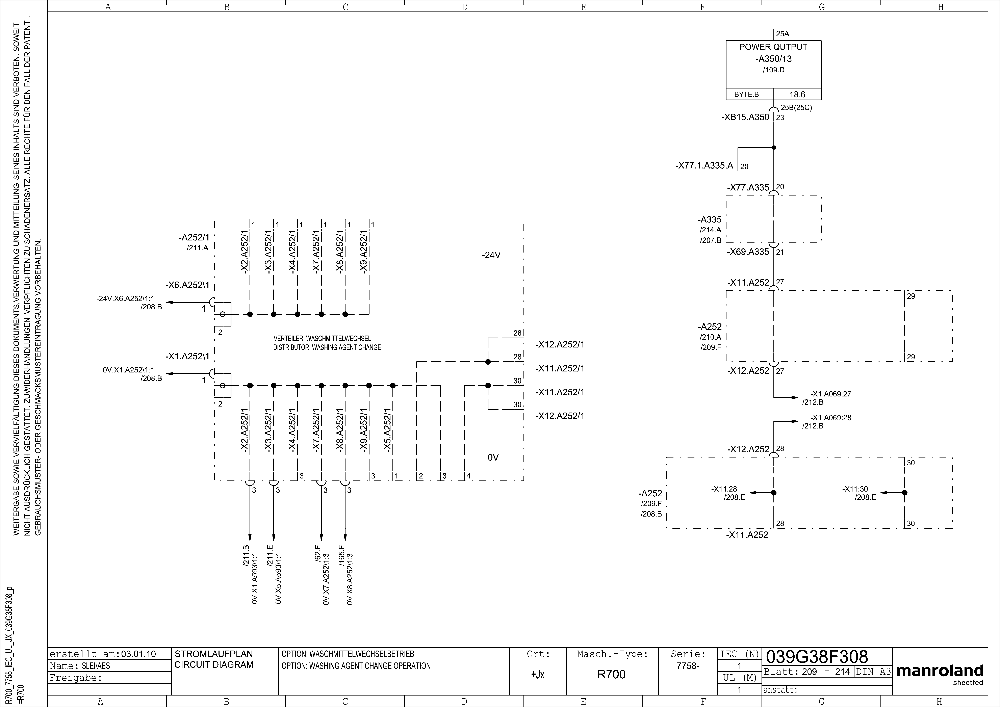

# +Jx — Sheet 209 of 214 — OPTION: WASCHMITTELWECHSELBETRIEB

**OPTION: WASHING AGENT CHANGE OPERATION**

> Part of the manroland **R700** printing press IEC/UL circuit diagrams.
> Drawing class: **Stromlaufplan / Circuit diagram** (DIN A3).
> Document `+Jx` covers the **1st printing module + feed register** machine section.

## At a glance

| Field | Value |
|---|---|
| Document | `+Jx`  (039G38F308) |
| Sheet | **209** of 214 |
| Section (DE) | OPTION: WASCHMITTELWECHSELBETRIEB |
| Section (EN) | OPTION: WASHING AGENT CHANGE OPERATION |
| Section type | CIRCUIT — Circuit diagram |
| Machine type | `R700` |
| Series | `7758` |
| Created | 03.01.10 |
| Replaces | — |
| Columns used | A, B, C, D, E, F, G, H |
| Path numbers | — |
| Labels on sheet | 105 |
| Cross-refs out | 18 |
| Cross-refs in | 50 |

**Previous:** [+Jx sheet 208](SHEET_0208.md) · **Next:** [+Jx sheet 210](SHEET_0210.md) · **Document TOC:** [_TOC.md](_TOC.md)  (+Jx) · **Master TOC:** [all sheets](../_MASTER_TOC.md)

## Sheet image (300 DPI, exact vector render)



_Rendered directly from the PDF vector layer at 300 DPI (1-bit), no OCR and no resampling. Use it to confirm anything ambiguous in the text below._

## Cross-references on this sheet

Each entry is a wire leaving this sheet. The printed token is `/sheet.column`; the link resolves to that sheet inside the same document.

| Ref | Target sheet | Col | Path | Destination on target | Target section | From col |
|---|---|---|---|---|---|---|
| `/109.D` | [+Jx sheet 109](SHEET_0109.md) | D | — | — | REFERENZMODUL | G |
| `/214.A` | [+Jx sheet 214](SHEET_0214.md) | A | — | — | OPTION: FZW | F |
| `/207.B` | [+Jx sheet 207](SHEET_0207.md) | B | — | — | OPTION: ZWISCHENTROCKNER, VORBEREITUNG | F |
| `/211.A` | [+Jx sheet 211](SHEET_0211.md) | A | — | — | OPTION: WASCHMITTELWECHSELBETRIEB | B |
| `/208.B` | [+Jx sheet 208](SHEET_0208.md) | B | — | 24V.X6.A252\1:1 | OPTION: WASCHMITTELWECHSELBETRIEB | A |
| `/210.A` | [+Jx sheet 210](SHEET_0210.md) | A | — | — | OPTION: WASCHMITTELWECHSELBETRIEB | F |
| `/209.F` | [+Jx sheet 209](SHEET_0209.md) | F | — | — | OPTION: WASCHMITTELWECHSELBETRIEB | F |
| `/208.B` | [+Jx sheet 208](SHEET_0208.md) | B | — | 0V.X1.A252\1:1 | OPTION: WASCHMITTELWECHSELBETRIEB | A |
| `/212.B` | [+Jx sheet 212](SHEET_0212.md) | B | — | — | OPTION: WASCHMITTELWECHSELBETRIEB | G |
| `/212.B` | [+Jx sheet 212](SHEET_0212.md) | B | — | — | OPTION: WASCHMITTELWECHSELBETRIEB | G |
| `/208.E` | [+Jx sheet 208](SHEET_0208.md) | E | — | X11:28 X11:30 | OPTION: WASCHMITTELWECHSELBETRIEB | G |
| `/208.E` | [+Jx sheet 208](SHEET_0208.md) | E | — | X11:28 X11:30 | OPTION: WASCHMITTELWECHSELBETRIEB | G |
| `/209.F` | [+Jx sheet 209](SHEET_0209.md) | F | — | — | OPTION: WASCHMITTELWECHSELBETRIEB | F |
| `/208.B` | [+Jx sheet 208](SHEET_0208.md) | B | — | — | OPTION: WASCHMITTELWECHSELBETRIEB | F |
| `/211.B` | [+Jx sheet 211](SHEET_0211.md) | B | — | — | OPTION: WASCHMITTELWECHSELBETRIEB | B |
| `/211.E` | [+Jx sheet 211](SHEET_0211.md) | E | — | — | OPTION: WASCHMITTELWECHSELBETRIEB | B |
| `/62.F` | [+Jx sheet 62](SHEET_0062.md) | F | — | — | GTW | C |
| `/165.F` | [+Jx sheet 165](SHEET_0165.md) | F | — | — | OPTION: | C |

### Incoming references (sheets that point here)

Every other sheet that sends a wire to this one. `Back-ref` is the token printed on *that* sheet; `Path` is its line number.

| From sheet | Cols | Back-ref | Path | Refs | What continues there |
|---|---|---|---|---|---|
| [+Jx#62](SHEET_0062.md) | D | `/62.D` | — | 1 | 0V.X1.A593:2 |
| [+Jx#109](SHEET_0109.md) | D | `/109.D` | — | 1 | — |
| [+Jx#124](SHEET_0124.md) | C | `/124.C` | — | 2 | — |
| [+Jx#127](SHEET_0127.md) | F | `/127.F` | — | 2 | — |
| [+Jx#129](SHEET_0129.md) | C | `/129.C` | — | 2 | — |
| [+Jx#131](SHEET_0131.md) | D | `/131.D` | — | 4 | — |
| [+Jx#133](SHEET_0133.md) | A, F | `/133.A`, `/133.F` | — | 4 | — |
| [+Jx#134](SHEET_0134.md) | C | `/134.C` | — | 2 | — |
| [+Jx#136](SHEET_0136.md) | B, D | `/136.B`, `/136.D` | — | 6 | — |
| [+Jx#137](SHEET_0137.md) | B, D | `/137.B`, `/137.D` | — | 6 | — |
| [+Jx#139](SHEET_0139.md) | B | `/139.B` | — | 1 | — |
| [+Jx#152](SHEET_0152.md) | G | `/152.G` | — | 1 | — |
| [+Jx#155](SHEET_0155.md) | D | `/155.D` | — | 1 | — |
| [+Jx#156](SHEET_0156.md) | A | `/156.A` | — | 1 | — |
| [+Jx#165](SHEET_0165.md) | E | `/165.E` | — | 1 | 0V.K305:A1 |
| [+Jx#207](SHEET_0207.md) | A | `/207.A` | — | 1 | — |
| [+Jx#208](SHEET_0208.md) | A, B, E | `/208.A`, `/208.B`, `/208.E` | — | 5 | 0V.X1.A252\1:1; 24V.X6.A252\1:1 |
| [+Jx#209](SHEET_0209.md) | F | `/209.F` | — | 2 | — |
| [+Jx#210](SHEET_0210.md) | A | `/210.A` | — | 1 | — |
| [+Jx#211](SHEET_0211.md) | A, D | `/211.A`, `/211.D` | — | 3 | 0V.X1.A593\1:1; 0V.X5.A593\1:1 |
| [+Jx#212](SHEET_0212.md) | A | `/212.A` | — | 2 | X1.A069:27; X1.A069:28 |
| [+Jx#214](SHEET_0214.md) | A | `/214.A` | — | 1 | — |


## Devices on this sheet

| Tag | Class | Class meaning (IEC) | Col | Sub | Terminal | Sign |
|---|---|---|---|---|---|---|
| `A252` | A | Baugruppe / assembly, module, PC board | F | — | — | — |
| `A252` | A | Baugruppe / assembly, module, PC board | F | — | — | — |
| `A252/1` | A | Baugruppe / assembly, module, PC board | B | 1 | — | — |
| `A335` | A | Baugruppe / assembly, module, PC board | F | — | — | — |
| `A350/13` | A | Baugruppe / assembly, module, PC board | G | 13 | — | — |
| `X11:30` | X | Klemme / terminal, plug connector | G | — | 30 | — |
| `X11:28` | X | Klemme / terminal, plug connector | F | — | 28 | — |
| `X6.A252\1` | — | cross-device reference | B | — | — | — |
| `X1.A252\1` | — | cross-device reference | B | — | — | — |
| `XB15.A350` | — | cross-device reference | F | — | — | — |
| `X12.A252` | — | cross-device reference | F | — | — | — |
| `X11.A252` | — | cross-device reference | F | — | — | — |
| `X12.A252` | — | cross-device reference | F | — | — | — |
| `X77.A335` | — | cross-device reference | F | — | — | — |
| `X69.A335` | — | cross-device reference | F | — | — | — |
| `X77.1.A335.A` | — | cross-device reference | F | — | — | — |
| `18.6` | — | cross-device reference | G | — | — | — |
| `X1.A069:28` | — | cross-device reference | G | — | 28 | — |
| `X1.A069:27` | — | cross-device reference | G | — | 27 | — |
| `X11.A252` | — | cross-device reference | F | — | — | — |

## Potentials / nets

| Potential | Count | Columns | Attached devices | Terminals |
|---|---|---|---|---|
| `0V` | 6 | A, B, C, D | `A252\1`, `A593\1`, `X1`, `X5`, `X7`, `X8` | `1`, `3` |
| `24V` | 2 | A, D | `A252\1`, `X6` | `1` |


A potential such as `L24+/4` or `M24+` is a named supply/return rail; every place it appears on this sheet is electrically common.

## Wire-end annotations (grouped as printed)

A wire that continues elsewhere is annotated with a small cluster: the destination description, the path/line number `#NN`, and the `/sheet.column` cross reference. Each row below is one such cluster exactly as it is grouped on the drawing.

| Col | Y | Path | Cross-ref | Text on the wire |
|---|---|---|---|---|
| G | 36.4 | — | — | `25A` |
| G | 51.5 | — | — | `POWER QUTPUT` |
| G | 65.4 | — | — | `A350/13` |
| G | 79.2 | — | `/109.D` | — |
| G | 108.3 | — | — | `BYTE.BIT 18.6` |
| G | 124.3 | — | — | `25B(25C)` |
| F | 134.9 | — | — | `XB15.A350 23` |
| F | 192.3 | — | — | `X77.1.A335.A 20` |
| F | 218.5 | — | — | `X77.A335 20` |
| F | 256.8 | — | — | `A335` |
| B | 263.9 | — | — | `1 1 1` |
| C | 263.9 | — | — | `1 1 1` |
| F | 269.9 | — | `/214.A`, `/207.B` | — |
| B | 273.0 | — | — | `X2.A252/1` |
| B | 273.0 | — | — | `X3.A252/1` |
| C | 273.0 | — | — | `X4.A252/1` |
| C | 273.0 | — | — | `X7.A252/1` |
| C | 273.0 | — | — | `X8.A252/1` |
| C | 273.0 | — | — | `X9.A252/1` |
| B | 278.0 | — | — | `A252/1` |
| B | 291.1 | — | `/211.A` | — |
| F | 295.0 | — | — | `X69.A335 21` |
| D | 299.3 | — | — | `24V` |
| F | 331.9 | — | — | `X11.A252 27` |
| B | 334.7 | — | — | `X6.A252\1` |
| H | 348.9 | — | — | `29` |
| A | 351.7 | — | `/208.B` | `24V.X6.A252\1:1` |
| B | 363.0 | — | — | `1` |
| F | 384.3 | — | — | `A252` |
| B | 392.2 | — | — | `2` |
| D | 392.9 | — | — | `28` |
| F | 397.4 | — | `/210.A` | — |
| C | 400.2 | — | — | `DISTRIBUTOR: WASHING AGENT CHANGE VERTEILER: WASCHMITTELWECHSEL` |
| E | 405.6 | — | — | `X12.A252/1` |
| F | 409.8 | — | `/209.F` | — |
| C | 419.8 | — | — | `X1.A252\1 28` |
| H | 421.2 | — | — | `29` |
| E | 433.9 | — | — | `X11.A252/1` |
| A | 436.7 | — | `/208.B` | `0V.X1.A252\1:1` |
| F | 436.8 | — | — | `X12.A252 27` |
| B | 448.1 | — | — | `1` |
| D | 449.6 | — | — | `30` |
| E | 462.3 | — | — | `X11.A252/1` |
| G | 465.1 | — | — | `X1.A069:27` |
| G | 475.0 | — | `/212.B` | — |
| B | 477.2 | — | — | `2` |
| D | 477.9 | — | — | `30` |
| B | 485.6 | — | — | `X2.A252/1` |
| B | 485.6 | — | — | `X3.A252/1` |
| C | 485.6 | — | — | `X4.A252/1` |
| C | 485.6 | — | — | `X7.A252/1` |
| C | 485.6 | — | — | `X8.A252/1` |
| C | 485.6 | — | — | `X9.A252/1` |
| C | 485.6 | — | — | `X5.A252/1` |
| E | 490.6 | — | — | `X12.A252/1` |
| G | 493.5 | — | — | `X1.A069:28` |
| G | 503.4 | — | `/212.B` | — |
| F | 530.3 | — | — | `X12.A252 28` |
| D | 540.2 | — | — | `0V` |
| H | 547.4 | — | — | `30` |
| C | 563.0 | — | — | `3` |
| C | 563.0 | — | — | `3` |
| D | 563.0 | — | — | `1 2 3 4` |
| G | 578.5 | — | `/208.E`, `/208.E` | `X11:28 X11:30` |
| B | 580.0 | — | — | `3` |
| B | 580.0 | — | — | `3` |
| C | 580.0 | — | — | `3` |
| C | 580.0 | — | — | `3` |
| F | 582.8 | — | — | `A252` |
| F | 595.9 | — | `/209.F`, `/208.B` | — |
| G | 619.6 | — | — | `28` |
| H | 619.6 | — | — | `30` |
| F | 632.4 | — | — | `X11.A252` |
| B | 648.9 | — | `/211.B` | — |
| B | 648.9 | — | `/211.E` | — |
| C | 648.9 | — | `/62.F` | — |
| C | 648.9 | — | `/165.F` | — |
| B | 657.6 | — | — | `0V.X1.A593\1:1` |
| B | 657.6 | — | — | `0V.X5.A593\1:1` |
| C | 658.8 | — | — | `0V.X7.A252\1:3` |
| C | 658.8 | — | — | `0V.X8.A252\1:3` |


## Reconstructed tables

This sheet carries tabular content (pin map / terminal assignment / index). The grid below was rebuilt from the drawing's own rule lines, so each row is exactly one physical row of the table.

### Table 1 — 2 data rows × 2 columns (at x=864.6, y=48.2)

| POWER A350/13 | QUTPUT /109.D |
|---|---|
| `BYTE.BIT` | `18.6` |
| `XB15.A350` | `25B(25C) 23` |


## Notes and free text on this sheet

| Text | Col | Y (pt) |
|---|---|---|
| `X2.A252/1` | B | 485.58 |
| `X3.A252/1` | B | 485.58 |
| `X7.A252/1` | C | 485.58 |
| `X8.A252/1` | C | 485.58 |
| `VERTEILER: WASCHMITTELWECHSEL` | C | 400.24 |
| `DISTRIBUTOR: WASHING AGENT CHANGE` | C | 410.89 |
| `25A` | G | 36.37 |
| `25B(25C)` | G | 124.28 |
| `POWER QUTPUT` | G | 51.52 |
| `BYTE.BIT` | F | 108.86 |
| `X5.A252/1` | C | 485.58 |
| `X9.A252/1` | C | 485.58 |
| `X4.A252/1` | C | 485.58 |
| `X12.A252/1` | E | 405.6 |
| `X11.A252/1` | E | 433.94 |

## Complete label inventory (exact text from the drawing)

Every text object inside the drawing area of this sheet, in DIN reading order (column A→H, then top→bottom). This is the authoritative list: if a string is not here it is not printed on this sheet.

| Col | Y | X | Dir | Type | Text |
|---|---|---|---|---|---|
| A | 351.7 | 114.8 | → | potential | `24V.X6.A252\1:1` |
| A | 361.6 | 167.5 | → | cross-reference | `/208.B` |
| A | 436.7 | 122.5 | → | potential | `0V.X1.A252\1:1` |
| A | 446.7 | 167.5 | → | cross-reference | `/208.B` |
| B | 263.9 | 299.6 | → | number | `1` |
| B | 263.9 | 328.0 | → | number | `1` |
| B | 273.0 | 286.5 | ↕ | text | `X2.A252/1` |
| B | 273.0 | 314.9 | ↕ | text | `X3.A252/1` |
| B | 278.0 | 212.9 | → | device tag | `A252/1` |
| B | 291.1 | 222.5 | → | cross-reference | `/211.A` |
| B | 334.7 | 197.0 | → | device ref | `X6.A252\1` |
| B | 363.0 | 239.8 | → | number | `1` |
| B | 392.2 | 259.9 | → | number | `2` |
| B | 419.8 | 197.0 | → | device ref | `X1.A252\1` |
| B | 448.1 | 239.8 | → | number | `1` |
| B | 477.2 | 259.9 | → | number | `2` |
| B | 485.6 | 286.5 | ↕ | text | `X2.A252/1` |
| B | 485.6 | 314.9 | ↕ | text | `X3.A252/1` |
| B | 580.0 | 300.2 | → | number | `3` |
| B | 580.0 | 328.5 | → | number | `3` |
| B | 648.9 | 289.3 | ↕ | cross-reference | `/211.B` |
| B | 648.9 | 317.7 | ↕ | cross-reference | `/211.E` |
| B | 657.6 | 299.3 | ↕ | potential | `0V.X1.A593\1:1` |
| B | 657.6 | 327.6 | ↕ | potential | `0V.X5.A593\1:1` |
| C | 263.9 | 356.3 | → | number | `1` |
| C | 263.9 | 384.7 | → | number | `1` |
| C | 263.9 | 413.0 | → | number | `1` |
| C | 263.9 | 441.4 | → | number | `1` |
| C | 273.0 | 343.2 | ↕ | text | `X4.A252/1` |
| C | 273.0 | 371.6 | ↕ | text | `X7.A252/1` |
| C | 273.0 | 399.9 | ↕ | text | `X8.A252/1` |
| C | 273.0 | 428.3 | ↕ | text | `X9.A252/1` |
| C | 400.2 | 326.0 | → | text | `VERTEILER: WASCHMITTELWECHSEL` |
| C | 410.9 | 325.4 | → | text | `DISTRIBUTOR: WASHING AGENT CHANGE` |
| C | 485.6 | 343.2 | ↕ | text | `X4.A252/1` |
| C | 485.6 | 371.6 | ↕ | text | `X7.A252/1` |
| C | 485.6 | 399.9 | ↕ | text | `X8.A252/1` |
| C | 485.6 | 428.3 | ↕ | text | `X9.A252/1` |
| C | 485.6 | 456.6 | ↕ | text | `X5.A252/1` |
| C | 562.9 | 356.9 | → | number | `3` |
| C | 562.9 | 441.9 | → | number | `3` |
| C | 562.9 | 469.7 | → | number | `1` |
| C | 580.0 | 385.2 | → | number | `3` |
| C | 580.0 | 413.6 | → | number | `3` |
| C | 648.9 | 374.4 | ↕ | cross-reference | `/62.F` |
| C | 648.9 | 402.7 | ↕ | cross-reference | `/165.F` |
| C | 658.8 | 384.3 | ↕ | potential | `0V.X7.A252\1:3` |
| C | 658.8 | 412.6 | ↕ | potential | `0V.X8.A252\1:3` |
| D | 299.3 | 573.7 | → | potential | `24V` |
| D | 392.9 | 611.4 | → | number | `28` |
| D | 421.2 | 611.4 | → | number | `28` |
| D | 449.6 | 611.4 | → | number | `30` |
| D | 477.9 | 611.4 | → | number | `30` |
| D | 540.2 | 580.8 | → | potential | `0V` |
| D | 562.9 | 498.9 | → | number | `2` |
| D | 562.9 | 527.0 | → | number | `3` |
| D | 562.9 | 555.6 | → | number | `4` |
| E | 405.6 | 637.5 | → | text | `X12.A252/1` |
| E | 433.9 | 637.5 | → | text | `X11.A252/1` |
| E | 462.3 | 637.5 | → | text | `X11.A252/1` |
| E | 490.6 | 637.5 | → | text | `X12.A252/1` |
| F | 108.9 | 874.5 | → | text | `BYTE.BIT` |
| F | 134.9 | 858.9 | → | device ref | `XB15.A350` |
| F | 192.3 | 804.2 | → | device ref | `X77.1.A335.A` |
| F | 194.4 | 881.6 | → | number | `20` |
| F | 218.5 | 865.7 | → | device ref | `X77.A335` |
| F | 256.8 | 830.8 | → | device tag | `A335` |
| F | 269.9 | 833.4 | → | cross-reference | `/214.A` |
| F | 282.3 | 833.7 | → | cross-reference | `/207.B` |
| F | 295.0 | 865.7 | → | device ref | `X69.A335` |
| F | 331.9 | 866.0 | → | device ref | `X11.A252` |
| F | 384.3 | 831.1 | → | device tag | `A252` |
| F | 397.4 | 833.4 | → | cross-reference | `/210.A` |
| F | 409.8 | 834.2 | → | cross-reference | `/209.F` |
| F | 436.8 | 866.0 | → | device ref | `X12.A252` |
| F | 530.3 | 866.0 | → | device ref | `X12.A252` |
| F | 578.5 | 847.0 | → | device tag | `X11:28` |
| F | 582.8 | 760.3 | → | device tag | `A252` |
| F | 588.4 | 862.0 | → | cross-reference | `/208.E` |
| F | 595.8 | 763.4 | → | cross-reference | `/209.F` |
| F | 608.2 | 762.8 | → | cross-reference | `/208.B` |
| F | 632.4 | 864.6 | → | device ref | `X11.A252` |
| G | 36.4 | 924.1 | → | text | `25A` |
| G | 51.5 | 880.4 | → | text | `POWER QUTPUT` |
| G | 65.4 | 899.7 | → | device tag | `A350/13` |
| G | 79.2 | 908.5 | → | cross-reference | `/109.D` |
| G | 108.3 | 939.8 | → | device ref | `18.6` |
| G | 124.3 | 929.8 | → | text | `25B(25C)` |
| G | 136.3 | 924.1 | → | number | `23` |
| G | 218.5 | 924.1 | → | number | `20` |
| G | 296.5 | 924.1 | → | number | `21` |
| G | 331.9 | 924.1 | → | number | `27` |
| G | 438.2 | 924.1 | → | number | `27` |
| G | 465.1 | 964.9 | → | device ref | `X1.A069:27` |
| G | 475.0 | 955.3 | → | cross-reference | `/212.B` |
| G | 493.5 | 964.9 | → | device ref | `X1.A069:28` |
| G | 503.4 | 955.3 | → | cross-reference | `/212.B` |
| G | 530.3 | 924.1 | → | number | `28` |
| G | 578.5 | 1002.9 | → | device tag | `X11:30` |
| G | 588.4 | 1017.9 | → | cross-reference | `/208.E` |
| G | 619.6 | 924.1 | → | number | `28` |
| H | 348.9 | 1080.0 | → | number | `29` |
| H | 421.2 | 1080.0 | → | number | `29` |
| H | 547.4 | 1079.7 | → | number | `30` |
| H | 619.6 | 1079.7 | → | number | `30` |

## Reading-order text block

The same content as a plain block, grouped by DIN column — convenient to paste or to match against a visual description.

```text
=== Column A ===
 351.7  114.8  net          24V.X6.A252\1:1
 361.6  167.5  xref         /208.B
 436.7  122.5  net          0V.X1.A252\1:1
 446.7  167.5  xref         /208.B
=== Column B ===
 263.9  299.6  numeric      1
 263.9  328.0  numeric      1
 273.0  286.5  text         X2.A252/1
 273.0  314.9  text         X3.A252/1
 278.0  212.9  devtag       A252/1
 291.1  222.5  xref         /211.A
 334.7  197.0  devref       X6.A252\1
 363.0  239.8  numeric      1
 392.2  259.9  numeric      2
 419.8  197.0  devref       X1.A252\1
 448.1  239.8  numeric      1
 477.2  259.9  numeric      2
 485.6  286.5  text         X2.A252/1
 485.6  314.9  text         X3.A252/1
 580.0  300.2  numeric      3
 580.0  328.5  numeric      3
 648.9  289.3  xref         /211.B
 648.9  317.7  xref         /211.E
 657.6  299.3  net          0V.X1.A593\1:1
 657.6  327.6  net          0V.X5.A593\1:1
=== Column C ===
 263.9  356.3  numeric      1
 263.9  384.7  numeric      1
 263.9  413.0  numeric      1
 263.9  441.4  numeric      1
 273.0  343.2  text         X4.A252/1
 273.0  371.6  text         X7.A252/1
 273.0  399.9  text         X8.A252/1
 273.0  428.3  text         X9.A252/1
 400.2  326.0  text         VERTEILER: WASCHMITTELWECHSEL
 410.9  325.4  text         DISTRIBUTOR: WASHING AGENT CHANGE
 485.6  343.2  text         X4.A252/1
 485.6  371.6  text         X7.A252/1
 485.6  399.9  text         X8.A252/1
 485.6  428.3  text         X9.A252/1
 485.6  456.6  text         X5.A252/1
 562.9  356.9  numeric      3
 562.9  441.9  numeric      3
 562.9  469.7  numeric      1
 580.0  385.2  numeric      3
 580.0  413.6  numeric      3
 648.9  374.4  xref         /62.F
 648.9  402.7  xref         /165.F
 658.8  384.3  net          0V.X7.A252\1:3
 658.8  412.6  net          0V.X8.A252\1:3
=== Column D ===
 299.3  573.7  net          24V
 392.9  611.4  numeric      28
 421.2  611.4  numeric      28
 449.6  611.4  numeric      30
 477.9  611.4  numeric      30
 540.2  580.8  net          0V
 562.9  498.9  numeric      2
 562.9  527.0  numeric      3
 562.9  555.6  numeric      4
=== Column E ===
 405.6  637.5  text         X12.A252/1
 433.9  637.5  text         X11.A252/1
 462.3  637.5  text         X11.A252/1
 490.6  637.5  text         X12.A252/1
=== Column F ===
 108.9  874.5  text         BYTE.BIT
 134.9  858.9  devref       XB15.A350
 192.3  804.2  devref       X77.1.A335.A
 194.4  881.6  numeric      20
 218.5  865.7  devref       X77.A335
 256.8  830.8  devtag       A335
 269.9  833.4  xref         /214.A
 282.3  833.7  xref         /207.B
 295.0  865.7  devref       X69.A335
 331.9  866.0  devref       X11.A252
 384.3  831.1  devtag       A252
 397.4  833.4  xref         /210.A
 409.8  834.2  xref         /209.F
 436.8  866.0  devref       X12.A252
 530.3  866.0  devref       X12.A252
 578.5  847.0  devtag       X11:28
 582.8  760.3  devtag       A252
 588.4  862.0  xref         /208.E
 595.8  763.4  xref         /209.F
 608.2  762.8  xref         /208.B
 632.4  864.6  devref       X11.A252
=== Column G ===
  36.4  924.1  text         25A
  51.5  880.4  text         POWER QUTPUT
  65.4  899.7  devtag       A350/13
  79.2  908.5  xref         /109.D
 108.3  939.8  devref       18.6
 124.3  929.8  text         25B(25C)
 136.3  924.1  numeric      23
 218.5  924.1  numeric      20
 296.5  924.1  numeric      21
 331.9  924.1  numeric      27
 438.2  924.1  numeric      27
 465.1  964.9  devref       X1.A069:27
 475.0  955.3  xref         /212.B
 493.5  964.9  devref       X1.A069:28
 503.4  955.3  xref         /212.B
 530.3  924.1  numeric      28
 578.5 1002.9  devtag       X11:30
 588.4 1017.9  xref         /208.E
 619.6  924.1  numeric      28
=== Column H ===
 348.9 1080.0  numeric      29
 421.2 1080.0  numeric      29
 547.4 1079.7  numeric      30
 619.6 1079.7  numeric      30
```

---
_Generated from the PDF vector text layer; no OCR. Source: `R700_7758_IEC_UL_JX_039G38F308_p`, sheet 209._
