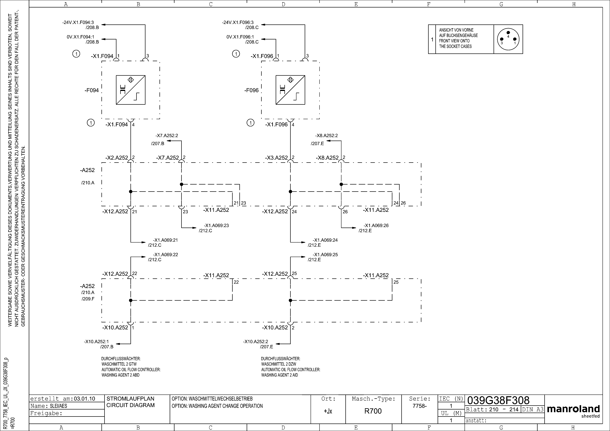

# +Jx — Sheet 210 of 214 — OPTION: WASCHMITTELWECHSELBETRIEB

**OPTION: WASHING AGENT CHANGE OPERATION**

> Part of the manroland **R700** printing press IEC/UL circuit diagrams.
> Drawing class: **Stromlaufplan / Circuit diagram** (DIN A3).
> Document `+Jx` covers the **1st printing module + feed register** machine section.

## At a glance

| Field | Value |
|---|---|
| Document | `+Jx`  (039G38F308) |
| Sheet | **210** of 214 |
| Section (DE) | OPTION: WASCHMITTELWECHSELBETRIEB |
| Section (EN) | OPTION: WASHING AGENT CHANGE OPERATION |
| Section type | CIRCUIT — Circuit diagram |
| Machine type | `R700` |
| Series | `7758` |
| Created | 03.01.10 |
| Replaces | — |
| Columns used | A, B, C, D, E, F, G |
| Path numbers | — |
| Labels on sheet | 95 |
| Cross-refs out | 17 |
| Cross-refs in | 41 |

**Previous:** [+Jx sheet 209](SHEET_0209.md) · **Next:** [+Jx sheet 211](SHEET_0211.md) · **Document TOC:** [_TOC.md](_TOC.md)  (+Jx) · **Master TOC:** [all sheets](../_MASTER_TOC.md)

## Sheet image (300 DPI, exact vector render)



_Rendered directly from the PDF vector layer at 300 DPI (1-bit), no OCR and no resampling. Use it to confirm anything ambiguous in the text below._

## Cross-references on this sheet

Each entry is a wire leaving this sheet. The printed token is `/sheet.column`; the link resolves to that sheet inside the same document.

| Ref | Target sheet | Col | Path | Destination on target | Target section | From col |
|---|---|---|---|---|---|---|
| `/208.B` | [+Jx sheet 208](SHEET_0208.md) | B | — | 24V.X1.F094:3 | OPTION: WASCHMITTELWECHSELBETRIEB | A |
| `/208.C` | [+Jx sheet 208](SHEET_0208.md) | C | — | 24V.X1.F096:3 | OPTION: WASCHMITTELWECHSELBETRIEB | C |
| `/208.B` | [+Jx sheet 208](SHEET_0208.md) | B | — | 0V.X1.F094:1 0V.X1.F096:1 | OPTION: WASCHMITTELWECHSELBETRIEB | B |
| `/208.C` | [+Jx sheet 208](SHEET_0208.md) | C | — | 0V.X1.F094:1 0V.X1.F096:1 | OPTION: WASCHMITTELWECHSELBETRIEB | B |
| `/207.B` | [+Jx sheet 207](SHEET_0207.md) | B | — | — | OPTION: ZWISCHENTROCKNER, VORBEREITUNG | B |
| `/207.E` | [+Jx sheet 207](SHEET_0207.md) | E | — | — | OPTION: ZWISCHENTROCKNER, VORBEREITUNG | D |
| `/210.A` | [+Jx sheet 210](SHEET_0210.md) | A | — | — | OPTION: WASCHMITTELWECHSELBETRIEB | A |
| `/212.E` | [+Jx sheet 212](SHEET_0212.md) | E | — | — | OPTION: WASCHMITTELWECHSELBETRIEB | E |
| `/212.C` | [+Jx sheet 212](SHEET_0212.md) | C | — | — | OPTION: WASCHMITTELWECHSELBETRIEB | C |
| `/212.E` | [+Jx sheet 212](SHEET_0212.md) | E | — | — | OPTION: WASCHMITTELWECHSELBETRIEB | D |
| `/212.C` | [+Jx sheet 212](SHEET_0212.md) | C | — | — | OPTION: WASCHMITTELWECHSELBETRIEB | B |
| `/212.E` | [+Jx sheet 212](SHEET_0212.md) | E | — | — | OPTION: WASCHMITTELWECHSELBETRIEB | D |
| `/212.C` | [+Jx sheet 212](SHEET_0212.md) | C | — | — | OPTION: WASCHMITTELWECHSELBETRIEB | B |
| `/210.A` | [+Jx sheet 210](SHEET_0210.md) | A | — | — | OPTION: WASCHMITTELWECHSELBETRIEB | A |
| `/209.F` | [+Jx sheet 209](SHEET_0209.md) | F | — | — | OPTION: WASCHMITTELWECHSELBETRIEB | A |
| `/207.B` | [+Jx sheet 207](SHEET_0207.md) | B | — | X10.A252:1 X10.A252:2 | OPTION: ZWISCHENTROCKNER, VORBEREITUNG | C |
| `/207.E` | [+Jx sheet 207](SHEET_0207.md) | E | — | X10.A252:1 X10.A252:2 | OPTION: ZWISCHENTROCKNER, VORBEREITUNG | C |

### Incoming references (sheets that point here)

Every other sheet that sends a wire to this one. `Back-ref` is the token printed on *that* sheet; `Path` is its line number.

| From sheet | Cols | Back-ref | Path | Refs | What continues there |
|---|---|---|---|---|---|
| [+Jx#118](SHEET_0118.md) | A, B | `/118.A`, `/118.B` | — | 6 | — |
| [+Jx#124](SHEET_0124.md) | C | `/124.C` | — | 1 | — |
| [+Jx#127](SHEET_0127.md) | E | `/127.E` | — | 1 | — |
| [+Jx#133](SHEET_0133.md) | A, F | `/133.A`, `/133.F` | — | 2 | — |
| [+Jx#135](SHEET_0135.md) | A | `/135.A` | — | 2 | — |
| [+Jx#136](SHEET_0136.md) | B | `/136.B` | — | 6 | — |
| [+Jx#137](SHEET_0137.md) | B | `/137.B` | — | 6 | — |
| [+Jx#207](SHEET_0207.md) | C, E | `/207.C`, `/207.E` | — | 4 | — |
| [+Jx#208](SHEET_0208.md) | B, C | `/208.B`, `/208.C` | — | 4 | 24V.X1.F094:3; 24V.X1.F096:3 |
| [+Jx#209](SHEET_0209.md) | F | `/209.F` | — | 1 | — |
| [+Jx#210](SHEET_0210.md) | A | `/210.A` | — | 2 | — |
| [+Jx#212](SHEET_0212.md) | C, D | `/212.C`, `/212.D` | — | 6 | X1.A069:21; X1.A069:22; X1.A069:23; X1.A069:24; X1.A069:25; X1.A069:26 |


## Devices on this sheet

| Tag | Class | Class meaning (IEC) | Col | Sub | Terminal | Sign |
|---|---|---|---|---|---|---|
| `F094` | F | Schutz / protection device (fuse, circuit breaker) | A | — | — | — |
| `F096` | F | Schutz / protection device (fuse, circuit breaker) | D | — | — | — |
| `A252` | A | Baugruppe / assembly, module, PC board | A | — | — | — |
| `A252` | A | Baugruppe / assembly, module, PC board | A | — | — | — |
| `X1.F094` | — | cross-device reference | B | — | — | — |
| `X1.F094` | — | cross-device reference | B | — | — | — |
| `X1.F096` | — | cross-device reference | D | — | — | — |
| `X1.F096` | — | cross-device reference | D | — | — | — |
| `X2.A252` | — | cross-device reference | B | — | — | — |
| `X12.A252` | — | cross-device reference | B | — | — | — |
| `X7.A252` | — | cross-device reference | B | — | — | — |
| `X3.A252` | — | cross-device reference | D | — | — | — |
| `X12.A252` | — | cross-device reference | D | — | — | — |
| `X8.A252` | — | cross-device reference | E | — | — | — |
| `X12.A252` | — | cross-device reference | B | — | — | — |
| `X10.A252` | — | cross-device reference | B | — | — | — |
| `X12.A252` | — | cross-device reference | D | — | — | — |
| `X10.A252` | — | cross-device reference | D | — | — | — |
| `X8.A252:2` | — | cross-device reference | E | — | 2 | — |
| `X7.A252:2` | — | cross-device reference | B | — | 2 | — |
| `X1.A069:26` | — | cross-device reference | E | — | 26 | — |
| `X1.A069:25` | — | cross-device reference | E | — | 25 | — |
| `X1.A069:21` | — | cross-device reference | B | — | 21 | — |
| `X1.A069:22` | — | cross-device reference | B | — | 22 | — |
| `X1.A069:24` | — | cross-device reference | E | — | 24 | — |
| `X1.A069:23` | — | cross-device reference | C | — | 23 | — |
| `X10.A252:2` | — | cross-device reference | D | — | 2 | — |
| `X10.A252:1` | — | cross-device reference | A | — | 1 | — |
| `X11.A252` | — | cross-device reference | C | — | — | — |
| `X11.A252` | — | cross-device reference | E | — | — | — |
| `X11.A252` | — | cross-device reference | C | — | — | — |
| `X11.A252` | — | cross-device reference | E | — | — | — |

## Potentials / nets

| Potential | Count | Columns | Attached devices | Terminals |
|---|---|---|---|---|
| `0V` | 2 | A, C | `F094`, `F096`, `X1` | `1` |
| `24V` | 2 | A, C | `F094`, `F096`, `X1` | `3` |


A potential such as `L24+/4` or `M24+` is a named supply/return rail; every place it appears on this sheet is electrically common.

## Wire-end annotations (grouped as printed)

A wire that continues elsewhere is annotated with a small cluster: the destination description, the path/line number `#NN`, and the `/sheet.column` cross reference. Each row below is one such cluster exactly as it is grouped on the drawing.

| Col | Y | Path | Cross-ref | Text on the wire |
|---|---|---|---|---|
| A | 39.9 | — | `/208.B` | `24V.X1.F094:3` |
| C | 39.9 | — | `/208.C` | `24V.X1.F096:3` |
| F | 55.9 | — | — | `FRONT VIEW ONTO ANSICHT VON VORNE AUF BUCHSENGEHÄUSE` |
| B | 68.2 | — | `/208.B`, `/208.C` | `0V.X1.F094:1 0V.X1.F096:1` |
| G | 68.2 | — | — | `1 THE SOCKET CASES 4` |
| G | 80.9 | — | — | `3 1` |
| A | 101.8 | — | — | `1` |
| C | 101.8 | — | — | `1` |
| B | 105.1 | — | — | `X1.F094 1 3` |
| D | 105.1 | — | — | `X1.F096 1 3` |
| A | 171.7 | — | — | `F094` |
| D | 171.7 | — | — | `F096` |
| A | 236.5 | — | — | `1` |
| D | 236.5 | — | — | `1` |
| B | 238.3 | — | — | `X1.F094 4` |
| D | 238.3 | — | — | `X1.F096 4` |
| B | 261.0 | — | — | `X7.A252:2` |
| E | 261.0 | — | — | `X8.A252:2` |
| B | 276.6 | — | `/207.B` | — |
| D | 276.6 | — | `/207.E` | — |
| B | 303.6 | — | — | `X2.A252 2` |
| B | 303.6 | — | — | `X7.A252 2` |
| D | 303.6 | — | — | `X3.A252 2` |
| E | 303.6 | — | — | `X8.A252 2` |
| A | 327.6 | — | — | `A252` |
| A | 353.1 | — | `/210.A` | — |
| C | 392.9 | — | — | `21 23` |
| F | 392.9 | — | — | `24 26` |
| D | 405.6 | — | — | `X11.A252 X11.A252` |
| B | 408.4 | — | — | `X12.A252 21` |
| D | 408.4 | — | — | `X12.A252 24` |
| C | 409.9 | — | — | `23` |
| E | 409.9 | — | — | `26` |
| C | 436.8 | — | — | `X1.A069:23` |
| E | 436.8 | — | — | `X1.A069:26` |
| C | 446.7 | — | `/212.C` | — |
| E | 446.7 | — | `/212.E` | — |
| B | 465.1 | — | — | `X1.A069:21` |
| E | 465.1 | — | — | `X1.A069:24` |
| B | 475.0 | — | `/212.C` | — |
| D | 475.0 | — | `/212.E` | — |
| B | 493.5 | — | — | `X1.A069:22` |
| E | 493.5 | — | — | `X1.A069:25` |
| B | 503.4 | — | `/212.C` | — |
| D | 503.4 | — | `/212.E` | — |
| B | 530.3 | — | — | `X12.A252 22` |
| D | 530.3 | — | — | `X12.A252 25` |
| D | 533.1 | — | — | `X11.A252 X11.A252` |
| C | 547.4 | — | — | `22` |
| F | 547.4 | — | — | `25` |
| A | 554.4 | — | — | `A252` |
| A | 567.5 | — | `/210.A` | — |
| A | 579.9 | — | `/209.F` | — |
| B | 635.2 | — | — | `X10.A252 1` |
| D | 635.2 | — | — | `X10.A252 2` |
| C | 663.5 | — | `/207.B`, `/207.E` | `X10.A252:1 X10.A252:2` |
| B | 697.9 | — | — | `DURCHFLUSSWÄCHTER:` |
| D | 697.9 | — | — | `DURCHFLUSSWÄCHTER:` |
| B | 708.5 | — | — | `WASCHMITTEL 2 GTW AUTOMATIC OIL FLOW CONTROLLER: WASHING AGENT 2 ABD` |
| D | 708.5 | — | — | `WASCHMITTEL 2 DZW AUTOMATIC OIL FLOW CONTROLLER: WASHING AGENT 2 AID` |


## Reconstructed tables

This sheet carries tabular content (pin map / terminal assignment / index). The grid below was rebuilt from the drawing's own rule lines, so each row is exactly one physical row of the table.

### Table 1 — 3 data rows × 11 columns (at x=226.8, y=48.2)

| 1 |  | 3 |  | 1 | /208.C 0V.X1.F096:1 /208.C X1.F096 | 1 |  | 3 |  |  |
|---|---|---|---|---|---|---|---|---|---|---|
|  |  |  |  |  | `F096` |  |  |  |  |  |
| `X1.F094 X2.A252` | `4 2` | `X7.A252:2 /207.B X7.A252` | `2` |  | `1` | `X1.F096 X3.A252` | `4 2` | `X8.A252:2 /207.E X8.A252` | `2` |  |
|  | `21 22` | `X1.A069:21 /212.C X1.A069:22 /212.C` | `X11.A252 23 X1.A069:23 /212.C X11.A252` | `21 22` | `23 X12.A252 X12.A252` |  | `24 25` | `X1.A069:24 /212.E X1.A069:25 /212.E` | `X11.A252 26 X1.A069:26 /212.E X11.A252` | `24 25` |


## Notes and free text on this sheet

| Text | Col | Y (pt) |
|---|---|---|
| `DURCHFLUSSWÄCHTER:` | B | 697.89 |
| `WASCHMITTEL 2 GTW` | B | 708.5 |
| `AUTOMATIC OIL FLOW CONTROLLER:` | B | 719.17 |
| `WASHING AGENT 2 ABD` | B | 729.78 |
| `DURCHFLUSSWÄCHTER:` | D | 697.89 |
| `WASCHMITTEL 2 DZW` | D | 708.5 |
| `AUTOMATIC OIL FLOW CONTROLLER:` | D | 719.17 |
| `WASHING AGENT 2 AID` | D | 729.77 |
| `ANSICHT VON VORNE` | F | 55.86 |
| `AUF BUCHSENGEHÄUSE` | F | 66.5 |
| `FRONT VIEW ONTO` | F | 77.09 |
| `THE SOCKET CASES` | F | 87.74 |

## Complete label inventory (exact text from the drawing)

Every text object inside the drawing area of this sheet, in DIN reading order (column A→H, then top→bottom). This is the authoritative list: if a string is not here it is not printed on this sheet.

| Col | Y | X | Dir | Type | Text |
|---|---|---|---|---|---|
| A | 39.9 | 121.6 | → | potential | `24V.X1.F094:3` |
| A | 49.8 | 167.5 | → | cross-reference | `/208.B` |
| A | 68.2 | 130.4 | → | potential | `0V.X1.F094:1` |
| A | 78.2 | 167.5 | → | cross-reference | `/208.B` |
| A | 101.8 | 147.0 | → | number | `1` |
| A | 171.7 | 165.3 | → | device tag | `F094` |
| A | 236.5 | 175.3 | → | number | `1` |
| A | 327.6 | 156.5 | → | device tag | `A252` |
| A | 353.1 | 158.7 | → | cross-reference | `/210.A` |
| A | 554.4 | 156.5 | → | device tag | `A252` |
| A | 567.5 | 158.7 | → | cross-reference | `/210.A` |
| A | 579.9 | 159.6 | → | cross-reference | `/209.F` |
| A | 663.5 | 163.8 | → | device ref | `X10.A252:1` |
| B | 105.1 | 177.7 | → | device ref | `X1.F094` |
| B | 105.1 | 228.8 | → | number | `1` |
| B | 105.1 | 286.0 | → | number | `3` |
| B | 238.3 | 206.1 | → | device ref | `X1.F094` |
| B | 239.8 | 258.0 | → | number | `4` |
| B | 261.0 | 303.6 | → | device ref | `X7.A252:2` |
| B | 276.6 | 295.1 | → | cross-reference | `/207.B` |
| B | 303.5 | 205.8 | → | device ref | `X2.A252` |
| B | 303.5 | 305.0 | → | device ref | `X7.A252` |
| B | 303.6 | 258.0 | → | number | `2` |
| B | 408.4 | 199.8 | → | device ref | `X12.A252` |
| B | 409.9 | 258.0 | → | number | `21` |
| B | 465.1 | 298.8 | → | device ref | `X1.A069:21` |
| B | 475.0 | 289.1 | → | cross-reference | `/212.C` |
| B | 493.5 | 298.8 | → | device ref | `X1.A069:22` |
| B | 503.4 | 289.1 | → | cross-reference | `/212.C` |
| B | 530.3 | 199.8 | → | device ref | `X12.A252` |
| B | 530.3 | 258.0 | → | number | `22` |
| B | 635.2 | 199.8 | → | device ref | `X10.A252` |
| B | 636.6 | 257.1 | → | number | `1` |
| B | 673.4 | 195.9 | → | cross-reference | `/207.B` |
| B | 697.9 | 197.9 | → | text | `DURCHFLUSSWÄCHTER:` |
| B | 708.5 | 198.4 | → | text | `WASCHMITTEL 2 GTW` |
| B | 719.2 | 198.4 | → | text | `AUTOMATIC OIL FLOW CONTROLLER:` |
| B | 729.8 | 198.4 | → | text | `WASHING AGENT 2 ABD` |
| C | 39.9 | 433.4 | → | potential | `24V.X1.F096:3` |
| C | 68.2 | 442.2 | → | potential | `0V.X1.F096:1` |
| C | 101.8 | 458.8 | → | number | `1` |
| C | 303.6 | 357.2 | → | number | `2` |
| C | 392.9 | 456.4 | → | number | `21 23` |
| C | 405.6 | 396.9 | → | device ref | `X11.A252` |
| C | 409.9 | 357.2 | → | number | `23` |
| C | 436.8 | 398.0 | → | device ref | `X1.A069:23` |
| C | 446.7 | 388.3 | → | cross-reference | `/212.C` |
| C | 533.1 | 396.9 | → | device ref | `X11.A252` |
| C | 547.4 | 456.4 | → | number | `22` |
| D | 49.8 | 479.1 | → | cross-reference | `/208.C` |
| D | 78.2 | 479.1 | → | cross-reference | `/208.C` |
| D | 105.1 | 489.5 | → | device ref | `X1.F096` |
| D | 105.1 | 540.6 | → | number | `1` |
| D | 105.1 | 597.8 | → | number | `3` |
| D | 171.7 | 477.1 | → | device tag | `F096` |
| D | 236.5 | 487.1 | → | number | `1` |
| D | 238.3 | 517.9 | → | device ref | `X1.F096` |
| D | 239.8 | 569.8 | → | number | `4` |
| D | 276.6 | 606.9 | → | cross-reference | `/207.E` |
| D | 303.5 | 517.6 | → | device ref | `X3.A252` |
| D | 303.6 | 569.8 | → | number | `2` |
| D | 408.4 | 511.7 | → | device ref | `X12.A252` |
| D | 409.9 | 569.8 | → | number | `24` |
| D | 475.0 | 600.9 | → | cross-reference | `/212.E` |
| D | 503.4 | 600.9 | → | cross-reference | `/212.E` |
| D | 530.3 | 511.7 | → | device ref | `X12.A252` |
| D | 530.3 | 569.8 | → | number | `25` |
| D | 635.2 | 511.7 | → | device ref | `X10.A252` |
| D | 636.6 | 569.8 | → | number | `2` |
| D | 663.5 | 474.5 | → | device ref | `X10.A252:2` |
| D | 673.4 | 507.7 | → | cross-reference | `/207.E` |
| D | 697.9 | 509.7 | → | text | `DURCHFLUSSWÄCHTER:` |
| D | 708.5 | 510.2 | → | text | `WASCHMITTEL 2 DZW` |
| D | 719.2 | 510.2 | → | text | `AUTOMATIC OIL FLOW CONTROLLER:` |
| D | 729.8 | 510.2 | → | text | `WASHING AGENT 2 AID` |
| E | 261.0 | 615.4 | → | device ref | `X8.A252:2` |
| E | 303.5 | 616.8 | → | device ref | `X8.A252` |
| E | 303.6 | 669.0 | → | number | `2` |
| E | 405.6 | 708.7 | → | device ref | `X11.A252` |
| E | 409.9 | 669.0 | → | number | `26` |
| E | 436.8 | 709.8 | → | device ref | `X1.A069:26` |
| E | 446.7 | 700.2 | → | cross-reference | `/212.E` |
| E | 465.1 | 610.6 | → | device ref | `X1.A069:24` |
| E | 493.5 | 610.6 | → | device ref | `X1.A069:25` |
| E | 533.1 | 708.7 | → | device ref | `X11.A252` |
| F | 55.9 | 857.5 | → | text | `ANSICHT VON VORNE` |
| F | 66.5 | 857.5 | → | text | `AUF BUCHSENGEHÄUSE` |
| F | 72.5 | 840.8 | → | number | `1` |
| F | 77.1 | 856.9 | → | text | `FRONT VIEW ONTO` |
| F | 87.7 | 857.5 | → | text | `THE SOCKET CASES` |
| F | 392.9 | 768.2 | → | number | `24 26` |
| F | 547.4 | 768.2 | → | number | `25` |
| G | 68.2 | 990.3 | → | number | `4` |
| G | 80.9 | 977.4 | → | number | `3` |
| G | 80.9 | 1003.2 | → | number | `1` |

## Reading-order text block

The same content as a plain block, grouped by DIN column — convenient to paste or to match against a visual description.

```text
=== Column A ===
  39.9  121.6  net          24V.X1.F094:3
  49.8  167.5  xref         /208.B
  68.2  130.4  net          0V.X1.F094:1
  78.2  167.5  xref         /208.B
 101.8  147.0  numeric      1
 171.7  165.3  devtag       F094
 236.5  175.3  numeric      1
 327.6  156.5  devtag       A252
 353.1  158.7  xref         /210.A
 554.4  156.5  devtag       A252
 567.5  158.7  xref         /210.A
 579.9  159.6  xref         /209.F
 663.5  163.8  devref       X10.A252:1
=== Column B ===
 105.1  177.7  devref       X1.F094
 105.1  228.8  numeric      1
 105.1  286.0  numeric      3
 238.3  206.1  devref       X1.F094
 239.8  258.0  numeric      4
 261.0  303.6  devref       X7.A252:2
 276.6  295.1  xref         /207.B
 303.5  205.8  devref       X2.A252
 303.5  305.0  devref       X7.A252
 303.6  258.0  numeric      2
 408.4  199.8  devref       X12.A252
 409.9  258.0  numeric      21
 465.1  298.8  devref       X1.A069:21
 475.0  289.1  xref         /212.C
 493.5  298.8  devref       X1.A069:22
 503.4  289.1  xref         /212.C
 530.3  199.8  devref       X12.A252
 530.3  258.0  numeric      22
 635.2  199.8  devref       X10.A252
 636.6  257.1  numeric      1
 673.4  195.9  xref         /207.B
 697.9  197.9  text         DURCHFLUSSWÄCHTER:
 708.5  198.4  text         WASCHMITTEL 2 GTW
 719.2  198.4  text         AUTOMATIC OIL FLOW CONTROLLER:
 729.8  198.4  text         WASHING AGENT 2 ABD
=== Column C ===
  39.9  433.4  net          24V.X1.F096:3
  68.2  442.2  net          0V.X1.F096:1
 101.8  458.8  numeric      1
 303.6  357.2  numeric      2
 392.9  456.4  numeric      21 23
 405.6  396.9  devref       X11.A252
 409.9  357.2  numeric      23
 436.8  398.0  devref       X1.A069:23
 446.7  388.3  xref         /212.C
 533.1  396.9  devref       X11.A252
 547.4  456.4  numeric      22
=== Column D ===
  49.8  479.1  xref         /208.C
  78.2  479.1  xref         /208.C
 105.1  489.5  devref       X1.F096
 105.1  540.6  numeric      1
 105.1  597.8  numeric      3
 171.7  477.1  devtag       F096
 236.5  487.1  numeric      1
 238.3  517.9  devref       X1.F096
 239.8  569.8  numeric      4
 276.6  606.9  xref         /207.E
 303.5  517.6  devref       X3.A252
 303.6  569.8  numeric      2
 408.4  511.7  devref       X12.A252
 409.9  569.8  numeric      24
 475.0  600.9  xref         /212.E
 503.4  600.9  xref         /212.E
 530.3  511.7  devref       X12.A252
 530.3  569.8  numeric      25
 635.2  511.7  devref       X10.A252
 636.6  569.8  numeric      2
 663.5  474.5  devref       X10.A252:2
 673.4  507.7  xref         /207.E
 697.9  509.7  text         DURCHFLUSSWÄCHTER:
 708.5  510.2  text         WASCHMITTEL 2 DZW
 719.2  510.2  text         AUTOMATIC OIL FLOW CONTROLLER:
 729.8  510.2  text         WASHING AGENT 2 AID
=== Column E ===
 261.0  615.4  devref       X8.A252:2
 303.5  616.8  devref       X8.A252
 303.6  669.0  numeric      2
 405.6  708.7  devref       X11.A252
 409.9  669.0  numeric      26
 436.8  709.8  devref       X1.A069:26
 446.7  700.2  xref         /212.E
 465.1  610.6  devref       X1.A069:24
 493.5  610.6  devref       X1.A069:25
 533.1  708.7  devref       X11.A252
=== Column F ===
  55.9  857.5  text         ANSICHT VON VORNE
  66.5  857.5  text         AUF BUCHSENGEHÄUSE
  72.5  840.8  numeric      1
  77.1  856.9  text         FRONT VIEW ONTO
  87.7  857.5  text         THE SOCKET CASES
 392.9  768.2  numeric      24 26
 547.4  768.2  numeric      25
=== Column G ===
  68.2  990.3  numeric      4
  80.9  977.4  numeric      3
  80.9 1003.2  numeric      1
```

---
_Generated from the PDF vector text layer; no OCR. Source: `R700_7758_IEC_UL_JX_039G38F308_p`, sheet 210._
