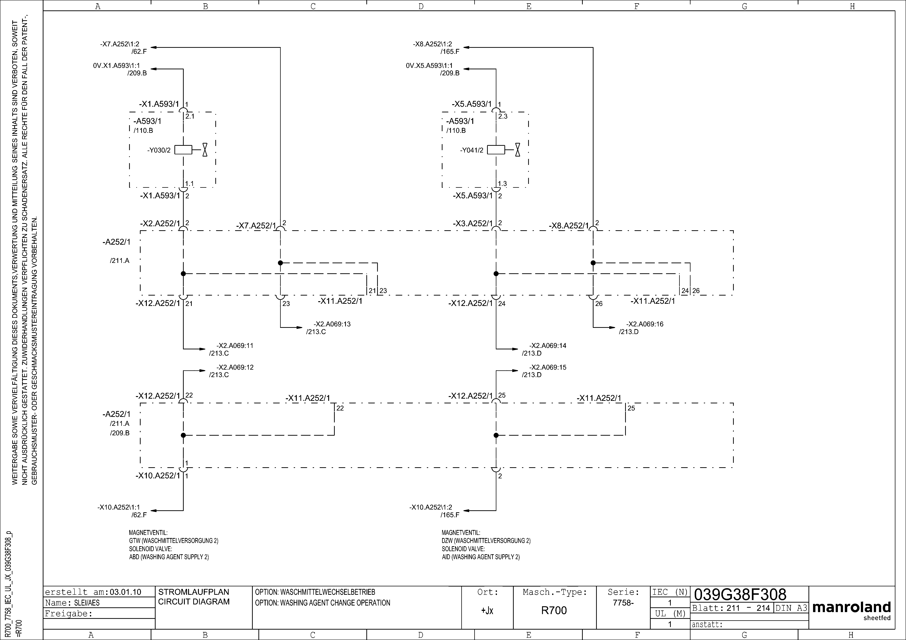

# +Jx — Sheet 211 of 214 — OPTION: WASCHMITTELWECHSELBETRIEB

**OPTION: WASHING AGENT CHANGE OPERATION**

> Part of the manroland **R700** printing press IEC/UL circuit diagrams.
> Drawing class: **Stromlaufplan / Circuit diagram** (DIN A3).
> Document `+Jx` covers the **1st printing module + feed register** machine section.

## At a glance

| Field | Value |
|---|---|
| Document | `+Jx`  (039G38F308) |
| Sheet | **211** of 214 |
| Section (DE) | OPTION: WASCHMITTELWECHSELBETRIEB |
| Section (EN) | OPTION: WASHING AGENT CHANGE OPERATION |
| Section type | CIRCUIT — Circuit diagram |
| Machine type | `R700` |
| Series | `7758` |
| Created | 03.01.10 |
| Replaces | — |
| Columns used | A, B, C, D, E, F, G |
| Path numbers | — |
| Labels on sheet | 85 |
| Cross-refs out | 17 |
| Cross-refs in | 39 |

**Previous:** [+Jx sheet 210](SHEET_0210.md) · **Next:** [+Jx sheet 212](SHEET_0212.md) · **Document TOC:** [_TOC.md](_TOC.md)  (+Jx) · **Master TOC:** [all sheets](../_MASTER_TOC.md)

## Sheet image (300 DPI, exact vector render)



_Rendered directly from the PDF vector layer at 300 DPI (1-bit), no OCR and no resampling. Use it to confirm anything ambiguous in the text below._

## Cross-references on this sheet

Each entry is a wire leaving this sheet. The printed token is `/sheet.column`; the link resolves to that sheet inside the same document.

| Ref | Target sheet | Col | Path | Destination on target | Target section | From col |
|---|---|---|---|---|---|---|
| `/62.F` | [+Jx sheet 62](SHEET_0062.md) | F | — | X7.A252\1:2 | GTW | A |
| `/165.F` | [+Jx sheet 165](SHEET_0165.md) | F | — | X8.A252\1:2 | OPTION: | D |
| `/209.B` | [+Jx sheet 209](SHEET_0209.md) | B | — | 0V.X1.A593\1:1 | OPTION: WASCHMITTELWECHSELBETRIEB | A |
| `/209.B` | [+Jx sheet 209](SHEET_0209.md) | B | — | 0V.X5.A593\1:1 | OPTION: WASCHMITTELWECHSELBETRIEB | D |
| `/110.B` | [+Jx sheet 110](SHEET_0110.md) | B | — | A593/1 | REFERENZMODUL | A |
| `/110.B` | [+Jx sheet 110](SHEET_0110.md) | B | — | A593/1 | REFERENZMODUL | D |
| `/211.A` | [+Jx sheet 211](SHEET_0211.md) | A | — | — | OPTION: WASCHMITTELWECHSELBETRIEB | A |
| `/213.C` | [+Jx sheet 213](SHEET_0213.md) | C | — | — | OPTION: WASCHMITTELWECHSELBETRIEB | C |
| `/213.D` | [+Jx sheet 213](SHEET_0213.md) | D | — | — | OPTION: WASCHMITTELWECHSELBETRIEB | F |
| `/213.C` | [+Jx sheet 213](SHEET_0213.md) | C | — | — | OPTION: WASCHMITTELWECHSELBETRIEB | B |
| `/213.D` | [+Jx sheet 213](SHEET_0213.md) | D | — | — | OPTION: WASCHMITTELWECHSELBETRIEB | E |
| `/213.C` | [+Jx sheet 213](SHEET_0213.md) | C | — | — | OPTION: WASCHMITTELWECHSELBETRIEB | B |
| `/213.D` | [+Jx sheet 213](SHEET_0213.md) | D | — | — | OPTION: WASCHMITTELWECHSELBETRIEB | E |
| `/211.A` | [+Jx sheet 211](SHEET_0211.md) | A | — | — | OPTION: WASCHMITTELWECHSELBETRIEB | A |
| `/209.B` | [+Jx sheet 209](SHEET_0209.md) | B | — | — | OPTION: WASCHMITTELWECHSELBETRIEB | A |
| `/62.F` | [+Jx sheet 62](SHEET_0062.md) | F | — | X10.A252\1:1 X10.A252\1:2 | GTW | C |
| `/165.F` | [+Jx sheet 165](SHEET_0165.md) | F | — | X10.A252\1:1 X10.A252\1:2 | OPTION: | C |

### Incoming references (sheets that point here)

Every other sheet that sends a wire to this one. `Back-ref` is the token printed on *that* sheet; `Path` is its line number.

| From sheet | Cols | Back-ref | Path | Refs | What continues there |
|---|---|---|---|---|---|
| [+Jx#62](SHEET_0062.md) | F | `/62.F` | — | 2 | — |
| [+Jx#110](SHEET_0110.md) | B | `/110.B` | — | 2 | — |
| [+Jx#115](SHEET_0115.md) | B | `/115.B` | — | 2 | — |
| [+Jx#124](SHEET_0124.md) | C | `/124.C` | — | 1 | — |
| [+Jx#127](SHEET_0127.md) | F | `/127.F` | — | 1 | — |
| [+Jx#132](SHEET_0132.md) | D | `/132.D` | — | 2 | — |
| [+Jx#133](SHEET_0133.md) | A, F | `/133.A`, `/133.F` | — | 2 | — |
| [+Jx#135](SHEET_0135.md) | A | `/135.A` | — | 2 | — |
| [+Jx#136](SHEET_0136.md) | D | `/136.D` | — | 6 | — |
| [+Jx#137](SHEET_0137.md) | D | `/137.D` | — | 6 | — |
| [+Jx#165](SHEET_0165.md) | F | `/165.F` | — | 2 | — |
| [+Jx#209](SHEET_0209.md) | B | `/209.B` | — | 3 | — |
| [+Jx#211](SHEET_0211.md) | A | `/211.A` | — | 2 | — |
| [+Jx#213](SHEET_0213.md) | B, D | `/213.B`, `/213.D` | — | 6 | X2.A069:11; X2.A069:12; X2.A069:13; X2.A069:14; X2.A069:15; X2.A069:16 |


## Devices on this sheet

| Tag | Class | Class meaning (IEC) | Col | Sub | Terminal | Sign |
|---|---|---|---|---|---|---|
| `A252/1` | A | Baugruppe / assembly, module, PC board | A | 1 | — | — |
| `A252/1` | A | Baugruppe / assembly, module, PC board | A | 1 | — | — |
| `Y030/2` | Y | Magnetventil / solenoid valve, actuator | B | 2 | — | — |
| `A593/1` | A | Baugruppe / assembly, module, PC board | A | 1 | — | — |
| `Y041/2` | Y | Magnetventil / solenoid valve, actuator | D | 2 | — | — |
| `A593/1` | A | Baugruppe / assembly, module, PC board | D | 1 | — | — |
| `2.1` | — | cross-device reference | B | — | — | — |
| `1.1` | — | cross-device reference | B | — | — | — |
| `2.3` | — | cross-device reference | E | — | — | — |
| `1.3` | — | cross-device reference | E | — | — | — |
| `X2.A069:11` | — | cross-device reference | B | — | 11 | — |
| `X2.A069:12` | — | cross-device reference | B | — | 12 | — |
| `X2.A069:13` | — | cross-device reference | C | — | 13 | — |
| `X2.A069:14` | — | cross-device reference | E | — | 14 | — |
| `X7.A252\1:2` | — | cross-device reference | A | — | 2 | — |
| `X2.A069:15` | — | cross-device reference | E | — | 15 | — |
| `X2.A069:16` | — | cross-device reference | F | — | 16 | — |
| `X8.A252\1:2` | — | cross-device reference | D | — | 2 | — |
| `X10.A252\1:2` | — | cross-device reference | D | — | 2 | — |
| `X10.A252\1:1` | — | cross-device reference | A | — | 1 | — |

## Potentials / nets

| Potential | Count | Columns | Attached devices | Terminals |
|---|---|---|---|---|
| `0V` | 2 | A, D | `A593\1`, `X1`, `X5` | `1` |


A potential such as `L24+/4` or `M24+` is a named supply/return rail; every place it appears on this sheet is electrically common.

## Wire-end annotations (grouped as printed)

A wire that continues elsewhere is annotated with a small cluster: the destination description, the path/line number `#NN`, and the `/sheet.column` cross reference. Each row below is one such cluster exactly as it is grouped on the drawing.

| Col | Y | Path | Cross-ref | Text on the wire |
|---|---|---|---|---|
| A | 54.1 | — | `/62.F` | `X7.A252\1:2` |
| D | 54.1 | — | `/165.F` | `X8.A252\1:2` |
| A | 82.4 | — | `/209.B` | `0V.X1.A593\1:1` |
| D | 82.4 | — | `/209.B` | `0V.X5.A593\1:1` |
| B | 132.1 | — | — | `X1.A593/1 1` |
| E | 132.1 | — | — | `X5.A593/1 1` |
| B | 149.1 | — | — | `2.1` |
| E | 149.1 | — | — | `2.3` |
| A | 154.7 | — | `/110.B` | `A593/1` |
| D | 154.7 | — | `/110.B` | `A593/1` |
| B | 193.7 | — | — | `Y030/2` |
| D | 193.7 | — | — | `Y041/2` |
| B | 237.6 | — | — | `1.1` |
| E | 237.6 | — | — | `1.3` |
| B | 252.5 | — | — | `X1.A593/1 2` |
| E | 252.5 | — | — | `X5.A593/1 2` |
| B | 289.4 | — | — | `X2.A252/1 2` |
| C | 289.4 | — | — | `X7.A252/1 2` |
| E | 289.4 | — | — | `X3.A252/1 2` |
| E | 289.4 | — | — | `X8.A252/1 2` |
| A | 313.5 | — | — | `A252/1` |
| A | 338.9 | — | `/211.A` | — |
| D | 378.7 | — | — | `21 23` |
| G | 378.7 | — | — | `24 26` |
| C | 391.4 | — | — | `X11.A252/1` |
| F | 391.4 | — | — | `X11.A252/1` |
| B | 394.3 | — | — | `X12.A252/1 21` |
| E | 394.3 | — | — | `X12.A252/1 24` |
| C | 395.7 | — | — | `23` |
| F | 395.7 | — | — | `26` |
| C | 422.6 | — | — | `X2.A069:13` |
| F | 422.6 | — | — | `X2.A069:16` |
| C | 432.5 | — | `/213.C` | — |
| F | 432.5 | — | `/213.D` | — |
| B | 450.9 | — | — | `X2.A069:11` |
| E | 450.9 | — | — | `X2.A069:14` |
| B | 460.9 | — | `/213.C` | — |
| E | 460.9 | — | `/213.D` | — |
| B | 479.3 | — | — | `X2.A069:12` |
| E | 479.3 | — | — | `X2.A069:15` |
| B | 489.2 | — | `/213.C` | — |
| E | 489.2 | — | `/213.D` | — |
| B | 516.1 | — | — | `X12.A252/1 22` |
| E | 516.1 | — | — | `X12.A252/1 25` |
| C | 519.0 | — | — | `X11.A252/1` |
| F | 519.0 | — | — | `X11.A252/1` |
| C | 533.2 | — | — | `22` |
| F | 533.2 | — | — | `25` |
| A | 540.2 | — | — | `A252/1` |
| A | 553.3 | — | `/211.A`, `/209.B` | — |
| B | 605.5 | — | — | `1` |
| B | 621.0 | — | — | `X10.A252/1 1` |
| E | 622.5 | — | — | `2` |
| C | 663.5 | — | `/62.F`, `/165.F` | `X10.A252\1:1 X10.A252\1:2` |
| B | 697.9 | — | — | `MAGNETVENTIL: GTW (WASCHMITTELVERSORGUNG 2) SOLENOID VALVE: ABD (WASHING AGENT SUPPLY 2)` |
| E | 697.9 | — | — | `MAGNETVENTIL: DZW (WASCHMITTELVERSORGUNG 2) SOLENOID VALVE: AID (WASHING AGENT SUPPLY 2)` |


## Reconstructed tables

This sheet carries tabular content (pin map / terminal assignment / index). The grid below was rebuilt from the drawing's own rule lines, so each row is exactly one physical row of the table.

### Table 1 — 0 data rows × 2 columns (at x=368.5, y=62.4) — **2**

_none_


### Table 2 — 0 data rows × 2 columns (at x=779.5, y=62.4) — **2**

_none_


## Notes and free text on this sheet

| Text | Col | Y (pt) |
|---|---|---|
| `X2.A252/1` | B | 289.38 |
| `X12.A252/1` | B | 394.26 |
| `X10.A252/1` | B | 621.03 |
| `MAGNETVENTIL:` | A | 697.89 |
| `GTW (WASCHMITTELVERSORGUNG 2)` | B | 708.52 |
| `SOLENOID VALVE:` | A | 719.15 |
| `ABD (WASHING AGENT SUPPLY 2)` | B | 729.79 |
| `X1.A593/1` | B | 132.06 |
| `X7.A252/1` | B | 292.21 |
| `X3.A252/1` | D | 289.38 |
| `X12.A252/1` | D | 394.26 |
| `MAGNETVENTIL:` | D | 697.89 |
| `DZW (WASCHMITTELVERSORGUNG 2)` | E | 708.52 |
| `SOLENOID VALVE:` | D | 719.15 |
| `AID (WASHING AGENT SUPPLY 2)` | E | 729.78 |
| `X5.A593/1` | D | 132.06 |
| `X8.A252/1` | E | 292.21 |
| `X11.A252/1` | C | 518.98 |
| `X11.A252/1` | F | 518.98 |

## Complete label inventory (exact text from the drawing)

Every text object inside the drawing area of this sheet, in DIN reading order (column A→H, then top→bottom). This is the authoritative list: if a string is not here it is not printed on this sheet.

| Col | Y | X | Dir | Type | Text |
|---|---|---|---|---|---|
| A | 54.1 | 131.8 | → | device ref | `X7.A252\1:2` |
| A | 64.0 | 172.9 | → | cross-reference | `/62.F` |
| A | 82.4 | 122.5 | → | potential | `0V.X1.A593\1:1` |
| A | 92.3 | 167.5 | → | cross-reference | `/209.B` |
| A | 154.7 | 175.5 | → | device tag | `A593/1` |
| A | 167.8 | 175.7 | → | cross-reference | `/110.B` |
| A | 313.5 | 134.9 | → | device tag | `A252/1` |
| A | 338.9 | 144.6 | → | cross-reference | `/211.A` |
| A | 540.2 | 134.9 | → | device tag | `A252/1` |
| A | 553.3 | 144.6 | → | cross-reference | `/211.A` |
| A | 565.7 | 144.9 | → | cross-reference | `/209.B` |
| A | 663.5 | 128.1 | → | device ref | `X10.A252\1:1` |
| A | 673.4 | 172.9 | → | cross-reference | `/62.F` |
| A | 697.9 | 169.5 | → | text | `MAGNETVENTIL:` |
| A | 719.1 | 169.8 | → | text | `SOLENOID VALVE:` |
| B | 132.1 | 182.8 | → | text | `X1.A593/1` |
| B | 133.5 | 242.9 | → | number | `1` |
| B | 149.0 | 243.8 | → | device ref | `2.1` |
| B | 193.7 | 193.6 | → | device tag | `Y030/2` |
| B | 237.6 | 242.9 | → | device ref | `1.1` |
| B | 252.5 | 184.3 | → | text | `X1.A593/1` |
| B | 254.0 | 243.8 | → | number | `2` |
| B | 289.4 | 184.3 | → | text | `X2.A252/1` |
| B | 289.4 | 243.8 | → | number | `2` |
| B | 292.2 | 310.4 | → | text | `X7.A252/1` |
| B | 394.3 | 178.3 | → | text | `X12.A252/1` |
| B | 395.7 | 243.8 | → | number | `21` |
| B | 450.9 | 284.6 | → | device ref | `X2.A069:11` |
| B | 460.9 | 275.0 | → | cross-reference | `/213.C` |
| B | 479.3 | 284.6 | → | device ref | `X2.A069:12` |
| B | 489.2 | 275.0 | → | cross-reference | `/213.C` |
| B | 516.1 | 178.3 | → | text | `X12.A252/1` |
| B | 516.2 | 243.8 | → | number | `22` |
| B | 605.5 | 242.9 | → | number | `1` |
| B | 621.0 | 178.3 | → | text | `X10.A252/1` |
| B | 622.5 | 242.9 | → | number | `1` |
| B | 708.5 | 169.8 | → | text | `GTW (WASCHMITTELVERSORGUNG 2)` |
| B | 729.8 | 170.1 | → | text | `ABD (WASHING AGENT SUPPLY 2)` |
| C | 289.4 | 371.3 | → | number | `2` |
| C | 391.4 | 417.8 | → | text | `X11.A252/1` |
| C | 395.7 | 371.3 | → | number | `23` |
| C | 422.6 | 412.2 | → | device ref | `X2.A069:13` |
| C | 432.5 | 402.5 | → | cross-reference | `/213.C` |
| C | 519.0 | 375.3 | → | text | `X11.A252/1` |
| C | 533.2 | 442.2 | → | number | `22` |
| D | 54.1 | 542.8 | → | device ref | `X8.A252\1:2` |
| D | 64.0 | 579.1 | → | cross-reference | `/165.F` |
| D | 82.4 | 533.5 | → | potential | `0V.X5.A593\1:1` |
| D | 92.3 | 578.6 | → | cross-reference | `/209.B` |
| D | 132.1 | 593.9 | → | text | `X5.A593/1` |
| D | 154.7 | 586.5 | → | device tag | `A593/1` |
| D | 167.8 | 586.8 | → | cross-reference | `/110.B` |
| D | 193.7 | 604.6 | → | device tag | `Y041/2` |
| D | 252.5 | 595.3 | → | text | `X5.A593/1` |
| D | 289.4 | 595.3 | → | text | `X3.A252/1` |
| D | 378.7 | 484.7 | → | number | `21 23` |
| D | 394.3 | 589.3 | → | text | `X12.A252/1` |
| D | 516.1 | 589.3 | → | text | `X12.A252/1` |
| D | 663.5 | 538.0 | → | device ref | `X10.A252\1:2` |
| D | 673.4 | 579.1 | → | cross-reference | `/165.F` |
| D | 697.9 | 580.5 | → | text | `MAGNETVENTIL:` |
| D | 719.1 | 580.8 | → | text | `SOLENOID VALVE:` |
| E | 133.5 | 654.0 | → | number | `1` |
| E | 149.0 | 654.8 | → | device ref | `2.3` |
| E | 237.6 | 654.0 | → | device ref | `1.3` |
| E | 254.0 | 654.8 | → | number | `2` |
| E | 289.4 | 654.8 | → | number | `2` |
| E | 292.2 | 721.4 | → | text | `X8.A252/1` |
| E | 395.7 | 654.8 | → | number | `24` |
| E | 450.9 | 695.6 | → | device ref | `X2.A069:14` |
| E | 460.9 | 686.0 | → | cross-reference | `/213.D` |
| E | 479.3 | 695.6 | → | device ref | `X2.A069:15` |
| E | 489.2 | 686.0 | → | cross-reference | `/213.D` |
| E | 516.2 | 654.8 | → | number | `25` |
| E | 622.5 | 654.8 | → | number | `2` |
| E | 708.5 | 580.5 | → | text | `DZW (WASCHMITTELVERSORGUNG 2)` |
| E | 729.8 | 581.1 | → | text | `AID (WASHING AGENT SUPPLY 2)` |
| F | 289.4 | 782.4 | → | number | `2` |
| F | 391.4 | 828.9 | → | text | `X11.A252/1` |
| F | 395.7 | 782.4 | → | number | `26` |
| F | 422.6 | 823.2 | → | device ref | `X2.A069:16` |
| F | 432.5 | 813.5 | → | cross-reference | `/213.D` |
| F | 519.0 | 758.0 | → | text | `X11.A252/1` |
| F | 533.2 | 824.9 | → | number | `25` |
| G | 378.7 | 895.7 | → | number | `24 26` |

## Reading-order text block

The same content as a plain block, grouped by DIN column — convenient to paste or to match against a visual description.

```text
=== Column A ===
  54.1  131.8  devref       X7.A252\1:2
  64.0  172.9  xref         /62.F
  82.4  122.5  net          0V.X1.A593\1:1
  92.3  167.5  xref         /209.B
 154.7  175.5  devtag       A593/1
 167.8  175.7  xref         /110.B
 313.5  134.9  devtag       A252/1
 338.9  144.6  xref         /211.A
 540.2  134.9  devtag       A252/1
 553.3  144.6  xref         /211.A
 565.7  144.9  xref         /209.B
 663.5  128.1  devref       X10.A252\1:1
 673.4  172.9  xref         /62.F
 697.9  169.5  text         MAGNETVENTIL:
 719.1  169.8  text         SOLENOID VALVE:
=== Column B ===
 132.1  182.8  text         X1.A593/1
 133.5  242.9  numeric      1
 149.0  243.8  devref       2.1
 193.7  193.6  devtag       Y030/2
 237.6  242.9  devref       1.1
 252.5  184.3  text         X1.A593/1
 254.0  243.8  numeric      2
 289.4  184.3  text         X2.A252/1
 289.4  243.8  numeric      2
 292.2  310.4  text         X7.A252/1
 394.3  178.3  text         X12.A252/1
 395.7  243.8  numeric      21
 450.9  284.6  devref       X2.A069:11
 460.9  275.0  xref         /213.C
 479.3  284.6  devref       X2.A069:12
 489.2  275.0  xref         /213.C
 516.1  178.3  text         X12.A252/1
 516.2  243.8  numeric      22
 605.5  242.9  numeric      1
 621.0  178.3  text         X10.A252/1
 622.5  242.9  numeric      1
 708.5  169.8  text         GTW (WASCHMITTELVERSORGUNG 2)
 729.8  170.1  text         ABD (WASHING AGENT SUPPLY 2)
=== Column C ===
 289.4  371.3  numeric      2
 391.4  417.8  text         X11.A252/1
 395.7  371.3  numeric      23
 422.6  412.2  devref       X2.A069:13
 432.5  402.5  xref         /213.C
 519.0  375.3  text         X11.A252/1
 533.2  442.2  numeric      22
=== Column D ===
  54.1  542.8  devref       X8.A252\1:2
  64.0  579.1  xref         /165.F
  82.4  533.5  net          0V.X5.A593\1:1
  92.3  578.6  xref         /209.B
 132.1  593.9  text         X5.A593/1
 154.7  586.5  devtag       A593/1
 167.8  586.8  xref         /110.B
 193.7  604.6  devtag       Y041/2
 252.5  595.3  text         X5.A593/1
 289.4  595.3  text         X3.A252/1
 378.7  484.7  numeric      21 23
 394.3  589.3  text         X12.A252/1
 516.1  589.3  text         X12.A252/1
 663.5  538.0  devref       X10.A252\1:2
 673.4  579.1  xref         /165.F
 697.9  580.5  text         MAGNETVENTIL:
 719.1  580.8  text         SOLENOID VALVE:
=== Column E ===
 133.5  654.0  numeric      1
 149.0  654.8  devref       2.3
 237.6  654.0  devref       1.3
 254.0  654.8  numeric      2
 289.4  654.8  numeric      2
 292.2  721.4  text         X8.A252/1
 395.7  654.8  numeric      24
 450.9  695.6  devref       X2.A069:14
 460.9  686.0  xref         /213.D
 479.3  695.6  devref       X2.A069:15
 489.2  686.0  xref         /213.D
 516.2  654.8  numeric      25
 622.5  654.8  numeric      2
 708.5  580.5  text         DZW (WASCHMITTELVERSORGUNG 2)
 729.8  581.1  text         AID (WASHING AGENT SUPPLY 2)
=== Column F ===
 289.4  782.4  numeric      2
 391.4  828.9  text         X11.A252/1
 395.7  782.4  numeric      26
 422.6  823.2  devref       X2.A069:16
 432.5  813.5  xref         /213.D
 519.0  758.0  text         X11.A252/1
 533.2  824.9  numeric      25
=== Column G ===
 378.7  895.7  numeric      24 26
```

---
_Generated from the PDF vector text layer; no OCR. Source: `R700_7758_IEC_UL_JX_039G38F308_p`, sheet 211._
