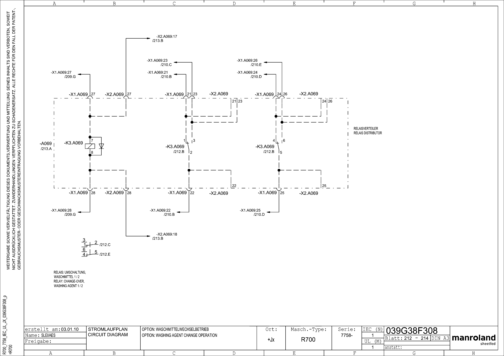

# +Jx — Sheet 212 of 214 — OPTION: WASCHMITTELWECHSELBETRIEB

**OPTION: WASHING AGENT CHANGE OPERATION**

> Part of the manroland **R700** printing press IEC/UL circuit diagrams.
> Drawing class: **Stromlaufplan / Circuit diagram** (DIN A3).
> Document `+Jx` covers the **1st printing module + feed register** machine section.

## At a glance

| Field | Value |
|---|---|
| Document | `+Jx`  (039G38F308) |
| Sheet | **212** of 214 |
| Section (DE) | OPTION: WASCHMITTELWECHSELBETRIEB |
| Section (EN) | OPTION: WASHING AGENT CHANGE OPERATION |
| Section type | CIRCUIT — Circuit diagram |
| Machine type | `R700` |
| Series | `7758` |
| Created | 03.01.10 |
| Replaces | — |
| Columns used | A, B, C, D, E, F |
| Path numbers | — |
| Labels on sheet | 75 |
| Cross-refs out | 15 |
| Cross-refs in | 31 |

**Previous:** [+Jx sheet 211](SHEET_0211.md) · **Next:** [+Jx sheet 213](SHEET_0213.md) · **Document TOC:** [_TOC.md](_TOC.md)  (+Jx) · **Master TOC:** [all sheets](../_MASTER_TOC.md)

## Sheet image (300 DPI, exact vector render)



_Rendered directly from the PDF vector layer at 300 DPI (1-bit), no OCR and no resampling. Use it to confirm anything ambiguous in the text below._

## Cross-references on this sheet

Each entry is a wire leaving this sheet. The printed token is `/sheet.column`; the link resolves to that sheet inside the same document.

| Ref | Target sheet | Col | Path | Destination on target | Target section | From col |
|---|---|---|---|---|---|---|
| `/213.B` | [+Jx sheet 213](SHEET_0213.md) | B | — | — | OPTION: WASCHMITTELWECHSELBETRIEB | C |
| `/210.C` | [+Jx sheet 210](SHEET_0210.md) | C | — | X1.A069:23 | OPTION: WASCHMITTELWECHSELBETRIEB | C |
| `/210.E` | [+Jx sheet 210](SHEET_0210.md) | E | — | X1.A069:26 | OPTION: WASCHMITTELWECHSELBETRIEB | D |
| `/209.G` | [+Jx sheet 209](SHEET_0209.md) | G | — | X1.A069:27 | OPTION: WASCHMITTELWECHSELBETRIEB | A |
| `/210.B` | [+Jx sheet 210](SHEET_0210.md) | B | — | X1.A069:21 | OPTION: WASCHMITTELWECHSELBETRIEB | C |
| `/210.D` | [+Jx sheet 210](SHEET_0210.md) | D | — | X1.A069:24 | OPTION: WASCHMITTELWECHSELBETRIEB | D |
| `/213.A` | [+Jx sheet 213](SHEET_0213.md) | A | — | — | OPTION: WASCHMITTELWECHSELBETRIEB | A |
| `/212.B` | [+Jx sheet 212](SHEET_0212.md) | B | — | — | OPTION: WASCHMITTELWECHSELBETRIEB | C |
| `/212.B` | [+Jx sheet 212](SHEET_0212.md) | B | — | — | OPTION: WASCHMITTELWECHSELBETRIEB | E |
| `/209.G` | [+Jx sheet 209](SHEET_0209.md) | G | — | X1.A069:28 | OPTION: WASCHMITTELWECHSELBETRIEB | A |
| `/210.B` | [+Jx sheet 210](SHEET_0210.md) | B | — | X1.A069:22 | OPTION: WASCHMITTELWECHSELBETRIEB | C |
| `/210.D` | [+Jx sheet 210](SHEET_0210.md) | D | — | X1.A069:25 | OPTION: WASCHMITTELWECHSELBETRIEB | D |
| `/213.B` | [+Jx sheet 213](SHEET_0213.md) | B | — | — | OPTION: WASCHMITTELWECHSELBETRIEB | C |
| `/212.C` | [+Jx sheet 212](SHEET_0212.md) | C | — | — | OPTION: WASCHMITTELWECHSELBETRIEB | B |
| `/212.E` | [+Jx sheet 212](SHEET_0212.md) | E | — | — | OPTION: WASCHMITTELWECHSELBETRIEB | B |

### Incoming references (sheets that point here)

Every other sheet that sends a wire to this one. `Back-ref` is the token printed on *that* sheet; `Path` is its line number.

| From sheet | Cols | Back-ref | Path | Refs | What continues there |
|---|---|---|---|---|---|
| [+Jx#112](SHEET_0112.md) | F | `/112.F` | — | 8 | — |
| [+Jx#123](SHEET_0123.md) | D | `/123.D` | — | 8 | — |
| [+Jx#209](SHEET_0209.md) | G | `/209.G` | — | 2 | — |
| [+Jx#210](SHEET_0210.md) | B, C, D, E | `/210.B`, `/210.C`, `/210.D`, `/210.E` | — | 6 | — |
| [+Jx#212](SHEET_0212.md) | B, C, E | `/212.B`, `/212.C`, `/212.E` | — | 4 | — |
| [+Jx#213](SHEET_0213.md) | A | `/213.A` | — | 3 | X2.A069:17; X2.A069:18 |


## Devices on this sheet

| Tag | Class | Class meaning (IEC) | Col | Sub | Terminal | Sign |
|---|---|---|---|---|---|---|
| `A069` | A | Baugruppe / assembly, module, PC board | A | — | — | — |
| `K3.A069` | — | cross-device reference | A | — | — | — |
| `X1.A069` | — | cross-device reference | A | — | — | — |
| `X2.A069` | — | cross-device reference | B | — | — | — |
| `X1.A069` | — | cross-device reference | A | — | — | — |
| `X2.A069` | — | cross-device reference | B | — | — | — |
| `K3.A069` | — | cross-device reference | C | — | — | — |
| `X1.A069` | — | cross-device reference | C | — | — | — |
| `X1.A069` | — | cross-device reference | C | — | — | — |
| `K3.A069` | — | cross-device reference | E | — | — | — |
| `X1.A069` | — | cross-device reference | E | — | — | — |
| `X1.A069` | — | cross-device reference | E | — | — | — |
| `X2.A069:18` | — | cross-device reference | C | — | 18 | — |
| `X2.A069:17` | — | cross-device reference | C | — | 17 | — |
| `X1.A069:28` | — | cross-device reference | A | — | 28 | — |
| `X1.A069:27` | — | cross-device reference | A | — | 27 | — |
| `X1.A069:26` | — | cross-device reference | D | — | 26 | — |
| `X1.A069:21` | — | cross-device reference | C | — | 21 | — |
| `X1.A069:22` | — | cross-device reference | C | — | 22 | — |
| `X1.A069:23` | — | cross-device reference | C | — | 23 | — |
| `X1.A069:25` | — | cross-device reference | D | — | 25 | — |
| `X1.A069:24` | — | cross-device reference | D | — | 24 | — |
| `X2.A069` | — | cross-device reference | D | — | — | — |
| `X2.A069` | — | cross-device reference | D | — | — | — |
| `X2.A069` | — | cross-device reference | E | — | — | — |
| `X2.A069` | — | cross-device reference | E | — | — | — |

## Potentials / nets

_No named potentials on this sheet._

## Wire-end annotations (grouped as printed)

A wire that continues elsewhere is annotated with a small cluster: the destination description, the path/line number `#NN`, and the `/sheet.column` cross reference. Each row below is one such cluster exactly as it is grouped on the drawing.

| Col | Y | Path | Cross-ref | Text on the wire |
|---|---|---|---|---|
| C | 82.4 | — | — | `X2.A069:17` |
| C | 92.3 | — | `/213.B` | — |
| C | 139.1 | — | `/210.C` | `X1.A069:23` |
| D | 139.1 | — | `/210.E` | `X1.A069:26` |
| A | 167.5 | — | `/209.G` | `X1.A069:27` |
| C | 167.5 | — | `/210.B` | `X1.A069:21` |
| D | 167.5 | — | `/210.D` | `X1.A069:24` |
| D | 217.1 | — | — | `X2.A069` |
| E | 217.1 | — | — | `X2.A069` |
| B | 218.5 | — | — | `X1.A069 27 X2.A069 27` |
| C | 218.5 | — | — | `X1.A069 21 23` |
| E | 218.5 | — | — | `X1.A069 24 26` |
| D | 235.5 | — | — | `21 23` |
| F | 235.5 | — | — | `24 26` |
| F | 301.0 | — | — | `RELAISVERTEILER RELAIS DISTRIBUTOR` |
| B | 328.4 | — | — | `7` |
| C | 328.4 | — | — | `K3.A069 3` |
| C | 328.4 | — | — | `1` |
| E | 328.4 | — | — | `K3.A069 6` |
| E | 328.4 | — | — | `4` |
| A | 333.3 | — | — | `K3.A069` |
| A | 334.7 | — | — | `A069` |
| A | 347.8 | — | `/213.A` | — |
| C | 354.9 | — | `/212.B` | — |
| E | 354.9 | — | `/212.B` | — |
| B | 356.7 | — | — | `8` |
| C | 356.7 | — | — | `2` |
| E | 356.7 | — | — | `5` |
| D | 435.4 | — | — | `22` |
| F | 435.4 | — | — | `25` |
| B | 450.9 | — | — | `X1.A069 28 X2.A069 28` |
| C | 450.9 | — | — | `X1.A069 22` |
| E | 450.9 | — | — | `X1.A069 25` |
| D | 452.4 | — | — | `X2.A069` |
| E | 452.4 | — | — | `X2.A069` |
| A | 493.5 | — | `/209.G` | `X1.A069:28` |
| C | 493.5 | — | `/210.B` | `X1.A069:22` |
| D | 493.5 | — | `/210.D` | `X1.A069:25` |
| C | 550.1 | — | — | `X2.A069:18` |
| C | 560.0 | — | `/213.B` | — |
| B | 562.9 | — | — | `3 6 4 1` |
| B | 568.5 | — | — | `2` |
| B | 575.0 | — | `/212.C` | — |
| B | 591.2 | — | — | `5` |
| B | 597.6 | — | `/212.E` | — |
| A | 641.2 | — | — | `RELAIS: UMSCHALTUNG,` |
| A | 651.8 | — | — | `RELAY: CHANGE OVER, WASCHMITTEL 1 / 2` |
| A | 673.1 | — | — | `WASHING AGENT 1 / 2` |


## Reconstructed tables

This sheet carries tabular content (pin map / terminal assignment / index). The grid below was rebuilt from the drawing's own rule lines, so each row is exactly one physical row of the table.

### Table 1 — 2 data rows × 2 columns (at x=212.6, y=90.7)

| 27 | X2.A069 |
|---|---|
| `7 8` |  |
| `28` | `X2.A069` |


## Notes and free text on this sheet

| Text | Col | Y (pt) |
|---|---|---|
| `RELAIS: UMSCHALTUNG,` | A | 641.21 |
| `WASCHMITTEL 1 / 2` | A | 651.82 |
| `RELAY: CHANGE OVER,` | A | 662.47 |
| `WASHING AGENT 1 / 2` | A | 673.08 |
| `RELAISVERTEILER` | F | 301.04 |
| `RELAIS DISTRIBUTOR` | F | 311.68 |

## Complete label inventory (exact text from the drawing)

Every text object inside the drawing area of this sheet, in DIN reading order (column A→H, then top→bottom). This is the authoritative list: if a string is not here it is not printed on this sheet.

| Col | Y | X | Dir | Type | Text |
|---|---|---|---|---|---|
| A | 167.5 | 120.2 | → | device ref | `X1.A069:27` |
| A | 177.4 | 152.5 | → | cross-reference | `/209.G` |
| A | 218.5 | 163.0 | → | device ref | `X1.A069` |
| A | 333.3 | 151.7 | → | device ref | `K3.A069` |
| A | 334.7 | 93.8 | → | device tag | `A069` |
| A | 347.8 | 96.4 | → | cross-reference | `/213.A` |
| A | 450.9 | 163.0 | → | device ref | `X1.A069` |
| A | 493.5 | 120.2 | → | device ref | `X1.A069:28` |
| A | 503.4 | 152.5 | → | cross-reference | `/209.G` |
| A | 562.9 | 195.6 | → | number | `3` |
| A | 585.6 | 195.6 | → | number | `6` |
| A | 596.9 | 195.6 | → | number | `4` |
| A | 641.2 | 127.0 | → | text | `RELAIS: UMSCHALTUNG,` |
| A | 651.8 | 127.6 | → | text | `WASCHMITTEL 1 / 2` |
| A | 662.5 | 127.0 | → | text | `RELAY: CHANGE OVER,` |
| A | 673.1 | 127.6 | → | text | `WASHING AGENT 1 / 2` |
| B | 218.5 | 215.4 | → | number | `27` |
| B | 218.5 | 248.0 | → | device ref | `X2.A069` |
| B | 218.5 | 300.5 | → | number | `27` |
| B | 328.4 | 215.1 | → | number | `7` |
| B | 356.7 | 215.1 | → | number | `8` |
| B | 450.9 | 248.0 | → | device ref | `X2.A069` |
| B | 452.4 | 215.4 | → | number | `28` |
| B | 452.4 | 300.5 | → | number | `28` |
| B | 568.5 | 223.7 | → | number | `2` |
| B | 574.2 | 197.3 | → | number | `1` |
| B | 575.0 | 235.3 | → | cross-reference | `/212.C` |
| B | 591.2 | 223.7 | → | number | `5` |
| B | 597.6 | 235.3 | → | cross-reference | `/212.E` |
| C | 82.4 | 369.6 | → | device ref | `X2.A069:17` |
| C | 92.3 | 360.0 | → | cross-reference | `/213.B` |
| C | 139.1 | 347.0 | → | device ref | `X1.A069:23` |
| C | 149.1 | 379.8 | → | cross-reference | `/210.C` |
| C | 167.5 | 348.1 | → | device ref | `X1.A069:21` |
| C | 177.4 | 380.1 | → | cross-reference | `/210.B` |
| C | 218.5 | 389.8 | → | device ref | `X1.A069` |
| C | 218.5 | 442.2 | → | number | `21` |
| C | 218.5 | 456.4 | → | number | `23` |
| C | 328.4 | 433.1 | → | number | `1` |
| C | 328.4 | 456.1 | → | number | `3` |
| C | 341.8 | 391.2 | → | device ref | `K3.A069` |
| C | 354.9 | 409.9 | → | cross-reference | `/212.B` |
| C | 356.7 | 449.3 | → | number | `2` |
| C | 450.9 | 396.9 | → | device ref | `X1.A069` |
| C | 452.4 | 449.3 | → | number | `22` |
| C | 493.5 | 354.0 | → | device ref | `X1.A069:22` |
| C | 503.4 | 387.2 | → | cross-reference | `/210.B` |
| C | 550.1 | 369.6 | → | device ref | `X2.A069:18` |
| C | 560.0 | 360.0 | → | cross-reference | `/213.B` |
| D | 139.1 | 559.6 | → | device ref | `X1.A069:26` |
| D | 149.0 | 592.7 | → | cross-reference | `/210.E` |
| D | 167.5 | 559.6 | → | device ref | `X1.A069:24` |
| D | 177.4 | 592.4 | → | cross-reference | `/210.D` |
| D | 217.1 | 494.6 | → | device ref | `X2.A069` |
| D | 235.5 | 548.5 | → | number | `21 23` |
| D | 435.4 | 548.5 | → | number | `22` |
| D | 452.4 | 494.6 | → | device ref | `X2.A069` |
| D | 493.5 | 566.6 | → | device ref | `X1.A069:25` |
| D | 503.4 | 599.5 | → | cross-reference | `/210.D` |
| E | 217.1 | 707.2 | → | device ref | `X2.A069` |
| E | 218.5 | 602.4 | → | device ref | `X1.A069` |
| E | 218.5 | 654.8 | → | number | `24` |
| E | 218.5 | 669.0 | → | number | `26` |
| E | 328.4 | 644.6 | → | number | `4` |
| E | 328.4 | 668.7 | → | number | `6` |
| E | 341.8 | 603.8 | → | device ref | `K3.A069` |
| E | 354.9 | 622.5 | → | cross-reference | `/212.B` |
| E | 356.7 | 661.6 | → | number | `5` |
| E | 450.9 | 609.4 | → | device ref | `X1.A069` |
| E | 452.4 | 661.9 | → | number | `25` |
| E | 452.4 | 707.2 | → | device ref | `X2.A069` |
| F | 235.5 | 761.1 | → | number | `24 26` |
| F | 301.0 | 835.7 | → | text | `RELAISVERTEILER` |
| F | 311.7 | 835.7 | → | text | `RELAIS DISTRIBUTOR` |
| F | 435.4 | 761.1 | → | number | `25` |

## Reading-order text block

The same content as a plain block, grouped by DIN column — convenient to paste or to match against a visual description.

```text
=== Column A ===
 167.5  120.2  devref       X1.A069:27
 177.4  152.5  xref         /209.G
 218.5  163.0  devref       X1.A069
 333.3  151.7  devref       K3.A069
 334.7   93.8  devtag       A069
 347.8   96.4  xref         /213.A
 450.9  163.0  devref       X1.A069
 493.5  120.2  devref       X1.A069:28
 503.4  152.5  xref         /209.G
 562.9  195.6  numeric      3
 585.6  195.6  numeric      6
 596.9  195.6  numeric      4
 641.2  127.0  text         RELAIS: UMSCHALTUNG,
 651.8  127.6  text         WASCHMITTEL 1 / 2
 662.5  127.0  text         RELAY: CHANGE OVER,
 673.1  127.6  text         WASHING AGENT 1 / 2
=== Column B ===
 218.5  215.4  numeric      27
 218.5  248.0  devref       X2.A069
 218.5  300.5  numeric      27
 328.4  215.1  numeric      7
 356.7  215.1  numeric      8
 450.9  248.0  devref       X2.A069
 452.4  215.4  numeric      28
 452.4  300.5  numeric      28
 568.5  223.7  numeric      2
 574.2  197.3  numeric      1
 575.0  235.3  xref         /212.C
 591.2  223.7  numeric      5
 597.6  235.3  xref         /212.E
=== Column C ===
  82.4  369.6  devref       X2.A069:17
  92.3  360.0  xref         /213.B
 139.1  347.0  devref       X1.A069:23
 149.1  379.8  xref         /210.C
 167.5  348.1  devref       X1.A069:21
 177.4  380.1  xref         /210.B
 218.5  389.8  devref       X1.A069
 218.5  442.2  numeric      21
 218.5  456.4  numeric      23
 328.4  433.1  numeric      1
 328.4  456.1  numeric      3
 341.8  391.2  devref       K3.A069
 354.9  409.9  xref         /212.B
 356.7  449.3  numeric      2
 450.9  396.9  devref       X1.A069
 452.4  449.3  numeric      22
 493.5  354.0  devref       X1.A069:22
 503.4  387.2  xref         /210.B
 550.1  369.6  devref       X2.A069:18
 560.0  360.0  xref         /213.B
=== Column D ===
 139.1  559.6  devref       X1.A069:26
 149.0  592.7  xref         /210.E
 167.5  559.6  devref       X1.A069:24
 177.4  592.4  xref         /210.D
 217.1  494.6  devref       X2.A069
 235.5  548.5  numeric      21 23
 435.4  548.5  numeric      22
 452.4  494.6  devref       X2.A069
 493.5  566.6  devref       X1.A069:25
 503.4  599.5  xref         /210.D
=== Column E ===
 217.1  707.2  devref       X2.A069
 218.5  602.4  devref       X1.A069
 218.5  654.8  numeric      24
 218.5  669.0  numeric      26
 328.4  644.6  numeric      4
 328.4  668.7  numeric      6
 341.8  603.8  devref       K3.A069
 354.9  622.5  xref         /212.B
 356.7  661.6  numeric      5
 450.9  609.4  devref       X1.A069
 452.4  661.9  numeric      25
 452.4  707.2  devref       X2.A069
=== Column F ===
 235.5  761.1  numeric      24 26
 301.0  835.7  text         RELAISVERTEILER
 311.7  835.7  text         RELAIS DISTRIBUTOR
 435.4  761.1  numeric      25
```

---
_Generated from the PDF vector text layer; no OCR. Source: `R700_7758_IEC_UL_JX_039G38F308_p`, sheet 212._
