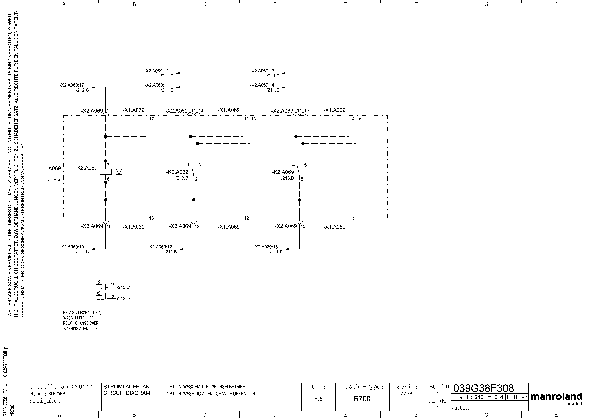

# +Jx — Sheet 213 of 214 — OPTION: WASCHMITTELWECHSELBETRIEB

**OPTION: WASHING AGENT CHANGE OPERATION**

> Part of the manroland **R700** printing press IEC/UL circuit diagrams.
> Drawing class: **Stromlaufplan / Circuit diagram** (DIN A3).
> Document `+Jx` covers the **1st printing module + feed register** machine section.

## At a glance

| Field | Value |
|---|---|
| Document | `+Jx`  (039G38F308) |
| Sheet | **213** of 214 |
| Section (DE) | OPTION: WASCHMITTELWECHSELBETRIEB |
| Section (EN) | OPTION: WASHING AGENT CHANGE OPERATION |
| Section type | CIRCUIT — Circuit diagram |
| Machine type | `R700` |
| Series | `7758` |
| Created | 03.01.10 |
| Replaces | — |
| Columns used | A, B, C, D, E |
| Path numbers | — |
| Labels on sheet | 69 |
| Cross-refs out | 13 |
| Cross-refs in | 29 |

**Previous:** [+Jx sheet 212](SHEET_0212.md) · **Next:** [+Jx sheet 214](SHEET_0214.md) · **Document TOC:** [_TOC.md](_TOC.md)  (+Jx) · **Master TOC:** [all sheets](../_MASTER_TOC.md)

## Sheet image (300 DPI, exact vector render)



_Rendered directly from the PDF vector layer at 300 DPI (1-bit), no OCR and no resampling. Use it to confirm anything ambiguous in the text below._

## Cross-references on this sheet

Each entry is a wire leaving this sheet. The printed token is `/sheet.column`; the link resolves to that sheet inside the same document.

| Ref | Target sheet | Col | Path | Destination on target | Target section | From col |
|---|---|---|---|---|---|---|
| `/211.C` | [+Jx sheet 211](SHEET_0211.md) | C | — | X2.A069:13 | OPTION: WASCHMITTELWECHSELBETRIEB | B |
| `/211.F` | [+Jx sheet 211](SHEET_0211.md) | F | — | X2.A069:16 | OPTION: WASCHMITTELWECHSELBETRIEB | D |
| `/212.C` | [+Jx sheet 212](SHEET_0212.md) | C | — | X2.A069:17 | OPTION: WASCHMITTELWECHSELBETRIEB | A |
| `/211.B` | [+Jx sheet 211](SHEET_0211.md) | B | — | X2.A069:11 | OPTION: WASCHMITTELWECHSELBETRIEB | B |
| `/211.E` | [+Jx sheet 211](SHEET_0211.md) | E | — | X2.A069:14 | OPTION: WASCHMITTELWECHSELBETRIEB | D |
| `/213.B` | [+Jx sheet 213](SHEET_0213.md) | B | — | — | OPTION: WASCHMITTELWECHSELBETRIEB | C |
| `/213.B` | [+Jx sheet 213](SHEET_0213.md) | B | — | — | OPTION: WASCHMITTELWECHSELBETRIEB | D |
| `/212.A` | [+Jx sheet 212](SHEET_0212.md) | A | — | — | OPTION: WASCHMITTELWECHSELBETRIEB | A |
| `/212.C` | [+Jx sheet 212](SHEET_0212.md) | C | — | X2.A069:18 | OPTION: WASCHMITTELWECHSELBETRIEB | A |
| `/211.B` | [+Jx sheet 211](SHEET_0211.md) | B | — | X2.A069:12 | OPTION: WASCHMITTELWECHSELBETRIEB | B |
| `/211.E` | [+Jx sheet 211](SHEET_0211.md) | E | — | X2.A069:15 | OPTION: WASCHMITTELWECHSELBETRIEB | D |
| `/213.C` | [+Jx sheet 213](SHEET_0213.md) | C | — | — | OPTION: WASCHMITTELWECHSELBETRIEB | B |
| `/213.D` | [+Jx sheet 213](SHEET_0213.md) | D | — | — | OPTION: WASCHMITTELWECHSELBETRIEB | B |

### Incoming references (sheets that point here)

Every other sheet that sends a wire to this one. `Back-ref` is the token printed on *that* sheet; `Path` is its line number.

| From sheet | Cols | Back-ref | Path | Refs | What continues there |
|---|---|---|---|---|---|
| [+Jx#112](SHEET_0112.md) | E, F | `/112.E`, `/112.F` | — | 8 | — |
| [+Jx#123](SHEET_0123.md) | C, D | `/123.C`, `/123.D` | — | 8 | — |
| [+Jx#211](SHEET_0211.md) | B, C, E, F | `/211.B`, `/211.C`, `/211.E`, `/211.F` | — | 6 | — |
| [+Jx#212](SHEET_0212.md) | A, C | `/212.A`, `/212.C` | — | 3 | — |
| [+Jx#213](SHEET_0213.md) | B, C, D | `/213.B`, `/213.C`, `/213.D` | — | 4 | — |


## Devices on this sheet

| Tag | Class | Class meaning (IEC) | Col | Sub | Terminal | Sign |
|---|---|---|---|---|---|---|
| `A069` | A | Baugruppe / assembly, module, PC board | A | — | — | — |
| `K2.A069` | — | cross-device reference | A | — | — | — |
| `X2.A069` | — | cross-device reference | A | — | — | — |
| `X2.A069` | — | cross-device reference | A | — | — | — |
| `K2.A069` | — | cross-device reference | C | — | — | — |
| `X2.A069` | — | cross-device reference | C | — | — | — |
| `X2.A069` | — | cross-device reference | C | — | — | — |
| `K2.A069` | — | cross-device reference | D | — | — | — |
| `X2.A069` | — | cross-device reference | D | — | — | — |
| `X2.A069` | — | cross-device reference | D | — | — | — |
| `X2.A069:12` | — | cross-device reference | B | — | 12 | — |
| `X2.A069:13` | — | cross-device reference | B | — | 13 | — |
| `X2.A069:11` | — | cross-device reference | B | — | 11 | — |
| `X2.A069:14` | — | cross-device reference | D | — | 14 | — |
| `X2.A069:18` | — | cross-device reference | A | — | 18 | — |
| `X2.A069:17` | — | cross-device reference | A | — | 17 | — |
| `X2.A069:15` | — | cross-device reference | D | — | 15 | — |
| `X2.A069:16` | — | cross-device reference | D | — | 16 | — |
| `X1.A069` | — | cross-device reference | B | — | — | — |
| `X1.A069` | — | cross-device reference | B | — | — | — |
| `X1.A069` | — | cross-device reference | C | — | — | — |
| `X1.A069` | — | cross-device reference | C | — | — | — |
| `X1.A069` | — | cross-device reference | E | — | — | — |
| `X1.A069` | — | cross-device reference | E | — | — | — |

## Potentials / nets

_No named potentials on this sheet._

## Wire-end annotations (grouped as printed)

A wire that continues elsewhere is annotated with a small cluster: the destination description, the path/line number `#NN`, and the `/sheet.column` cross reference. Each row below is one such cluster exactly as it is grouped on the drawing.

| Col | Y | Path | Cross-ref | Text on the wire |
|---|---|---|---|---|
| B | 139.1 | — | `/211.C` | `X2.A069:13` |
| D | 139.1 | — | `/211.F` | `X2.A069:16` |
| A | 167.5 | — | `/212.C` | `X2.A069:17` |
| B | 167.5 | — | `/211.B` | `X2.A069:11` |
| D | 167.5 | — | `/211.E` | `X2.A069:14` |
| B | 217.1 | — | — | `X1.A069` |
| C | 217.1 | — | — | `X1.A069` |
| E | 217.1 | — | — | `X1.A069` |
| A | 218.5 | — | — | `X2.A069 17` |
| C | 218.5 | — | — | `X2.A069 11 13` |
| D | 218.5 | — | — | `X2.A069 14 16` |
| B | 235.5 | — | — | `17` |
| D | 235.5 | — | — | `11 13` |
| E | 235.5 | — | — | `14 16` |
| B | 328.4 | — | — | `7` |
| C | 328.4 | — | — | `K2.A069 3` |
| C | 328.4 | — | — | `1` |
| D | 328.4 | — | — | `K2.A069 6` |
| D | 328.4 | — | — | `4` |
| A | 333.3 | — | — | `K2.A069` |
| A | 334.7 | — | — | `A069` |
| C | 354.9 | — | `/213.B` | — |
| D | 354.9 | — | `/213.B` | — |
| B | 356.7 | — | — | `8` |
| C | 356.7 | — | — | `2` |
| D | 356.7 | — | — | `5` |
| A | 360.2 | — | `/212.A` | — |
| B | 435.4 | — | — | `18` |
| D | 435.4 | — | — | `12` |
| E | 435.4 | — | — | `15` |
| A | 450.9 | — | — | `X2.A069 18` |
| C | 450.9 | — | — | `X2.A069 12` |
| D | 450.9 | — | — | `X2.A069 15` |
| B | 452.4 | — | — | `X1.A069` |
| C | 452.4 | — | — | `X1.A069` |
| E | 452.4 | — | — | `X1.A069` |
| A | 493.5 | — | `/212.C` | `X2.A069:18` |
| B | 493.5 | — | `/211.B` | `X2.A069:12` |
| D | 493.5 | — | `/211.E` | `X2.A069:15` |
| B | 562.9 | — | — | `3 6 4 1` |
| B | 568.5 | — | — | `2` |
| B | 575.0 | — | `/213.C` | — |
| B | 591.2 | — | — | `5` |
| B | 597.6 | — | `/213.D` | — |
| A | 627.0 | — | — | `RELAIS: UMSCHALTUNG,` |
| A | 637.6 | — | — | `RELAY: CHANGE OVER, WASCHMITTEL 1 / 2` |
| A | 658.9 | — | — | `WASHING AGENT 1 / 2` |


## Notes and free text on this sheet

| Text | Col | Y (pt) |
|---|---|---|
| `RELAIS: UMSCHALTUNG,` | A | 627.04 |
| `WASCHMITTEL 1 / 2` | A | 637.64 |
| `RELAY: CHANGE OVER,` | A | 648.29 |
| `WASHING AGENT 1 / 2` | A | 658.9 |

## Complete label inventory (exact text from the drawing)

Every text object inside the drawing area of this sheet, in DIN reading order (column A→H, then top→bottom). This is the authoritative list: if a string is not here it is not printed on this sheet.

| Col | Y | X | Dir | Type | Text |
|---|---|---|---|---|---|
| A | 167.5 | 120.2 | → | device ref | `X2.A069:17` |
| A | 177.4 | 153.1 | → | cross-reference | `/212.C` |
| A | 218.5 | 163.0 | → | device ref | `X2.A069` |
| A | 333.3 | 151.7 | → | device ref | `K2.A069` |
| A | 334.7 | 93.8 | → | device tag | `A069` |
| A | 360.2 | 96.4 | → | cross-reference | `/212.A` |
| A | 450.9 | 163.0 | → | device ref | `X2.A069` |
| A | 493.5 | 120.2 | → | device ref | `X2.A069:18` |
| A | 503.4 | 153.1 | → | cross-reference | `/212.C` |
| A | 562.9 | 195.6 | → | number | `3` |
| A | 585.6 | 195.6 | → | number | `6` |
| A | 596.9 | 195.6 | → | number | `4` |
| A | 627.0 | 127.0 | → | text | `RELAIS: UMSCHALTUNG,` |
| A | 637.6 | 127.6 | → | text | `WASCHMITTEL 1 / 2` |
| A | 648.3 | 127.0 | → | text | `RELAY: CHANGE OVER,` |
| A | 658.9 | 127.6 | → | text | `WASHING AGENT 1 / 2` |
| B | 139.1 | 290.3 | → | device ref | `X2.A069:13` |
| B | 149.1 | 323.1 | → | cross-reference | `/211.C` |
| B | 167.5 | 291.4 | → | device ref | `X2.A069:11` |
| B | 177.4 | 323.4 | → | cross-reference | `/211.B` |
| B | 217.1 | 246.6 | → | device ref | `X1.A069` |
| B | 218.5 | 214.6 | → | number | `17` |
| B | 235.5 | 299.6 | → | number | `17` |
| B | 328.4 | 215.1 | → | number | `7` |
| B | 356.7 | 215.1 | → | number | `8` |
| B | 435.4 | 299.6 | → | number | `18` |
| B | 452.4 | 214.6 | → | number | `18` |
| B | 452.4 | 246.6 | → | device ref | `X1.A069` |
| B | 493.5 | 297.4 | → | device ref | `X2.A069:12` |
| B | 568.5 | 223.7 | → | number | `2` |
| B | 574.2 | 197.3 | → | number | `1` |
| B | 575.0 | 235.3 | → | cross-reference | `/213.C` |
| B | 591.2 | 223.7 | → | number | `5` |
| B | 597.6 | 235.3 | → | cross-reference | `/213.D` |
| C | 217.1 | 438.0 | → | device ref | `X1.A069` |
| C | 218.5 | 333.1 | → | device ref | `X2.A069` |
| C | 218.5 | 384.7 | → | number | `11` |
| C | 218.5 | 398.8 | → | number | `13` |
| C | 328.4 | 376.4 | → | number | `1` |
| C | 328.4 | 399.4 | → | number | `3` |
| C | 341.8 | 334.5 | → | device ref | `K2.A069` |
| C | 354.9 | 353.2 | → | cross-reference | `/213.B` |
| C | 356.7 | 392.6 | → | number | `2` |
| C | 450.9 | 340.2 | → | device ref | `X2.A069` |
| C | 452.4 | 391.7 | → | number | `12` |
| C | 452.4 | 438.0 | → | device ref | `X1.A069` |
| C | 503.4 | 330.5 | → | cross-reference | `/211.B` |
| D | 139.1 | 502.9 | → | device ref | `X2.A069:16` |
| D | 149.0 | 536.6 | → | cross-reference | `/211.F` |
| D | 167.5 | 502.9 | → | device ref | `X2.A069:14` |
| D | 177.4 | 536.0 | → | cross-reference | `/211.E` |
| D | 218.5 | 545.7 | → | device ref | `X2.A069` |
| D | 218.5 | 597.3 | → | number | `14` |
| D | 218.5 | 611.4 | → | number | `16` |
| D | 235.5 | 491.0 | → | number | `11 13` |
| D | 328.4 | 587.9 | → | number | `4` |
| D | 328.4 | 612.0 | → | number | `6` |
| D | 341.8 | 547.1 | → | device ref | `K2.A069` |
| D | 354.9 | 565.8 | → | cross-reference | `/213.B` |
| D | 356.7 | 604.9 | → | number | `5` |
| D | 435.4 | 491.0 | → | number | `12` |
| D | 450.9 | 552.8 | → | device ref | `X2.A069` |
| D | 452.4 | 604.3 | → | number | `15` |
| D | 493.5 | 510.0 | → | device ref | `X2.A069:15` |
| D | 503.4 | 543.1 | → | cross-reference | `/211.E` |
| E | 217.1 | 650.6 | → | device ref | `X1.A069` |
| E | 235.5 | 703.6 | → | number | `14 16` |
| E | 435.4 | 703.6 | → | number | `15` |
| E | 452.4 | 650.6 | → | device ref | `X1.A069` |

## Reading-order text block

The same content as a plain block, grouped by DIN column — convenient to paste or to match against a visual description.

```text
=== Column A ===
 167.5  120.2  devref       X2.A069:17
 177.4  153.1  xref         /212.C
 218.5  163.0  devref       X2.A069
 333.3  151.7  devref       K2.A069
 334.7   93.8  devtag       A069
 360.2   96.4  xref         /212.A
 450.9  163.0  devref       X2.A069
 493.5  120.2  devref       X2.A069:18
 503.4  153.1  xref         /212.C
 562.9  195.6  numeric      3
 585.6  195.6  numeric      6
 596.9  195.6  numeric      4
 627.0  127.0  text         RELAIS: UMSCHALTUNG,
 637.6  127.6  text         WASCHMITTEL 1 / 2
 648.3  127.0  text         RELAY: CHANGE OVER,
 658.9  127.6  text         WASHING AGENT 1 / 2
=== Column B ===
 139.1  290.3  devref       X2.A069:13
 149.1  323.1  xref         /211.C
 167.5  291.4  devref       X2.A069:11
 177.4  323.4  xref         /211.B
 217.1  246.6  devref       X1.A069
 218.5  214.6  numeric      17
 235.5  299.6  numeric      17
 328.4  215.1  numeric      7
 356.7  215.1  numeric      8
 435.4  299.6  numeric      18
 452.4  214.6  numeric      18
 452.4  246.6  devref       X1.A069
 493.5  297.4  devref       X2.A069:12
 568.5  223.7  numeric      2
 574.2  197.3  numeric      1
 575.0  235.3  xref         /213.C
 591.2  223.7  numeric      5
 597.6  235.3  xref         /213.D
=== Column C ===
 217.1  438.0  devref       X1.A069
 218.5  333.1  devref       X2.A069
 218.5  384.7  numeric      11
 218.5  398.8  numeric      13
 328.4  376.4  numeric      1
 328.4  399.4  numeric      3
 341.8  334.5  devref       K2.A069
 354.9  353.2  xref         /213.B
 356.7  392.6  numeric      2
 450.9  340.2  devref       X2.A069
 452.4  391.7  numeric      12
 452.4  438.0  devref       X1.A069
 503.4  330.5  xref         /211.B
=== Column D ===
 139.1  502.9  devref       X2.A069:16
 149.0  536.6  xref         /211.F
 167.5  502.9  devref       X2.A069:14
 177.4  536.0  xref         /211.E
 218.5  545.7  devref       X2.A069
 218.5  597.3  numeric      14
 218.5  611.4  numeric      16
 235.5  491.0  numeric      11 13
 328.4  587.9  numeric      4
 328.4  612.0  numeric      6
 341.8  547.1  devref       K2.A069
 354.9  565.8  xref         /213.B
 356.7  604.9  numeric      5
 435.4  491.0  numeric      12
 450.9  552.8  devref       X2.A069
 452.4  604.3  numeric      15
 493.5  510.0  devref       X2.A069:15
 503.4  543.1  xref         /211.E
=== Column E ===
 217.1  650.6  devref       X1.A069
 235.5  703.6  numeric      14 16
 435.4  703.6  numeric      15
 452.4  650.6  devref       X1.A069
```

---
_Generated from the PDF vector text layer; no OCR. Source: `R700_7758_IEC_UL_JX_039G38F308_p`, sheet 213._
