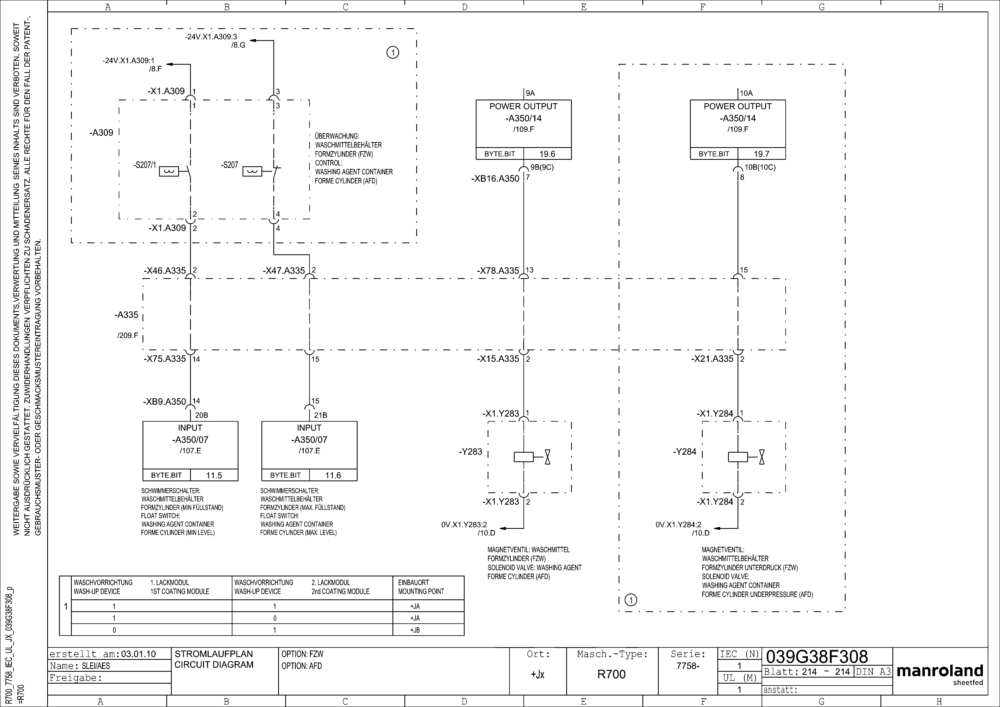

# +Jx — Sheet 214 of 214 — OPTION: FZW

**OPTION: AFD**

> Part of the manroland **R700** printing press IEC/UL circuit diagrams.
> Drawing class: **Stromlaufplan / Circuit diagram** (DIN A3).
> Document `+Jx` covers the **1st printing module + feed register** machine section.

## At a glance

| Field | Value |
|---|---|
| Document | `+Jx`  (039G38F308) |
| Sheet | **214** of 214 |
| Section (DE) | OPTION: FZW |
| Section (EN) | OPTION: AFD |
| Section type | CIRCUIT — Circuit diagram |
| Machine type | `R700` |
| Series | `7758` |
| Created | 03.01.10 |
| Replaces | — |
| Columns used | A, B, C, D, E, F |
| Path numbers | — |
| Labels on sheet | 129 |
| Cross-refs out | 9 |
| Cross-refs in | 29 |

**Previous:** [+Jx sheet 213](SHEET_0213.md) · **Document TOC:** [_TOC.md](_TOC.md)  (+Jx) · **Master TOC:** [all sheets](../_MASTER_TOC.md)

## Sheet image (300 DPI, exact vector render)



_Rendered directly from the PDF vector layer at 300 DPI (1-bit), no OCR and no resampling. Use it to confirm anything ambiguous in the text below._

## Cross-references on this sheet

Each entry is a wire leaving this sheet. The printed token is `/sheet.column`; the link resolves to that sheet inside the same document.

| Ref | Target sheet | Col | Path | Destination on target | Target section | From col |
|---|---|---|---|---|---|---|
| `/8.G` | [+Jx sheet 8](SHEET_0008.md) | G | — | 24V.X1.A309:3 | SPANNUNGSVERSORGUNG, SCHALTSCHRANKBELÜFTUNG | B |
| `/8.F` | [+Jx sheet 8](SHEET_0008.md) | F | — | 24V.X1.A309:1 | SPANNUNGSVERSORGUNG, SCHALTSCHRANKBELÜFTUNG | A |
| `/109.F` | [+Jx sheet 109](SHEET_0109.md) | F | — | — | REFERENZMODUL | E |
| `/109.F` | [+Jx sheet 109](SHEET_0109.md) | F | — | — | REFERENZMODUL | F |
| `/209.F` | [+Jx sheet 209](SHEET_0209.md) | F | — | — | OPTION: WASCHMITTELWECHSELBETRIEB | A |
| `/107.E` | [+Jx sheet 107](SHEET_0107.md) | E | — | — | REFERENZMODUL | B |
| `/107.E` | [+Jx sheet 107](SHEET_0107.md) | E | — | — | REFERENZMODUL | C |
| `/10.D` | [+Jx sheet 10](SHEET_0010.md) | D | — | 0V.X1.Y283:2 0V.X1.Y284:2 | SPANNUNGSVERSORGUNG, SCHALTSCHRANKBELÜFTUNG | E |
| `/10.D` | [+Jx sheet 10](SHEET_0010.md) | D | — | 0V.X1.Y283:2 0V.X1.Y284:2 | SPANNUNGSVERSORGUNG, SCHALTSCHRANKBELÜFTUNG | E |

### Incoming references (sheets that point here)

Every other sheet that sends a wire to this one. `Back-ref` is the token printed on *that* sheet; `Path` is its line number.

| From sheet | Cols | Back-ref | Path | Refs | What continues there |
|---|---|---|---|---|---|
| [+Jx#8](SHEET_0008.md) | F | `/8.F` | — | 2 | — |
| [+Jx#10](SHEET_0010.md) | D | `/10.D` | — | 2 | 0V.X1.Y283:2; 0V.X1.Y284:2 |
| [+Jx#107](SHEET_0107.md) | E | `/107.E` | — | 2 | — |
| [+Jx#109](SHEET_0109.md) | F | `/109.F` | — | 2 | — |
| [+Jx#113](SHEET_0113.md) | G | `/113.G` | — | 4 | — |
| [+Jx#120](SHEET_0120.md) | H | `/120.H` | — | 4 | — |
| [+Jx#134](SHEET_0134.md) | G | `/134.G` | — | 2 | — |
| [+Jx#138](SHEET_0138.md) | G | `/138.G` | — | 1 | — |
| [+Jx#139](SHEET_0139.md) | G | `/139.G` | — | 2 | — |
| [+Jx#141](SHEET_0141.md) | G | `/141.G` | — | 1 | — |
| [+Jx#150](SHEET_0150.md) | G | `/150.G` | — | 2 | — |
| [+Jx#155](SHEET_0155.md) | A | `/155.A` | — | 2 | — |
| [+Jx#156](SHEET_0156.md) | C | `/156.C` | — | 2 | — |
| [+Jx#209](SHEET_0209.md) | F | `/209.F` | — | 1 | — |


## Devices on this sheet

| Tag | Class | Class meaning (IEC) | Col | Sub | Terminal | Sign |
|---|---|---|---|---|---|---|
| `A350/07` | A | Baugruppe / assembly, module, PC board | B | 07 | — | — |
| `A350/07` | A | Baugruppe / assembly, module, PC board | C | 07 | — | — |
| `A335` | A | Baugruppe / assembly, module, PC board | A | — | — | — |
| `Y283` | Y | Magnetventil / solenoid valve, actuator | D | — | — | — |
| `S207/1` | S | Schalter / switch | A | 1 | — | — |
| `S207` | S | Schalter / switch | B | — | — | — |
| `A309` | A | Baugruppe / assembly, module, PC board | A | — | — | — |
| `A350/14` | A | Baugruppe / assembly, module, PC board | D | 14 | — | — |
| `A350/14` | A | Baugruppe / assembly, module, PC board | F | 14 | — | — |
| `Y284` | Y | Magnetventil / solenoid valve, actuator | F | — | — | — |
| `11.5` | — | cross-device reference | B | — | — | — |
| `XB9.A350` | — | cross-device reference | A | — | — | — |
| `11.6` | — | cross-device reference | C | — | — | — |
| `X46.A335` | — | cross-device reference | A | — | — | — |
| `X75.A335` | — | cross-device reference | A | — | — | — |
| `X47.A335` | — | cross-device reference | B | — | — | — |
| `X1.Y283` | — | cross-device reference | D | — | — | — |
| `X1.Y283` | — | cross-device reference | D | — | — | — |
| `X78.A335` | — | cross-device reference | D | — | — | — |
| `X15.A335` | — | cross-device reference | D | — | — | — |
| `X1.A309` | — | cross-device reference | A | — | — | — |
| `X1.A309` | — | cross-device reference | B | — | — | — |
| `19.6` | — | cross-device reference | E | — | — | — |
| `XB16.A350` | — | cross-device reference | D | — | — | — |
| `X1.Y284` | — | cross-device reference | F | — | — | — |
| `X1.Y284` | — | cross-device reference | F | — | — | — |
| `X21.A335` | — | cross-device reference | F | — | — | — |
| `19.7` | — | cross-device reference | F | — | — | — |

## Potentials / nets

| Potential | Count | Columns | Attached devices | Terminals |
|---|---|---|---|---|
| `0V` | 2 | D, F | `X1`, `Y283`, `Y284` | `2` |
| `24V` | 2 | A, B | `A309`, `X1` | `1`, `3` |


A potential such as `L24+/4` or `M24+` is a named supply/return rail; every place it appears on this sheet is electrically common.

## Wire-end annotations (grouped as printed)

A wire that continues elsewhere is annotated with a small cluster: the destination description, the path/line number `#NN`, and the `/sheet.column` cross reference. Each row below is one such cluster exactly as it is grouped on the drawing.

| Col | Y | Path | Cross-ref | Text on the wire |
|---|---|---|---|---|
| B | 39.9 | — | `/8.G` | `24V.X1.A309:3` |
| C | 59.3 | — | — | `1` |
| A | 68.2 | — | `/8.F` | `24V.X1.A309:1` |
| B | 103.7 | — | — | `X1.A309 1 3` |
| E | 107.2 | — | — | `9A` |
| F | 107.2 | — | — | `10A` |
| B | 122.2 | — | — | `1` |
| B | 122.2 | — | — | `3` |
| D | 122.4 | — | — | `POWER OUTPUT` |
| F | 122.4 | — | — | `POWER OUTPUT` |
| D | 136.3 | — | — | `A350/14` |
| F | 136.3 | — | — | `A350/14` |
| E | 150.1 | — | `/109.F` | — |
| F | 150.1 | — | `/109.F` | — |
| B | 153.3 | — | — | `A309 ÜBERWACHUNG:` |
| C | 169.9 | — | — | `FORMZYLINDER (FZW) FORME CYLINDER (AFD) CONTROL: WASCHMITTELBEHÄLTER WASHING AGENT CONTAINER` |
| D | 179.2 | — | — | `BYTE.BIT 19.6` |
| F | 179.2 | — | — | `BYTE.BIT 19.7` |
| B | 192.8 | — | — | `S207/1 S207` |
| E | 195.1 | — | — | `9B(9C)` |
| F | 195.2 | — | — | `10B(10C)` |
| D | 207.2 | — | — | `XB16.A350 7` |
| F | 207.2 | — | — | `8` |
| B | 251.1 | — | — | `2` |
| B | 251.1 | — | — | `4` |
| B | 266.7 | — | — | `X1.A309 2 4` |
| B | 317.7 | — | — | `X46.A335 2` |
| C | 317.7 | — | — | `X47.A335 2` |
| D | 317.7 | — | — | `X78.A335 13` |
| F | 317.8 | — | — | `15` |
| A | 370.1 | — | — | `A335` |
| A | 395.6 | — | `/209.F` | — |
| B | 422.6 | — | — | `X75.A335 14` |
| D | 422.6 | — | — | `X15.A335 2` |
| F | 422.6 | — | — | `X21.A335 2` |
| C | 424.1 | — | — | `15` |
| B | 473.6 | — | — | `XB9.A350 14` |
| C | 473.6 | — | — | `15` |
| D | 487.8 | — | — | `X1.Y283 1` |
| F | 487.8 | — | — | `X1.Y284 1` |
| B | 490.6 | — | — | `20B` |
| C | 490.6 | — | — | `21B` |
| B | 505.1 | — | — | `INPUT` |
| C | 505.1 | — | — | `INPUT` |
| B | 519.0 | — | — | `A350/07` |
| C | 519.0 | — | — | `A350/07` |
| B | 532.8 | — | `/107.E` | — |
| C | 532.8 | — | `/107.E` | — |
| D | 533.2 | — | — | `Y283` |
| F | 533.2 | — | — | `Y284` |
| B | 561.8 | — | — | `BYTE.BIT 11.5` |
| C | 561.8 | — | — | `BYTE.BIT 11.6` |
| B | 581.8 | — | — | `FORMZYLINDER (MIN FÜLLSTAND) FLOAT SWITCH: SCHWIMMERSCHALTER: WASCHMITTELBEHÄLTER` |
| C | 581.8 | — | — | `FORMZYLINDER (MAX. FÜLLSTAND) FLOAT SWITCH: SCHWIMMERSCHALTER: WASCHMITTELBEHÄLTER` |
| D | 592.7 | — | — | `X1.Y283 2` |
| F | 592.7 | — | — | `X1.Y284 2` |
| E | 621.0 | — | `/10.D`, `/10.D` | `0V.X1.Y283:2 0V.X1.Y284:2` |
| B | 621.6 | — | — | `FORME CYLINDER (MIN LEVEL) WASHING AGENT CONTAINER` |
| C | 621.6 | — | — | `FORME CYLINDER (MAX. LEVEL) WASHING AGENT CONTAINER` |
| E | 651.8 | — | — | `MAGNETVENTIL: WASCHMITTEL FORMZYLINDER (FZW) FORME CYLINDER (AFD) SOLENOID VALVE: WASHING AGENT` |
| F | 651.8 | — | — | `MAGNETVENTIL:` |
| F | 662.5 | — | — | `FORMZYLINDER UNTERDRUCK (FZW) FORME CYLINDER UNDERPRESSURE (AFD) SOLENOID VALVE: WASCHMITTELBEHÄLTER WASHING AGENT CONTAINER` |
| A | 690.8 | — | — | `WASCHVORRICHTUNG WASH UP DEVICE` |
| B | 690.8 | — | — | `1. LACKMODUL 1ST COATING MODULE WASCHVORRICHTUNG WASH UP DEVICE` |
| C | 690.8 | — | — | `2. LACKMODUL 2nd COATING MODULE` |
| D | 690.8 | — | — | `EINBAUORT MOUNTING POINT` |
| E | 711.3 | — | — | `1` |
| A | 717.4 | — | — | `1` |
| A | 718.7 | — | — | `1` |
| B | 718.7 | — | — | `1` |
| D | 719.1 | — | — | `+JA` |
| A | 732.9 | — | — | `1` |
| B | 733.2 | — | — | `0` |
| D | 733.3 | — | — | `+JA` |
| B | 747.0 | — | — | `0 1` |
| D | 747.4 | — | — | `+JB` |


## Reconstructed tables

This sheet carries tabular content (pin map / terminal assignment / index). The grid below was rebuilt from the drawing's own rule lines, so each row is exactly one physical row of the table.

### Table 1 — 10 data rows × 4 columns (at x=85.0, y=119.1)

| A309 |  |  | 1 |
|---|---|---|---|
|  |  | `S207/1` | `S207 2` |
|  |  | `X1.A309` | `2` |
|  | `A335 /209.F` | `X46.A335 X75.A335 XB9.A350` | `2 14 14 20B` |
|  |  | `INPUT A350/07` | `/107.E` |
|  |  | `BYTE.BIT` | `11.5` |
|  |  | `SCHWIMMERSCHALTER: WASCHMITTELBEHÄLTER FORMZYLINDER (MIN FLOAT SWITCH: WASHING AGENT FORME CYLINDER` | `FÜLLSTAND) CONTAINER (MIN LEVEL)` |
| `WASCHVORRICHTUNG WASH UP DEVICE` |  | `1. LACKMODUL 1ST COATING` | `MODULE` |
| `1` |  |  |  |
| `1` |  |  |  |
| `0` |  |  |  |


### Table 2 — 11 data rows × 9 columns (at x=283.5, y=119.1)

|  |  | 3 | ÜBERWACHUNG: WASCHMITTELBEHÄLTER |  |  |  | POWER | OUTPUT A350/14 /109.F |
|---|---|---|---|---|---|---|---|---|
|  |  |  | `FORMZYLINDER` | `(FZW)` |  |  | `BYTE.BIT` | `19.6` |
|  |  | `4` | `CONTROL: WASHING AGENT FORME CYLINDER` | `CONTAINER (AFD)` |  |  | `XB16.A350` | `9B(9C) 7` |
|  |  | `4` |  |  |  |  |  |  |
|  |  | `X47.A335` | `2 15 15 21B` |  |  |  | `X78.A335 X15.A335 X1.Y283` | `13 2 1` |
|  |  | `INPUT` | `A350/07 /107.E` |  |  | `Y283` |  |  |
|  |  | `BYTE.BIT` | `11.6` |  |  |  |  |  |
|  | `FLOAT WASHING FORME` | `SCHWIMMERSCHALTER: WASCHMITTELBEHÄLTER FORMZYLINDER (MAX. SWITCH: AGENT CYLINDER` | `FÜLLSTAND) CONTAINER (MAX. LEVEL)` |  | `0V.X1.Y283:2` |  | `X1.Y283 /10.D MAGNETVENTIL: FORMZYLINDER SOLENOID` | `2 WASCHMITTEL (FZW) VALVE: WASHING` |
| `WASH UP` | `WASCHVORRICHTUNG DEVICE` |  | `2. LACKMODUL 2nd COATING` | `MODULE` | `EINBAUORT MOUNTING POINT` |  | `FORME CYLINDER` | `(AFD)` |
|  |  | `1` |  |  | `+JA` |  |  |  |
|  |  | `0` |  |  | `+JA` |  |  |  |
|  |  | `1` |  |  | `+JB` |  |  |  |


### Table 3 — 1 data rows × 2 columns (at x=822.0, y=119.1)

| POWER | OUTPUT A350/14 /109.F |
|---|---|
| `BYTE.BIT` | `19.7` |


## Notes and free text on this sheet

| Text | Col | Y (pt) |
|---|---|---|
| `20B` | B | 490.62 |
| `INPUT` | B | 505.14 |
| `BYTE.BIT` | A | 562.4 |
| `SCHWIMMERSCHALTER:` | B | 581.84 |
| `WASCHMITTELBEHÄLTER` | B | 591.77 |
| `FORMZYLINDER (MIN FÜLLSTAND)` | B | 601.74 |
| `FLOAT SWITCH:` | A | 611.61 |
| `WASHING AGENT CONTAINER` | B | 621.61 |
| `FORME CYLINDER (MIN LEVEL)` | B | 631.6 |
| `21B` | C | 490.62 |
| `INPUT` | C | 505.14 |
| `BYTE.BIT` | B | 562.4 |
| `SCHWIMMERSCHALTER:` | C | 581.84 |
| `WASCHMITTELBEHÄLTER` | C | 591.77 |
| `FORMZYLINDER (MAX. FÜLLSTAND)` | C | 601.74 |
| `FLOAT SWITCH:` | B | 611.61 |
| `WASHING AGENT CONTAINER` | C | 621.61 |
| `FORME CYLINDER (MAX. LEVEL)` | C | 631.59 |
| `MAGNETVENTIL: WASCHMITTEL` | E | 651.83 |
| `FORMZYLINDER (FZW)` | D | 662.47 |
| `SOLENOID VALVE: WASHING AGENT` | E | 673.09 |
| `FORME CYLINDER (AFD)` | D | 683.75 |
| `ÜBERWACHUNG:` | C | 159.29 |
| `FORMZYLINDER (FZW)` | C | 180.58 |
| `CONTROL:` | C | 191.22 |
| `FORME CYLINDER (AFD)` | C | 212.5 |
| `9A` | E | 107.22 |
| `9B(9C)` | E | 195.14 |
| `POWER OUTPUT` | D | 122.39 |
| `BYTE.BIT` | D | 179.72 |
| `10A` | F | 107.24 |
| `10B(10C)` | F | 195.15 |
| `POWER OUTPUT` | F | 122.39 |
| `BYTE.BIT` | F | 179.72 |
| `MAGNETVENTIL:` | F | 651.83 |
| `WASCHMITTELBEHÄLTER` | F | 662.46 |
| `FORMZYLINDER UNTERDRUCK (FZW)` | F | 673.11 |
| `SOLENOID VALVE:` | F | 683.72 |
| `WASHING AGENT CONTAINER` | F | 694.36 |
| `FORME CYLINDER UNDERPRESSURE (AFD)` | F | 705.02 |
| `WASCHVORRICHTUNG` | A | 690.82 |
| `WASH UP DEVICE` | A | 701.42 |
| `1. LACKMODUL` | B | 690.83 |
| `1ST COATING MODULE` | B | 701.46 |
| `WASCHVORRICHTUNG` | B | 690.82 |
| `WASH UP DEVICE` | B | 701.42 |
| `2. LACKMODUL` | C | 690.84 |
| `2nd COATING MODULE` | C | 701.47 |
| `+JA` | D | 719.12 |
| `EINBAUORT` | D | 690.81 |
| `MOUNTING POINT` | D | 701.46 |
| `+JB` | D | 747.44 |

## Complete label inventory (exact text from the drawing)

Every text object inside the drawing area of this sheet, in DIN reading order (column A→H, then top→bottom). This is the authoritative list: if a string is not here it is not printed on this sheet.

| Col | Y | X | Dir | Type | Text |
|---|---|---|---|---|---|
| A | 68.3 | 122.2 | → | potential | `24V.X1.A309:1` |
| A | 78.1 | 177.7 | → | cross-reference | `/8.F` |
| A | 103.7 | 175.7 | → | device ref | `X1.A309` |
| A | 153.3 | 106.6 | → | device tag | `A309` |
| A | 192.8 | 159.2 | → | device tag | `S207/1` |
| A | 317.7 | 171.2 | → | device ref | `X46.A335` |
| A | 370.2 | 136.3 | → | device tag | `A335` |
| A | 395.6 | 139.7 | → | cross-reference | `/209.F` |
| A | 422.6 | 171.2 | → | device ref | `X75.A335` |
| A | 473.6 | 170.4 | → | device ref | `XB9.A350` |
| A | 562.4 | 180.0 | → | text | `BYTE.BIT` |
| A | 611.6 | 168.1 | → | text | `FLOAT SWITCH:` |
| A | 690.8 | 87.9 | → | text | `WASCHVORRICHTUNG` |
| A | 701.4 | 87.9 | → | text | `WASH UP DEVICE` |
| A | 717.4 | 75.4 | → | number | `1` |
| A | 718.7 | 133.8 | → | number | `1` |
| A | 732.9 | 133.8 | → | number | `1` |
| A | 747.4 | 134.4 | → | number | `0` |
| B | 39.9 | 220.3 | → | potential | `24V.X1.A309:3` |
| B | 49.8 | 275.5 | → | cross-reference | `/8.G` |
| B | 105.1 | 228.8 | → | number | `1` |
| B | 105.1 | 328.5 | → | number | `3` |
| B | 122.2 | 228.8 | → | number | `1` |
| B | 122.2 | 328.5 | → | number | `3` |
| B | 192.8 | 263.5 | → | device tag | `S207` |
| B | 251.1 | 229.6 | → | number | `2` |
| B | 251.1 | 328.8 | → | number | `4` |
| B | 266.7 | 177.2 | → | device ref | `X1.A309` |
| B | 268.1 | 229.6 | → | number | `2` |
| B | 268.1 | 328.8 | → | number | `4` |
| B | 317.7 | 229.6 | → | number | `2` |
| B | 317.7 | 312.9 | → | device ref | `X47.A335` |
| B | 424.0 | 228.8 | → | number | `14` |
| B | 473.7 | 228.8 | → | number | `14` |
| B | 490.6 | 232.4 | → | text | `20B` |
| B | 505.1 | 211.9 | → | text | `INPUT` |
| B | 519.0 | 205.2 | → | device tag | `A350/07` |
| B | 532.8 | 214.2 | → | cross-reference | `/107.E` |
| B | 561.8 | 245.3 | → | device ref | `11.5` |
| B | 562.4 | 321.7 | → | text | `BYTE.BIT` |
| B | 581.8 | 168.4 | → | text | `SCHWIMMERSCHALTER:` |
| B | 591.8 | 168.7 | → | text | `WASCHMITTELBEHÄLTER` |
| B | 601.7 | 168.1 | → | text | `FORMZYLINDER (MIN FÜLLSTAND)` |
| B | 611.6 | 309.8 | → | text | `FLOAT SWITCH:` |
| B | 621.6 | 168.7 | → | text | `WASHING AGENT CONTAINER` |
| B | 631.6 | 168.1 | → | text | `FORME CYLINDER (MIN LEVEL)` |
| B | 690.8 | 179.1 | → | text | `1. LACKMODUL` |
| B | 690.8 | 279.2 | → | text | `WASCHVORRICHTUNG` |
| B | 701.4 | 279.2 | → | text | `WASH UP DEVICE` |
| B | 701.5 | 179.1 | → | text | `1ST COATING MODULE` |
| B | 718.7 | 325.1 | → | number | `1` |
| B | 733.3 | 325.7 | → | number | `0` |
| B | 747.0 | 325.1 | → | number | `1` |
| C | 59.3 | 465.9 | → | number | `1` |
| C | 159.3 | 375.0 | → | text | `ÜBERWACHUNG:` |
| C | 169.9 | 375.6 | → | text | `WASCHMITTELBEHÄLTER` |
| C | 180.6 | 375.0 | → | text | `FORMZYLINDER (FZW)` |
| C | 191.2 | 375.3 | → | text | `CONTROL:` |
| C | 201.8 | 375.6 | → | text | `WASHING AGENT CONTAINER` |
| C | 212.5 | 375.0 | → | text | `FORME CYLINDER (AFD)` |
| C | 317.7 | 371.3 | → | number | `2` |
| C | 424.0 | 370.5 | → | number | `15` |
| C | 473.7 | 370.5 | → | number | `15` |
| C | 490.6 | 374.2 | → | text | `21B` |
| C | 505.1 | 353.6 | → | text | `INPUT` |
| C | 519.0 | 347.0 | → | device tag | `A350/07` |
| C | 532.8 | 355.9 | → | cross-reference | `/107.E` |
| C | 561.8 | 387.1 | → | device ref | `11.6` |
| C | 581.8 | 310.1 | → | text | `SCHWIMMERSCHALTER:` |
| C | 591.8 | 310.4 | → | text | `WASCHMITTELBEHÄLTER` |
| C | 601.7 | 309.8 | → | text | `FORMZYLINDER (MAX. FÜLLSTAND)` |
| C | 621.6 | 310.4 | → | text | `WASHING AGENT CONTAINER` |
| C | 631.6 | 309.8 | → | text | `FORME CYLINDER (MAX. LEVEL)` |
| C | 690.8 | 371.3 | → | text | `2. LACKMODUL` |
| C | 701.5 | 371.3 | → | text | `2nd COATING MODULE` |
| D | 122.4 | 582.8 | → | text | `POWER OUTPUT` |
| D | 136.3 | 602.1 | → | device tag | `A350/14` |
| D | 179.7 | 576.9 | → | text | `BYTE.BIT` |
| D | 207.9 | 561.3 | → | device ref | `XB16.A350` |
| D | 317.7 | 568.1 | → | device ref | `X78.A335` |
| D | 422.6 | 568.1 | → | device ref | `X15.A335` |
| D | 487.9 | 574.6 | → | device ref | `X1.Y283` |
| D | 533.2 | 546.5 | → | device tag | `Y283` |
| D | 592.7 | 574.6 | → | device ref | `X1.Y283` |
| D | 621.0 | 525.5 | → | potential | `0V.X1.Y283:2` |
| D | 630.9 | 568.9 | → | cross-reference | `/10.D` |
| D | 662.5 | 580.5 | → | text | `FORMZYLINDER (FZW)` |
| D | 683.8 | 580.5 | → | text | `FORME CYLINDER (AFD)` |
| D | 690.8 | 474.2 | → | text | `EINBAUORT` |
| D | 701.5 | 474.2 | → | text | `MOUNTING POINT` |
| D | 719.1 | 488.7 | → | text | `+JA` |
| D | 733.3 | 488.7 | → | text | `+JA` |
| D | 747.4 | 488.7 | → | text | `+JB` |
| E | 107.2 | 626.2 | → | text | `9A` |
| E | 150.1 | 611.3 | → | cross-reference | `/109.F` |
| E | 179.1 | 642.2 | → | device ref | `19.6` |
| E | 195.1 | 631.8 | → | text | `9B(9C)` |
| E | 207.2 | 626.2 | → | number | `7` |
| E | 317.7 | 625.6 | → | number | `13` |
| E | 424.0 | 626.5 | → | number | `2` |
| E | 487.8 | 625.6 | → | number | `1` |
| E | 594.1 | 626.5 | → | number | `2` |
| E | 651.8 | 580.5 | → | text | `MAGNETVENTIL: WASCHMITTEL` |
| E | 673.1 | 580.8 | → | text | `SOLENOID VALVE: WASHING AGENT` |
| E | 711.3 | 749.3 | → | number | `1` |
| F | 107.2 | 880.7 | → | text | `10A` |
| F | 122.4 | 837.9 | → | text | `POWER OUTPUT` |
| F | 136.3 | 857.2 | → | device tag | `A350/14` |
| F | 150.1 | 866.4 | → | cross-reference | `/109.F` |
| F | 179.1 | 897.3 | → | device ref | `19.7` |
| F | 179.7 | 832.0 | → | text | `BYTE.BIT` |
| F | 195.1 | 886.4 | → | text | `10B(10C)` |
| F | 207.2 | 881.3 | → | number | `8` |
| F | 317.7 | 880.7 | → | number | `15` |
| F | 422.6 | 823.2 | → | device ref | `X21.A335` |
| F | 424.0 | 881.6 | → | number | `2` |
| F | 487.8 | 880.7 | → | number | `1` |
| F | 487.9 | 829.7 | → | device ref | `X1.Y284` |
| F | 533.2 | 801.6 | → | device tag | `Y284` |
| F | 592.7 | 829.7 | → | device ref | `X1.Y284` |
| F | 594.1 | 881.6 | → | number | `2` |
| F | 621.0 | 780.7 | → | potential | `0V.X1.Y284:2` |
| F | 630.9 | 824.0 | → | cross-reference | `/10.D` |
| F | 651.8 | 835.7 | → | text | `MAGNETVENTIL:` |
| F | 662.5 | 836.2 | → | text | `WASCHMITTELBEHÄLTER` |
| F | 673.1 | 835.7 | → | text | `FORMZYLINDER UNTERDRUCK (FZW)` |
| F | 683.7 | 835.9 | → | text | `SOLENOID VALVE:` |
| F | 694.4 | 836.2 | → | text | `WASHING AGENT CONTAINER` |
| F | 705.0 | 835.7 | → | text | `FORME CYLINDER UNDERPRESSURE (AFD)` |

## Reading-order text block

The same content as a plain block, grouped by DIN column — convenient to paste or to match against a visual description.

```text
=== Column A ===
  68.3  122.2  net          24V.X1.A309:1
  78.1  177.7  xref         /8.F
 103.7  175.7  devref       X1.A309
 153.3  106.6  devtag       A309
 192.8  159.2  devtag       S207/1
 317.7  171.2  devref       X46.A335
 370.2  136.3  devtag       A335
 395.6  139.7  xref         /209.F
 422.6  171.2  devref       X75.A335
 473.6  170.4  devref       XB9.A350
 562.4  180.0  text         BYTE.BIT
 611.6  168.1  text         FLOAT SWITCH:
 690.8   87.9  text         WASCHVORRICHTUNG
 701.4   87.9  text         WASH UP DEVICE
 717.4   75.4  numeric      1
 718.7  133.8  numeric      1
 732.9  133.8  numeric      1
 747.4  134.4  numeric      0
=== Column B ===
  39.9  220.3  net          24V.X1.A309:3
  49.8  275.5  xref         /8.G
 105.1  228.8  numeric      1
 105.1  328.5  numeric      3
 122.2  228.8  numeric      1
 122.2  328.5  numeric      3
 192.8  263.5  devtag       S207
 251.1  229.6  numeric      2
 251.1  328.8  numeric      4
 266.7  177.2  devref       X1.A309
 268.1  229.6  numeric      2
 268.1  328.8  numeric      4
 317.7  229.6  numeric      2
 317.7  312.9  devref       X47.A335
 424.0  228.8  numeric      14
 473.7  228.8  numeric      14
 490.6  232.4  text         20B
 505.1  211.9  text         INPUT
 519.0  205.2  devtag       A350/07
 532.8  214.2  xref         /107.E
 561.8  245.3  devref       11.5
 562.4  321.7  text         BYTE.BIT
 581.8  168.4  text         SCHWIMMERSCHALTER:
 591.8  168.7  text         WASCHMITTELBEHÄLTER
 601.7  168.1  text         FORMZYLINDER (MIN FÜLLSTAND)
 611.6  309.8  text         FLOAT SWITCH:
 621.6  168.7  text         WASHING AGENT CONTAINER
 631.6  168.1  text         FORME CYLINDER (MIN LEVEL)
 690.8  179.1  text         1. LACKMODUL
 690.8  279.2  text         WASCHVORRICHTUNG
 701.4  279.2  text         WASH UP DEVICE
 701.5  179.1  text         1ST COATING MODULE
 718.7  325.1  numeric      1
 733.3  325.7  numeric      0
 747.0  325.1  numeric      1
=== Column C ===
  59.3  465.9  numeric      1
 159.3  375.0  text         ÜBERWACHUNG:
 169.9  375.6  text         WASCHMITTELBEHÄLTER
 180.6  375.0  text         FORMZYLINDER (FZW)
 191.2  375.3  text         CONTROL:
 201.8  375.6  text         WASHING AGENT CONTAINER
 212.5  375.0  text         FORME CYLINDER (AFD)
 317.7  371.3  numeric      2
 424.0  370.5  numeric      15
 473.7  370.5  numeric      15
 490.6  374.2  text         21B
 505.1  353.6  text         INPUT
 519.0  347.0  devtag       A350/07
 532.8  355.9  xref         /107.E
 561.8  387.1  devref       11.6
 581.8  310.1  text         SCHWIMMERSCHALTER:
 591.8  310.4  text         WASCHMITTELBEHÄLTER
 601.7  309.8  text         FORMZYLINDER (MAX. FÜLLSTAND)
 621.6  310.4  text         WASHING AGENT CONTAINER
 631.6  309.8  text         FORME CYLINDER (MAX. LEVEL)
 690.8  371.3  text         2. LACKMODUL
 701.5  371.3  text         2nd COATING MODULE
=== Column D ===
 122.4  582.8  text         POWER OUTPUT
 136.3  602.1  devtag       A350/14
 179.7  576.9  text         BYTE.BIT
 207.9  561.3  devref       XB16.A350
 317.7  568.1  devref       X78.A335
 422.6  568.1  devref       X15.A335
 487.9  574.6  devref       X1.Y283
 533.2  546.5  devtag       Y283
 592.7  574.6  devref       X1.Y283
 621.0  525.5  net          0V.X1.Y283:2
 630.9  568.9  xref         /10.D
 662.5  580.5  text         FORMZYLINDER (FZW)
 683.8  580.5  text         FORME CYLINDER (AFD)
 690.8  474.2  text         EINBAUORT
 701.5  474.2  text         MOUNTING POINT
 719.1  488.7  text         +JA
 733.3  488.7  text         +JA
 747.4  488.7  text         +JB
=== Column E ===
 107.2  626.2  text         9A
 150.1  611.3  xref         /109.F
 179.1  642.2  devref       19.6
 195.1  631.8  text         9B(9C)
 207.2  626.2  numeric      7
 317.7  625.6  numeric      13
 424.0  626.5  numeric      2
 487.8  625.6  numeric      1
 594.1  626.5  numeric      2
 651.8  580.5  text         MAGNETVENTIL: WASCHMITTEL
 673.1  580.8  text         SOLENOID VALVE: WASHING AGENT
 711.3  749.3  numeric      1
=== Column F ===
 107.2  880.7  text         10A
 122.4  837.9  text         POWER OUTPUT
 136.3  857.2  devtag       A350/14
 150.1  866.4  xref         /109.F
 179.1  897.3  devref       19.7
 179.7  832.0  text         BYTE.BIT
 195.1  886.4  text         10B(10C)
 207.2  881.3  numeric      8
 317.7  880.7  numeric      15
 422.6  823.2  devref       X21.A335
 424.0  881.6  numeric      2
 487.8  880.7  numeric      1
 487.9  829.7  devref       X1.Y284
 533.2  801.6  devtag       Y284
 592.7  829.7  devref       X1.Y284
 594.1  881.6  numeric      2
 621.0  780.7  net          0V.X1.Y284:2
 630.9  824.0  xref         /10.D
 651.8  835.7  text         MAGNETVENTIL:
 662.5  836.2  text         WASCHMITTELBEHÄLTER
 673.1  835.7  text         FORMZYLINDER UNTERDRUCK (FZW)
 683.7  835.9  text         SOLENOID VALVE:
 694.4  836.2  text         WASHING AGENT CONTAINER
 705.0  835.7  text         FORME CYLINDER UNDERPRESSURE (AFD)
```

---
_Generated from the PDF vector text layer; no OCR. Source: `R700_7758_IEC_UL_JX_039G38F308_p`, sheet 214._
